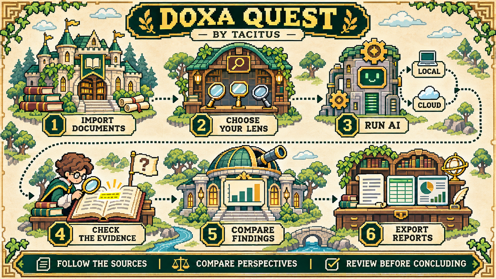

# DOXA by TACITUS

**A browser workbench for examining what documents assert, assume, normalize, and contest.**

Import a corpus, choose an analytical lens, follow every finding back to its source, compare interpretations, and produce a report you can inspect and share. Run the application on your computer or deploy the same analysis engine to Cloudflare.

DOXA is a **research preview**. Exact citations, processing coverage, and model provenance are checked by software. Interpretation accuracy has not been established through independent human annotation. A lexical baseline is available without a model and is always identified as word matching.



Follow the [DOXA Quest walkthrough](docs/guide.md): import documents → choose a lens → run local or cloud AI → inspect evidence → compare findings → export reports. The running app includes the same guide through **How DOXA works**.

## Start locally

### Docker: no model needed to explore

```bash
git clone https://github.com/sargonxg/DOXA-by-TACITUS.git
cd DOXA-by-TACITUS
docker compose up --build
```

Open **http://localhost:8000** and load the real-document collection. It includes previously computed Gemma observations, with source references, historical usage, and incomplete coverage clearly labeled. No inference key is required to inspect these saved results. A lexical baseline is also available without a model. Documents, results, and reports persist in the `doxa-data` volume.

### Add private local inference

Install [Ollama](https://ollama.com/), then:

```bash
ollama pull qwen3.5:4b
```

Choose **Ollama** and `qwen3.5:4b` in the Run monitor. The conservative laptop profile uses Q4 quantization, an 8K context, and one request at a time. CPU inference works but can take substantial time on a large corpus. On Apple Silicon, native Ollama provides Metal acceleration.

For Linux using the optional CPU Ollama container:

```bash
DOXA_OLLAMA_BASE_URL=http://ollama:11434 docker compose --profile ollama up --build
# In another terminal:
docker compose exec ollama ollama pull qwen3.5:4b
```

Native Ollama on Linux must be reachable from the application container; the optional Compose profile avoids exposing the host service. See [deployment instructions](docs/deployment.md) for host networking and macOS details.

### Native Python / development

Requires Python 3.11+ and Node 22+.

```bash
python -m venv .venv
source .venv/bin/activate
python -m pip install --upgrade 'pip>=26.2,<27'
pip install -e '.[dev]'
cd frontend
npm ci
npm run build
cd ..
doxa
```

Windows: activate `.venv\Scripts\activate` instead. For frontend development, `npm run dev` proxies `/api` to port 8000. `doxa --data-dir /your/path` selects a different private workspace.

## What you can study

- Claims, target-specific stance, frames, values, rhetorical devices, and possible implicit assumptions.
- Author and institutional discourse, document types, dates, and differences across imported batches.
- Antisemitism through **IHRA, Jerusalem Declaration, and Nexus**, shown as separate analytical frameworks.
- Anti-Muslim prejudice through contextual-hostility and structural-racism lenses.
- Language norms and political correctness through an explicit inquiry and editable custom rubric.

Every finding includes the exact passage, page/paragraph locator, speaker attribution, criterion, explanation, alternative interpretation, and review state. Confirm, reject, or revise observations while retaining an audit trail.

Framework disagreements are part of the research. DOXA does not vote across definitions, produce a universal prejudice score, or infer an author's private identity or beliefs. Counts describe the selected corpus, rather than public opinion.

## Documents and reports

Supported inputs: PDF, scanned PDF with optional local OCR, DOCX, TXT, Markdown, and saved HTML. Uploads support bounded, resumable parts up to 500 MiB per file. Source metadata is editable, exact duplicates are detected, and failures remain visible.

Export **PDF, standalone HTML, XLSX, CSV, and JSONL**. Report profiles serve researchers/civil society, newsrooms/policy, and teaching. They share the same source evidence and calculations. XLSX includes charts, filterable evidence, authors, lenses, run provenance, and methodology. Report snapshots preserve the selected filters and source context.

OCR is optional because its models and dependencies are substantial. Install `pip install -e '.[ocr]'`, prefetch Docling artifacts, and configure the local artifacts directory before enabling it. Unreadable pages are recorded; DOXA never silently presents them as analyzed. See [deployment instructions](docs/deployment.md).

## Twenty real documents

The bundled collection, **Public institutions: prejudice, protection and freedom of expression**, contains **20 real UK and US publications**, approximately **357,000 words**, including substantial government strategies, executive orders, reviews, statistical reports, and discrimination guidance.

Snapshots preserve source URLs, authors, dates, rights notices, supersession warnings, page/paragraph locators, and SHA256 checksums. Quoted and hypothetical discriminatory examples remain distinguishable from the institution's own position. This is a purposive institutional collection, not a representative media sample.

```bash
python scripts/fetch_corpus.py --audit  # Offline integrity audit
```

See the [complete corpus and rights manifest](docs/corpus.md), [research dossier](docs/research.md), and [methodology](docs/methodology.md).

The actual cloud run retained **1,071 source-linked observations**. Strict evidence checks left the run partial: 5,788 of 8,999 source blocks passed all checks. The dashboard and reports preserve these gaps. The actual CPU-only Qwen 4B benchmark sampled one passage from each of the 20 documents, retaining 32 observations with one rejected source range. It does not establish full-corpus local performance or interpretation accuracy. Inspect [complete benchmark artifacts and summaries](benchmarks/README.md).

## Cloud and larger models

The Cloudflare profile uses Workers for authenticated routing, D1 for durable metadata/jobs, R2 for documents and reports, Queues for resumable work, and a Python Container running the shared engine. Managed inference uses an AI binding, with credentials kept on the server. No Python OCR or model loading runs inside a Worker isolate.

The budget cloud candidate is **Gemma 4 26B A4B**. Prices checked November 16, 2026 were $0.10/M input and $0.30/M output tokens. Workers Paid starts at $5/month; parsing, storage, and other usage add costs. The default application variable-spend budget is $20/month. This is a control on recorded application usage, not a guarantee about your entire vendor bill.

Ollama, Cloudflare, OpenAI-compatible/vLLM, and RunPod adapters are replaceable. Models never change silently within a run. Larger Qwen and GPT-OSS profiles are comparison candidates, not presumed improvements. [Deployment documentation](docs/deployment.md) includes explicit provisioning, cleanup, and GPU alternatives; nothing deploys simply by running tests.

## Benchmarks and checks

```bash
pytest -q
cd frontend && npm ci && npm run build
cd ../infra/cloudflare && npm ci && npm test && npm run typecheck
```

Run actual providers using the shared application scheduler:

```bash
python scripts/benchmark.py --provider lexical --output benchmarks/lexical-full.json
python scripts/benchmark.py --provider ollama --model qwen3.5:4b --output benchmarks/local.json
python scripts/benchmark.py --provider cloudflare --output benchmarks/cloud.json
```

Resume an interrupted benchmark with the same arguments plus `--resume`. Sample flags explicitly label an incomplete benchmark. Results record source coverage, exact citation validity, hardware, model identity, tokens, cost, timing, and errors. See [benchmarking](docs/benchmarking.md) for result interpretation and the separate 1,000-document load test.

## Architecture and growth

The Python package owns extraction, chunking, prompts, rubric application, citation validation, and reports. The browser and cloud router consume versioned contracts. SQLite/filesystem and D1/R2 adapters preserve the same analysis semantics. Artifacts and report snapshots provide a portable record of the research.

See the [architecture](docs/architecture.md), [dependency and source licenses](docs/licenses.md), and actual example [PDF](examples/doxa-public-institutions.pdf), [HTML](examples/doxa-public-institutions.html), and [XLSX](examples/doxa-public-institutions.xlsx) reports. The original application code is Apache 2.0; dependencies, including PyMuPDF, retain their own licensing terms.

The [verification record](docs/verification.md) explains exactly which checks ran, what they establish, and which deployment and interpretation limits remain.

Future modules can add authenticated connectors, scheduled collection, multilingual validation, semantic search, and larger GPU profiles. Fine-tuning follows reviewed annotations and held-out comparisons; the showcase must never serve as both training data and claimed validation.

Source content is treated as data and cannot invoke tools. Local operation binds to loopback; cloud deployments require authentication. No provider keys belong in browser configuration, source control, or exported reports.
