# DOXA by TACITUS

**Read what a corpus says, who says it, and how the interpretation was reached.**

DOXA is a browser research workspace for discourse, political framing and contextual prejudice analysis. Import sources, declare an analytical framework, inspect exact passages, compare patterns and download a reproducible research record.

**Bias Detection as a Service** means an open-source toolkit you run on your computer or in your own cloud, with optional [TACITUS methodology and deployment support](https://tacitus.me/doxa/). This repository does not provision a hosted SaaS account. The software is a **research preview**: source anchoring and processing coverage are checked; interpretation accuracy requires independent human reference labels.


*Actual interface with 5,000 real news articles and the settled partial run: 4,927 complete source checks and 10,686 of 10,759 fully assessed units. Processing coverage and correct interpretations are different quantities.*

The highlighted source is [Dahlia Kholaif's Global Voices report](https://globalvoices.org/2020/12/29/saudi-court-slams-jail-term-to-iconic-female-activist-despite-global-criticism/), December 29, 2020, CC BY 3.0. Its displayed model reading remains a proposal for review.

## v0.4 · the evidence workbench

**Compose a casebook in the browser, freeze its evidence, and generate a downloadable report in a persistent background job.** Choose a briefing, teaching packet, casebook or complete archive; retain exact source passages, original model readings, framework conditions, review state and your separately attributed editorial notes. Jobs expose progress, cancellation, restart and resumable artifact downloads.

<a href="examples/v04-reader-explainer.pdf">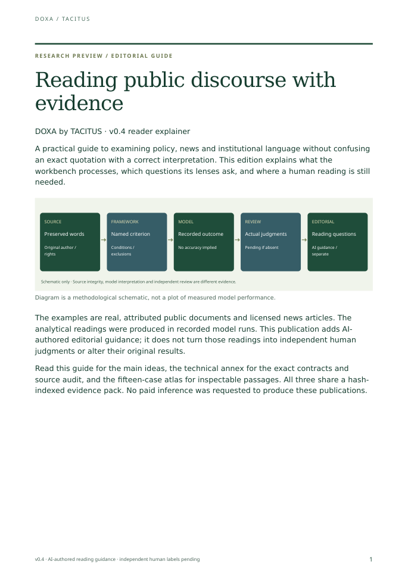</a> <a href="examples/v04-technical-annex.pdf">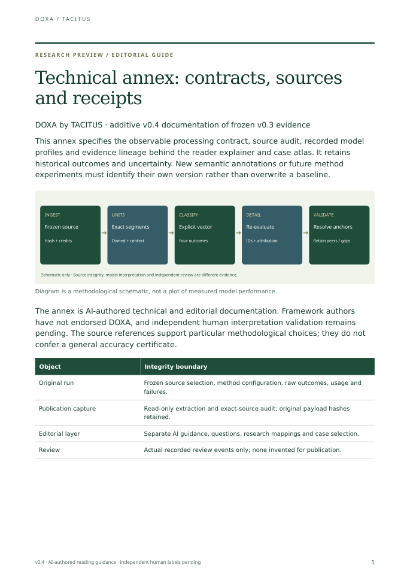</a> <a href="examples/v04-case-atlas.pdf">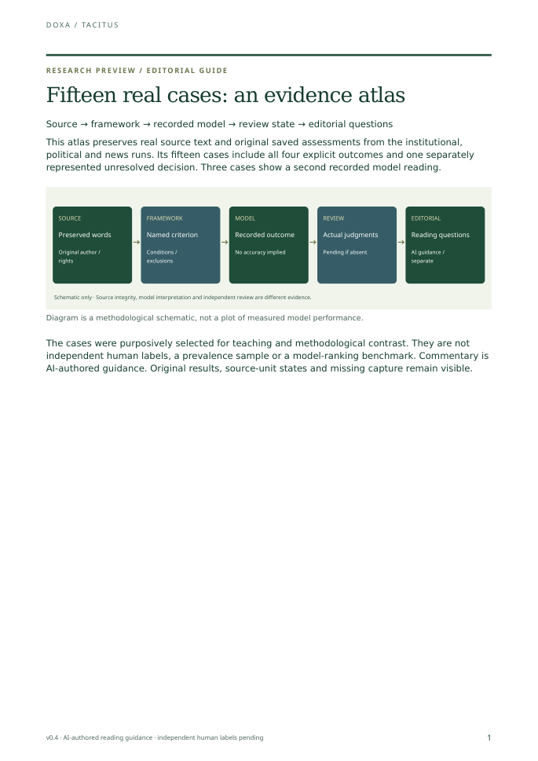</a>

| Start here | What you will find |
| --- | --- |
| **[Reader explainer · PDF](examples/v04-reader-explainer.pdf)** | A layered introduction to the biases and descriptive frames examined, attribution, context, trajectories and the review process. [HTML](examples/v04-reader-explainer.html) · [Markdown](docs/v04-reader-explainer.md). |
| **[Technical annex · PDF](examples/v04-technical-annex.pdf)** | Extraction, frozen methods, decision coverage, exact evidence, candidate overlays, evaluation design and academic sources. [HTML](examples/v04-technical-annex.html) · [Bibliography](docs/v04-bibliography.bib). |
| **[Real-source case atlas · PDF](examples/v04-case-atlas.pdf)** | Fifteen illustrative cases spanning all four recorded outcomes, missing decisions, reported speech, boundaries and independent-model differences. Commentary is AI-authored; it is not human adjudication. [HTML](examples/v04-case-atlas.html) · [Frozen cases](examples/v04-case-atlas.snapshot.json.gz). |
| **[Evidence-pack manifest](examples/v04-evidence-pack.manifest.json)** | Checksums, provenance and links to processed flows, source archives and publication inputs. [Download the evidence ZIP](examples/v04-evidence-pack.zip) · [Lineage index](examples/v04-lineage-index.json) · [Source-reference audit](examples/v04-corpus-verification.json). |

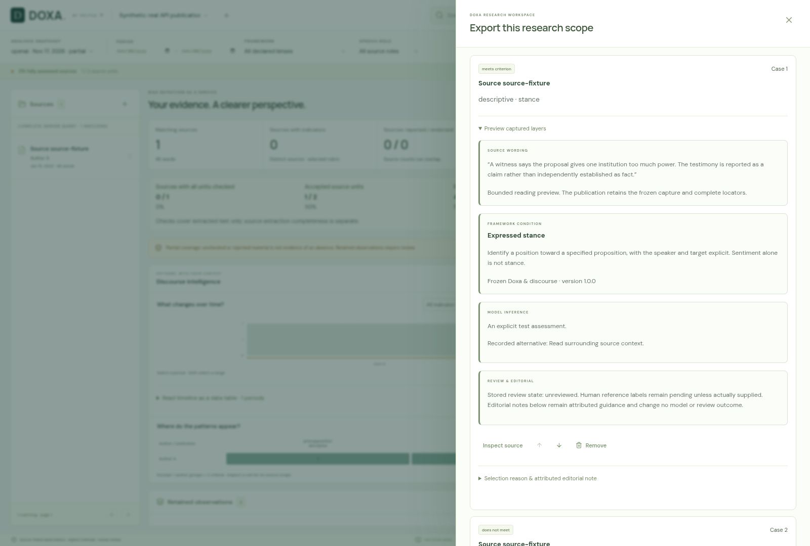

*Actual browser/API workflow with explicitly synthetic source and model fixtures: mixed outcomes, frozen framework conditions and separate editorial notes. This screenshot demonstrates application behavior, not model quality. [Report-job view](docs/images/workspace-v04-report-jobs.png) · [Mobile layout](docs/images/workspace-v04-mobile.png).*

Ten implemented improvements make the research workflow easier to inspect:

1. **Curated browser casebooks:** pin positive, negative, not-applicable, uncertain and genuinely unfinished cases; reorder and annotate without changing original model output.
2. **Persistent report jobs:** bounded source capture, immutable report inputs, progress, cancellation, recovery and checksummed downloads.
3. **Three coverage denominators:** sources, source units and criterion decisions remain separate, including unresolved work.
4. **Review queues:** uncertainty, literal model disagreement and unfinished work have distinct queues and inspectable source context.
5. **Evidence layers:** original source, framework, model reading, human review and editorial commentary keep their own authorship.
6. **Extraction provenance:** shared TXT behavior, page/block manifests, exclusions and explicit re-extraction create new versions while preserving earlier evidence.
7. **Reliable state:** atomic imports, coherent snapshots, revision guards, migration backups and retry-safe multipart completion.
8. **Frozen analytical methods:** distinguish a method's identity from execution settings; retain source metadata and opt-in candidate annotations explicitly.
9. **Independent-evaluation scaffold:** 200 model-blind review cases and 120 authored functional fixtures. Human labels and functional model runs are still pending; no accuracy score is fabricated.
10. **Portable distribution:** a wheel containing the compiled browser application, Docker, isolated install checks, browser workflows and an opt-in complete 5,000-source evidence-replay gate.

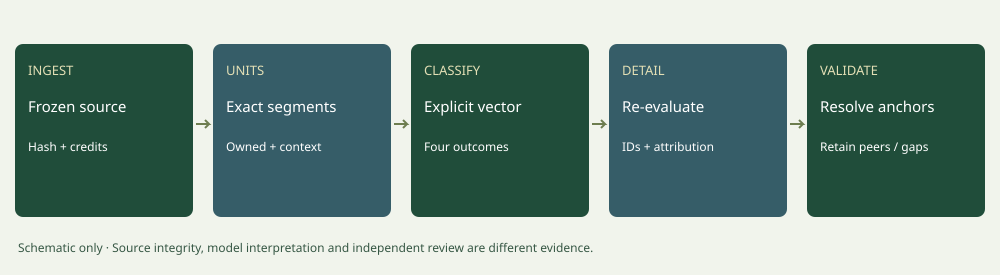

The existing v0.3 source corpus, recorded results and published reports remain the baseline. v0.4 adds the workbench and evidence record; it does not silently rerun the corpus or turn model agreement into validated accuracy. See the [documentation map](docs/README.md), [casebook and report-job guide](docs/report-jobs.md), [release notes](CHANGELOG.md) and [verification record](docs/verification-v04.md).

## Open a real, commented report

<a href="examples/political-framing-commentary.pdf">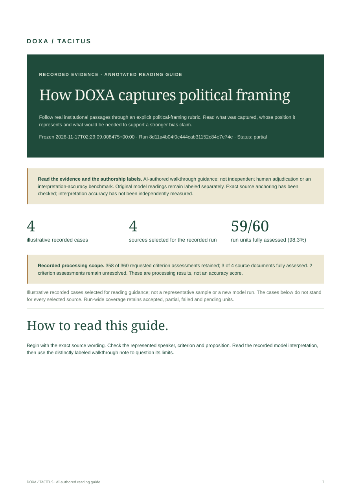</a> <a href="examples/institutional-context-commentary.pdf"></a> <a href="examples/news-monitoring.pdf">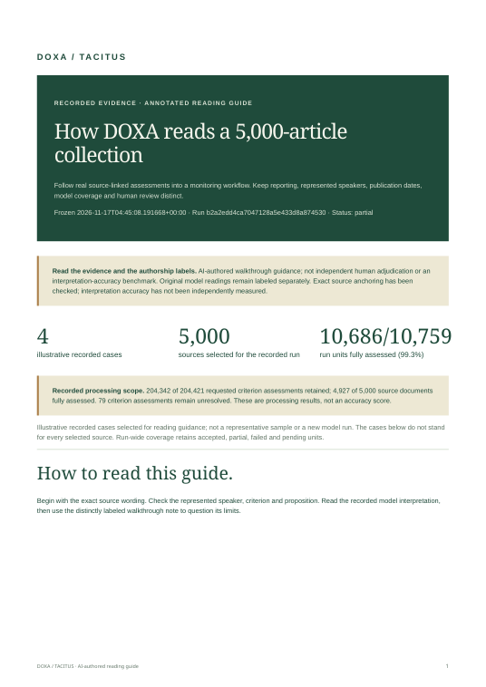</a>

**[Read the political-framing PDF](examples/political-framing-commentary.pdf)** · [Standalone HTML](examples/political-framing-commentary.html) · [Excel case workbook](examples/political-framing-commentary.xlsx) · [Frozen snapshot](examples/political-framing-commentary.snapshot.json.gz) · [Checksums and manifest](examples/political-framing-commentary.manifest.json)

This recorded four-source case packet retains **358 of 360 criterion decisions**, **59 of 60 fully assessed source units**, and **3 of 4 fully assessed documents**. **Two criterion decisions remain unresolved.** Its commentary is AI-authored reading guidance, **not independent human adjudication or human gold labels**. Original model output, unknown attribution fields, review state and incomplete coverage remain visible.

The **[institutional-context PDF](examples/institutional-context-commentary.pdf)** follows four illustrative cases from the 20-source run: protective language, reported discrimination, a framework boundary and criterion-specific uncertainty. The run retains **11,701 of 11,704 decisions**, **613 of 616 fully assessed units**, and **18 of 20 fully assessed documents**; **three decisions remain unresolved**. Its reading notes are also AI-authored, not human gold. [HTML](examples/institutional-context-commentary.html) · [XLSX](examples/institutional-context-commentary.xlsx) · [Snapshot](examples/institutional-context-commentary.snapshot.json.gz) · [Manifest](examples/institutional-context-commentary.manifest.json).

The **[news-monitoring PDF](examples/news-monitoring.pdf)** follows four actual cases from the 5,000-article run: quoted hostility, a political-expression boundary, an uncertain discrimination claim and a descriptive constitutional frame. It preserves exact passages, original model readings, author/translator credits and separately labeled AI reading notes. [HTML](examples/news-monitoring.html) · [Case XLSX](examples/news-monitoring.xlsx) · [Snapshot](examples/news-monitoring.snapshot.json.gz) · [Manifest](examples/news-monitoring.manifest.json).

For the entire news cohort, open the **[5,000-source dashboard PDF](examples/news-corpus-dashboard.pdf)** or [offline dashboard](examples/news-corpus-dashboard.html), and download the **[complete result workbook · 92.6 MB](examples/news-corpus-dashboard.xlsx)**. The [full export snapshot · 66.7 MB](examples/news-corpus-dashboard.snapshot.json.gz) and [manifest](examples/news-corpus-dashboard.manifest.json) retain the same frozen selection. All four result types and all 5,000 source records remain available; the PDF/HTML briefing discloses its 25-entry evidence appendix. The underlying analysis is partial, with **79 unresolved decisions**. The actual streaming export took **123.81 seconds** with approximately **226 MiB peak process memory**; its [resource receipt](examples/news-corpus-dashboard.receipt.json) records the environment and integrity checks.

The [annotated-example guide](docs/v3-annotated-examples.md) explains the source → model reading → commentary → review distinction. Opening these files makes no new inference requests.

The [actual independent-model comparison](docs/v3-independent-review.md) covers **79 source units and 1,500 paired criterion assessments**. It explains which disagreements change an indicator outcome, which distinguish negative from not-applicable, and which concern the represented speaker. Both models' readings remain available; agreement does not establish accuracy.

## Start locally

From a clone of this repository, Docker provides the complete application:

```sh
docker compose up --build
```

Open **http://localhost:8000**. In **Import**, load a recorded collection or add your own files. Inspect saved results without an inference key. **Analyze** starts a new inquiry; remote inference requires explicit source-text transfer consent and a budget. The named Docker volume persists your workspace.

The release also supplies a self-contained application wheel. Install the downloaded wheel and start it without Node or a source checkout:

```sh
python -m pip install ./doxa_by_tacitus-0.4.0-py3-none-any.whl
doxa --host 127.0.0.1 --port 8000 --data-dir ./doxa-data
```

The wheel includes the UI and engine; demonstration corpora and recorded results are distributed in this repository. Model weights are installed separately and explicitly. Download the wheel from [GitHub Releases](https://github.com/sargonxg/DOXA-by-TACITUS/releases). Native PDF rendering may require system libraries; [Docker and installation guidance](docs/deployment.md) cover that setup.

For native development, use Python 3.11+ and Node 22+:

```sh
python -m venv .venv
.venv/bin/python -m pip install -e '.[dev]'
npm --prefix frontend ci
npm --prefix frontend run build
.venv/bin/python -m doxa.cli --host 127.0.0.1 --port 8000 --data-dir data
```

On Windows, use `.venv\Scripts\python.exe`. For UI development, `npm --prefix frontend run dev` proxies the API to port 8000. See [installation, persistence, OCR and deployment](docs/deployment.md).

For a fully local inference fallback, install [Ollama](https://ollama.com/download), explicitly download the model, and select it in **Analyze**:

```sh
ollama pull qwen3.5:4b
```

The conservative profile targets a **16 GB computer**, **Q4 weights**, an **8K context** and **one concurrent request**, with CPU-only operation supported. This is a resource target, not a full-corpus speed guarantee. Native Ollama uses Metal on Apple silicon; [Compose also supplies an optional CPU Ollama service](docs/deployment.md#local-models). The app never downloads weights automatically.

## One linked workspace, ten capabilities

| Capability | What you can inspect or do |
| --- | --- |
| **1. Linked workspace** | Sources, observations, timeline, author × criterion matrix and evidence inspector share a frozen server query. Cursor pages and virtual rows keep large collections bounded. |
| **2. Bulk import** | TXT, Markdown, PDF, DOCX, saved HTML and ZIP; resumable 8 MiB parts for large files, grouped imports, source versions and explicit extraction failures. OCR is optional. |
| **3. Authors and metadata** | Filter credited bylines, document type, publication period and import batch. Preserve author/institution, URLs, rights, hashes and translation roles. |
| **4. Explicit frameworks** | Political framing, discourse, IHRA, Jerusalem Declaration, Nexus, anti-Muslim hostility, structural racism and language norms; add a declared custom rubric. |
| **5. Context and evidence** | Exact Unicode source spans, surrounding text, proposition, speaker attribution, speaker/document stance, hypothetical status, alternatives and uncertainty. |
| **6. Temporal monitoring** | Publication trajectories and assessment history use separate clocks. Eligible-source denominators, coverage and comparison gates qualify statistical review candidates. |
| **7. Independent verification** | A separate GPT-OSS 120B job checks indicator-positive/uncertain units plus a 5% target sample of other accepted units, which are not validated negatives. Consent, a $2 cap and literal disagreements stay explicit. |
| **8. Reviewed learning** | Human-approved examples → immutable memory snapshots → paired candidate evaluation → explicit activation or rollback. No automatic weight training. |
| **9. Optional CPU tools** | Persistent MiniLM passage retrieval and independent DeBERTa hypothesis scoring, with pinned artifacts, exact source windows and uncalibrated scores. |
| **10. Downloadable research** | PDF, offline HTML, XLSX, CSV and JSONL; research/civil-society, newsroom/policy and teaching presentations preserve the same evidence and query scope. PDF/HTML appendices disclose their bounds; data exports retain the complete selection. |

Successful manual imports select **Corpus · all imported sources** so new files remain visible. Corpus view makes no model-assessment claims; an analysis selection shows that run's frozen cohort. Analyze the current corpus scope to include newly imported material.

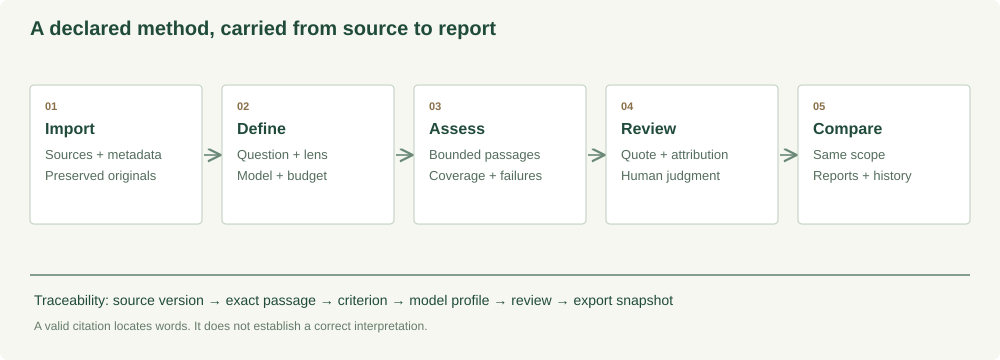

## How political analysis works

The `political-framing` rubric asks six descriptive questions: expressed policy position, evaluative language, agency/causal responsibility, foregrounded voices, comparator-dependent asymmetry and presupposition hypotheses. Detecting one of these textual features does not establish prejudice, factual error, unfairness or a private political identity.

| Source wording | An inspectable reading | What still needs evidence |
| --- | --- | --- |
| Executive Order 14149 says the previous administration **“trampled free speech rights.”** | “Trampled” is an appraisal; the surrounding sentence alleges coercion involving online platforms. | Whether the alleged events occurred, whether the characterization is fair, and whether a relevant comparator shows unequal treatment. |
| Executive Order 14188 proposes **“all available and appropriate legal tools”** against unlawful antisemitic harassment and violence. | An expressed enforcement policy, with legal qualifications that must survive extraction and interpretation. | Support for an enforcement policy is not endorsement of antisemitism. The policy's effects or comparative fairness require additional evidence. |

The saved model leaves attribution **unknown** in these examples. The commentary points out the institutional-voice question; it does not silently repair the record or present the note as a human verdict. Read the [research-backed rubric, exact anchors and comparator policy](docs/political-bias-methodology.md).


IHRA, Jerusalem and Nexus remain distinct frameworks. A descriptive frame, a prejudice indicator and a boundary/exclusion condition have different meanings. User-specified reviewer roles declare analytical priorities; they do not simulate protected demographic traits. No universal left/right or “politically correct” score is produced. An omission or double-standard audit needs a declared relevant comparator and paired evidence; a single document cannot establish one.

The contextual engine separates compact classification from detailed interpretation:

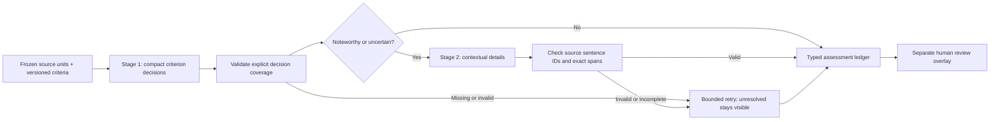

**Exact-source checks are not semantic-accuracy checks.** Missing or rejected decisions stay unresolved rather than becoming negative findings. Framework agreement and independent-model agreement are not accuracy. The [v3 research dossier](docs/research-v3.md) records the rationale, engineering pilot and their limits.

## Real sources, with declared boundaries

| Collection | Frozen material and intended use |
| --- | --- |
| **Global Voices news** | **5,000 articles**, **5,251,119 whitespace-counted words**, **778 distinct credited author names**, **585 translated articles**, **72 publication months across 2020–2025**. A month-stratified split holds **4,000 development / 1,000 held-out article groups** apart. |
| **Public institutions** | **20 UK and US publications**, approximately **357,000 words**: strategies, executive orders, reviews, discrimination guidance and policy responses. A purposive case collection with separate source-specific rights. |

The news file/provenance audit and independent source-character audit both passed **5,000/5,000**. These establish source integrity, not interpretation accuracy. Global Voices is one publisher's collection, not a representative sample of all news or political perspectives. Current text was frozen at collection time; publication-date plots do not reconstruct every original edition.

Per-source records retain authors/translators, URLs, licences, extraction changes and hashes. Global Voices material follows observed CC BY 3.0/publisher conditions and recorded exclusions; institutional sources retain their own notices. This is a documented rights audit, not exhaustive legal clearance. See [news collection and audits](docs/news-corpus.md), [institutional corpus](docs/corpus.md) and [licences](docs/licenses.md).

The actual six-framework cloud run attempted **all 5,000 articles** and settled **partial**: **4,927 fully assessed articles**, **10,686/10,759 accepted units (99.32%)**, and **204,342/204,421 explicit criterion decisions (99.96%)**. **73 units and 79 decisions remain incomplete**. Two bounded recovery passes preserved accepted results and the frozen method. Packaging checked **3,860,336 source references**. These are processing and provenance measurements, not measured interpretation accuracy. [Run summary](benchmarks/v3-news-final-summary.json) · [portable result package](benchmarks/v3-news/showcase.json) · [recovery record](benchmarks/v3-news-recovery.json).

The run conservatively accounted **$14.11** for inference across its inherited and new sessions; the provider invoice remains unknown. Its cumulative active benchmark time was **158.39 minutes**, excluding downtime, across recorded sessions and operational concurrency changes. This is a measured workload, not a speed or price guarantee. The temporary inference endpoint was [disabled after settlement](benchmarks/v3-gateway-cleanup.json).

A [fresh-workspace restore check](benchmarks/v3-news-restore-verification.json) restored all 5,000 sources and 204,342 assessments, checked every retained source reference, then repeated the restore with identical data fingerprints. It made **zero model or network calls** and preserved the partial status. The complete proof took **262.17 seconds** at approximately **259 MiB peak process RSS** in the recorded environment.

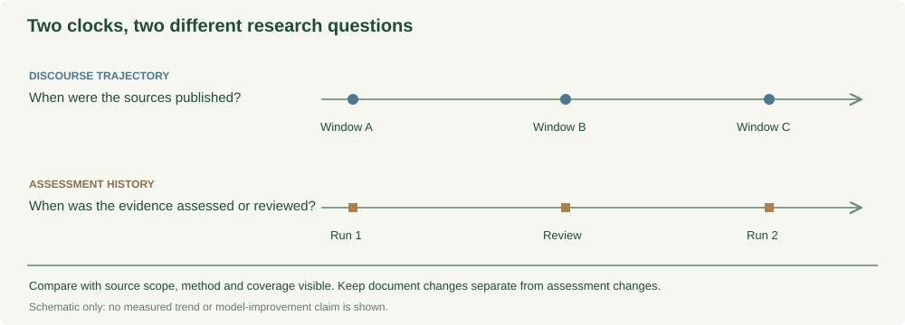

Rates describe the selected imported corpus. Reporting about hostility, quoted hostility and author-endorsed hostility remain separate. Missing analysis is not absence; unknown dates are not invented. The diagram is schematic, not a measured spike or improvement claim.

## Models and a practical growth path

| Profile | Role and limits |
| --- | --- |
| [all-MiniLM-L6-v2](https://huggingface.co/sentence-transformers/all-MiniLM-L6-v2) | Apache-2.0 CPU retrieval: **384-dimensional** vectors and a **256-wordpiece** sentence-transformer limit. Similarity does not establish shared stance or prejudice. |
| [DeBERTa-v3-base-zeroshot-v2.0-c](https://huggingface.co/MoritzLaurer/deberta-v3-base-zeroshot-v2.0-c) | MIT pretrained NLI; each explicit hypothesis is scored independently within its combined token budget. Scores are **uncalibrated**, not probabilities of prejudice; not-entailment is not contradiction. |
| [Qwen3.5-4B](https://huggingface.co/Qwen/Qwen3.5-4B) / Ollama | Conservative local contextual inference; model digest, quantization, context and observed resource use remain recorded. |
| [Gemma 4 26B A4B](https://developers.cloudflare.com/workers-ai/models/gemma-4-26b-a4b-it/) | Managed cloud primary. Availability, provider-managed revision limits, token use and application budget accounting are recorded. |
| [GPT-OSS 120B](https://huggingface.co/openai/gpt-oss-120b) | Independent model verification through Cloudflare. Its separate comparison exposes paired differences and incomplete selection coverage; it does not adjudicate the primary model. |
| [vLLM](https://docs.vllm.ai/) / [RunPod](https://docs.runpod.io/) | Configured OpenAI-compatible or GPU endpoints for larger-model experiments. Provider adapters are replaceable; larger weights are not presumed improvements. |

DOXA has **not fine-tuned these models**. The current methodology and CPU profiles are English-first; multilingual claims need separate validation. Optional CPU models are installed explicitly and loaded from verified, pinned local artifacts. Start with one question, one source cohort and one declared rubric; add reviewed examples or another provider while preserving the baseline. See [installation and model profiles](docs/models-v3.md).

A full 5,000-source CPU index can take many minutes. The [actual canonical-cohort benchmark](benchmarks/cpu-semantic-5000-summary.json) built **120,464 passages**, verified restart/reuse and exact search quotations, and recorded approximately **49.91 active indexing minutes** across its attempts. This does not measure ranking accuracy or promise another computer's speed. The current browser build action waits on one HTTP request and can hit a proxy timeout; prefer `python scripts/semantic_index.py build PROJECT_ID --data-dir data` for full collections, then search the persisted index in the browser. Run heavy local generation and indexing sequentially when they contend for CPU.

**[Download the real CPU hypothesis-scoring workbook](examples/local-cpu-nli-20.xlsx)** to inspect **20 complete articles, 60 source windows and 240 independent hypothesis scores**. DeBERTa completed this profile in **247.102 seconds**, including model loading, with **2.038 GiB peak process RSS** and no API fee. The workbook preserves full source windows, credits, raw logits and model settings; the [receipt](examples/local-cpu-nli-20.receipt.json) and [frozen scores](benchmarks/cpu-nli-20-news-scores.jsonl.gz) support reproduction. These are uncalibrated textual-entailment scores, not probabilities of bias or prejudice.

The separate [Qwen CPU generation trial](benchmarks/v3-local-news-summary.json) selected the same 20 whole articles but stopped after **2 fully assessed articles and 8 of 115 accepted units**. Its sampled combined runner/process RSS reached **9.238 GiB**. Retrieval, hypothesis scoring and contextual generation have different workloads; a completed index or NLI pass does not imply that a laptop can quickly generate full contextual assessments for 5,000 articles.

The new [bounded 2B/4B CPU study](docs/local-study-v04.md) used the same six short whole articles and a 30-minute cap per profile. Both completed one article; 2B retained 12/17 complete units and 4B 3/17, with partial peer decisions preserved. Their 95 jointly retained decisions differed in 89 outcomes, mostly non-match versus non-applicability. These are feasibility and disagreement observations, not accuracy or a clean speed comparison; no model is promoted. [Frozen summary](benchmarks/v04-cpu-study.json) · [offline request/anchor audit](benchmarks/v04-cpu-study-audit.json).

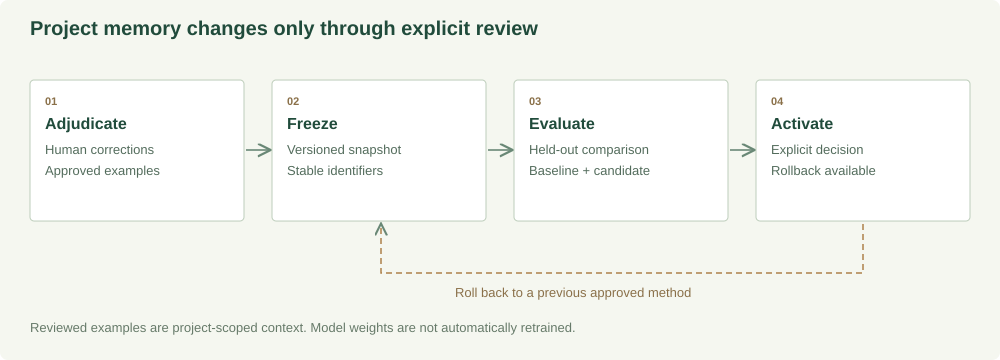

Held-out/story groups remain separate from approved example memory. A passing software check or model-agreement result does not become an independent reference label. [The service-toolkit guide](docs/v3-service-toolkit.md) explains reviewed learning, attribution, source history and rollback.

## Local first; optional cloud infrastructure

The lowest-infrastructure starting point is the local application with SQLite/files and optional metered cloud inference. Keep inference local when appropriate; choose managed inference when its measured throughput and token cost suit the workload. Selecting remote inference sends approved source text to that provider; credentials stay on the server.

The optional Cloudflare deployment supplies Access authentication, a Worker/static UI, D1, R2, durable Queues and a Python Container running the shared engine. It is a shared private workspace for its permitted users; isolate deployments for groups requiring separate data. RunPod/GPU rental adds its own operating and idle costs. Provisioning is explicit: installation and tests do not deploy a service.

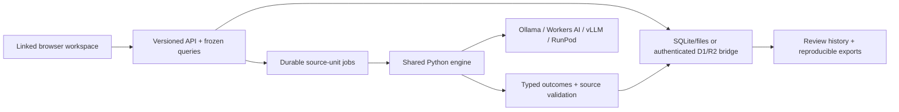

The default **$20/month application variable-spend cap is configurable**. It controls application-accounted usage, **not the whole vendor bill**: fixed plans, storage, containers, GPU time and unreported charges can differ. Unknown provider billing stays unknown. Each run also has its own budget; independent verification is capped at $2. [Deployment and cost guidance](docs/deployment.md) covers configuration, authentication, persistence and cleanup.

## Reproduce and inspect

The [v0.4 verification record](docs/verification-v04.md) and [v3 verification record](docs/verification-v3.md) list the actual software, browser, corpus and runtime checks, their artifacts, and what they establish.

```sh
pytest -q
npm --prefix frontend ci && npm --prefix frontend run build
npm --prefix infra/cloudflare ci && npm --prefix infra/cloudflare test
.venv/bin/python tests/browser_v3.py
.venv/bin/python tests/browser_import_scope.py
.venv/bin/python tests/browser_verification.py
.venv/bin/python tests/browser_publications_v04.py
.venv/bin/python scripts/verify_repository.py
```

Browser contract tests use isolated synthetic fixtures and mocked paid requests; they establish application behavior, not model quality. Separate checks cover actual 11 MiB refresh/reselection recovery, grouped imports and a read-only copy of the real 5,000-source workspace. See [frontend checks](frontend/README.md).

To run a **new** whole-article local pilot after installing Ollama:

```sh
python scripts/benchmark_v3.py --collection news-sample --limit 20 \
  --provider ollama --model qwen3.5:4b --concurrency 1 \
  --data-dir data/my-local-pilot --output benchmarks/my-local-pilot.json
```

For the full 5,000-source selection, configure Cloudflare credentials and deliberately request paid inference with separate state/output paths:

```sh
python scripts/benchmark_v3.py --collection news --provider cloudflare \
  --model @cf/google/gemma-4-26b-a4b-it --concurrency 4 --budget 5 \
  --data-dir data/my-cloud-news --output benchmarks/my-cloud-news.json
```

The budget does not promise completion. **Resume by repeating the identical command, paths and analytical arguments with `--resume`**. Source/model/method changes require a new run. Coverage, unresolved decisions, resource measurements and token/cost accounting—not merely a finished process—determine what a benchmark establishes.

[Recorded benchmark summaries](benchmarks/README.md) distinguish the actual partial cloud backfill, completed CPU profiles, scoped pilots and historical v1 artifacts. Full-corpus inference coverage is recorded separately from source audits and independently validated interpretation accuracy. For a large recorded workspace, the [streaming export command](docs/v3-recorded-exports.md) writes full JSON/XLSX without materializing every assessment in memory; the compatibility export endpoint has a separate memory profile. The new persistent report-job service stages bounded chunks and renders outside the API process. The earlier [v1 institutional PDF](examples/doxa-public-institutions.pdf) remains a historical example.

## Explore the project

- [V3 research and measured pilot](docs/research-v3.md) · [political-bias methodology](docs/political-bias-methodology.md) · [interpretation contract](docs/v3-interpretation.md)
- [Models and CPU retrieval](docs/models-v3.md) · [architecture](docs/architecture.md) · [deployment](docs/deployment.md) · [benchmarking](docs/benchmarking.md)
- [Annotated real-source examples](docs/v3-annotated-examples.md) · [service toolkit](docs/v3-service-toolkit.md) · [research background](docs/research.md)

<details><summary>Prefer an illustrated introduction? Follow DOXA Quest.</summary>


Read the [updated Quest guide](docs/guide.md). The pixel map explains the research steps; the current application uses one linked workspace and Import, Analyze, Models, Processing and Reports drawers.

</details>

Original application code is Apache 2.0. Dependencies and source materials retain their own licences, including PyMuPDF's separate terms. Keep originals, rights notices, model provenance and human review attached to conclusions.
