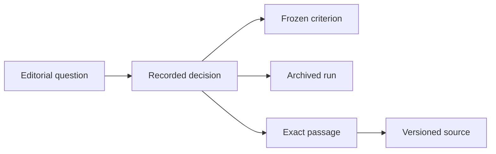

# DOXA by TACITUS

**Read what a corpus says, who says it, and how the interpretation was reached.**

DOXA is an open-source research workbench for discourse, political framing and contextual prejudice analysis. Import documents, declare a framework, and inspect recorded readings next to the exact source passages. Compare readings and export the evidence for review.

[Open the field study](https://doxa-public-study.giuliocatanzariti.workers.dev/) · [Run DOXA locally](#start-locally) · [Visit DOXA on TACITUS](https://tacitus.me/doxa/) · [Download v0.7.0](https://github.com/sargonxg/DOXA-by-TACITUS/releases/tag/v0.7.0)

[](https://github.com/sargonxg/DOXA-by-TACITUS/actions/workflows/ci.yml)

## Read a real study

In a selection of **60 Global Voices articles** published from 2020 to 2025, the recorded model flagged passages in **14 articles**. It attributed **45 of 49 flags** to people the articles quoted or reported. The six walkthroughs let you assess how speaker attribution, context and criterion wording affect a reading. Independent reviewers have yet to assess those readings.

[](https://doxa-public-study.giuliocatanzariti.workers.dev/)

| Read or reproduce | Start here |
| --- | --- |
| **Follow one flag** | A student was reportedly pressured to remove her hijab. Compare the unequal-treatment flag with the uncertain reading about repeated institutional practice. [Open the case](https://doxa-public-study.giuliocatanzariti.workers.dev/#case-school-hijab) |
| **Challenge a reading** | Check a possible false flag and a possible miss against the text and the frozen criteria. [Flag to challenge](https://doxa-public-study.giuliocatanzariti.workers.dev/#case-challenge-a-flag) · [Possible miss](https://doxa-public-study.giuliocatanzariti.workers.dev/#case-possible-miss) |
| **Read or share the study** | Open the briefing and take the results with you. [PDF](frontend/public/studies/muslim-coverage/report.pdf) · [Workbook](frontend/public/studies/muslim-coverage/evidence.xlsx) · [Attributed source texts and decisions](frontend/public/studies/muslim-coverage/sources.zip) |
| **Check the methodology** | See the selection rule, decision denominators, unresolved-reading scenarios and what happens when each year is omitted. [Study methods](docs/reading-muslim-coverage.md) · [Sensitivity table](https://doxa-public-study.giuliocatanzariti.workers.dev/#sensitivity) |
| **Explore a different topic** | Read how a four-source political framing example treats appraisal, attribution and two unresolved decisions. [Annotated PDF](examples/political-framing-commentary.pdf) · [More examples](docs/v3-annotated-examples.md) |

## Follow the evidence graph

The study graph connects every retained decision to a frozen criterion, the archived analysis run and exact passages in versioned sources. The standalone and local readers use that graph to show the evidence path for each walkthrough. The graph distinguishes model-selected evidence, software-attached context and editorial review questions.



From a clone, follow the school case or list decisions under one criterion with Python 3.11+.

```sh
python scripts/query_study_graph.py --case school-hijab
python scripts/query_study_graph.py --criterion discrimination_claim
```

[Graph vocabulary and examples](docs/evidence-graph.md) · [JSON-LD export](frontend/public/studies/muslim-coverage/evidence.jsonld) · [Artifact checksums](examples/muslim-coverage.manifest.json)

## Start locally

Use Docker from a clone of this repository.

```sh
docker compose up --build
```

Open **http://localhost:8000** and choose **Read the 60-article study**. You can inspect the existing results and practice with fictional texts without a model, key or upload. To use your own documents, open **Import**, review extraction quality, then open **Analyze** to choose a question, framework and processing destination.

To run without Docker, download the application wheel from the release and install it in a Python 3.11+ environment.

```sh
python -m pip install ./doxa_by_tacitus-0.7.0-py3-none-any.whl
doxa doctor --json --data-dir ./doxa-data
doxa --host 127.0.0.1 --port 8000 --data-dir ./doxa-data
```

The wheel includes the browser interface and recorded readers. New analyses use a configured local or remote inference provider. Remote processing requires explicit source-text transfer consent and a budget. [Release files](https://github.com/sargonxg/DOXA-by-TACITUS/releases/tag/v0.7.0) · [System dependencies and deployment](docs/deployment.md)

## Use DOXA in a review

1. **Declare what counts.** Choose the research question, unit of analysis, framework and exclusions. The same passage may support different readings under different criteria. [Measurement cards and independent evaluation](docs/methodology-v06.md)
2. **Read the source in context.** Inspect the passage, speaker, target and stance. A source anchor verifies where the wording occurs. Assessing the interpretation requires judgment. [A worked review protocol](docs/reading-muslim-coverage.md#review-a-reading)
3. **Report the coverage.** Publish the cohort and retained decisions with their denominators. Keep uncertainty, missing decisions and human corrections visible in the review record. [Casebooks and reports](docs/report-jobs.md)

DOXA is a research preview. The field study describes a topic-selected sample from one publisher. Claims about prevalence, cross-publisher differences or model accuracy require an appropriate collection and model-blind human review.

## Documentation

- [Documentation index](docs/README.md) · [Workbench and release reference](docs/workbench-reference.md) · [Changelog](CHANGELOG.md)
- [Contributing](CONTRIBUTING.md) · [0.7 delivery plan](docs/release-plan-v07.md) · [Citation](CITATION.cff) · [Apache 2.0 software license](LICENSE)
