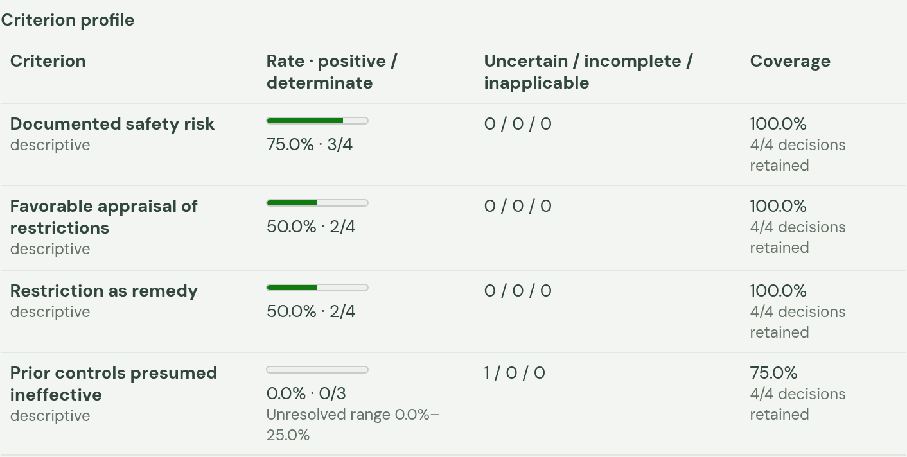

# DOXA by TACITUS


**Compare political framing and evidence of prejudice in documents and speech transcripts.** Run DOXA on your laptop, then trace each result to a named criterion, an exact passage, and the sources behind the rate.

[Install locally](#start-locally) · [See the worked scorecard](#worked-scorecard) · [Read the technical method](docs/bias-detection-method.md) · [Release downloads](https://github.com/sargonxg/DOXA-by-TACITUS/releases/latest)

[](https://github.com/sargonxg/DOXA-by-TACITUS/actions/workflows/ci.yml)

The reader owl identifies DOXA across the local workbench, [TACITUS website](https://tacitus.me/) and [GitHub organization](https://github.com/TACITUS-me). [Character use and accessibility](docs/product-character.md)


A scorecard shows criterion rates, source coverage, uncertain readings, and matched comparisons. Drill down to the original wording or caption time and export the same saved result as PDF, HTML, XLSX, CSV, JSONL, or a JSON-LD evidence graph. [Example PDF](frontend/public/studies/scorecard/doxa-scorecard.pdf) · [Antisemitism and anti-Muslim bias studies](#worked-studies)

## Open evidence research

DOXA’s Hugging Face benchmark tests whether a supplied passage supports a claim, contradicts it, or leaves it unresolved. It contains 1,348 judgments across government speeches and statutes, political and public-policy papers, and SciFact. The 132 DOXA-authored annotations remain provisional.

The CPU-trained Evidence Verifier scored **0.685 macro-F1** on 274 held-out judgments, compared with **0.604** for the frozen DeBERTa baseline. The improvement came from government texts and SciFact. The PLOS ONE slice matched the baseline. This evaluation concerns claim–passage evidence support within its benchmark scope.

[Benchmark](https://huggingface.co/datasets/Giuliocc/doxa-evidence-benchmark/tree/v0.1.0) · [CPU model](https://huggingface.co/Giuliocc/doxa-evidence-verifier/tree/v0.1.0) · [Methods and errors](https://huggingface.co/datasets/Giuliocc/doxa-evidence-benchmark/blob/v0.1.0/EVALUATION.md) · [Browser Evidence Lab](https://giuliocc-doxa-lab.static.hf.space/#documents) · [TACITUS DOXA](https://tacitus.me/doxa/)

## Start locally

Download the **Python wheel** from the release and put it in your current directory. Install Python 3.11 or newer, then run the commands for your OS. [Download the wheel](https://github.com/sargonxg/DOXA-by-TACITUS/releases/download/v0.9.2/doxa_by_tacitus-0.9.2-py3-none-any.whl)

**macOS or Linux**

```sh
python3 -m venv .venv
. .venv/bin/activate
python -m pip install ./doxa_by_tacitus-0.9.2-py3-none-any.whl
doxa --data-dir ./doxa-data
```

<details>
<summary>Windows PowerShell</summary>

```powershell
py -m venv .venv
.\.venv\Scripts\python.exe -m pip install .\doxa_by_tacitus-0.9.2-py3-none-any.whl
.\.venv\Scripts\python.exe -m doxa.cli --data-dir .\doxa-data
```

</details>

Open **http://127.0.0.1:8000** and select **Open worked example**. The bundled instance contains authored labels and downloadable results, so you can try the interface before setting up a model.

### Analyze your own sources

1. Install and start Ollama. In a second terminal, run the commands below. The doctor checks local configuration and the installed model's identity.
2. In DOXA, **Import** your sources. You can start with one file or drop in the four-source Civic Square ZIP. Check the extraction preview before continuing. [Import-ready Civic Square sources](frontend/public/studies/scorecard/civic-square-sources.zip)
3. Select **Analyze**, enable the bounded laptop preset, then set your question and rubric. Check the model and workload before starting.
4. Select **Save scorecard** when results arrive. Open a criterion in the source matrix, review its evidence, then choose an export.

```sh
ollama pull qwen3.5:2b-q4_K_M
doxa doctor --laptop --data-dir ./doxa-data
```

On Windows, use `.\.venv\Scripts\python.exe -m doxa.cli` in place of `doxa`. The laptop preset sends source text to Ollama on your machine. It has a bounded workload of eight sources, 24 units and six criteria. Input includes PDF, DOCX, TXT, Markdown, saved HTML, email archives, SRT and WebVTT. The PDF renderer requires WeasyPrint system libraries. [Setup and PDF dependencies](docs/deployment.md#installed-wheel-and-external-demonstration-data) · [Measured laptop-profile run](docs/research-scorecards.md#evaluation-and-hardware-verification)

## What DOXA measures

A **lens** supplies criteria for a research question. A **criterion** specifies an observable signal and the context required to count it. A **finding** records the result and its evidence for review. Apply each prejudice framework on its own terms. [Technical workflow and boundary checks](docs/bias-detection-method.md)

| Lens | What to look for | What qualifies the reading |
| --- | --- | --- |
| **Political positions and framing** | Policy stance, appraisal, responsibility, prominence, comparisons, and backgrounded assumptions. | Declare the proposition or issue. A claim of unequal standards needs comparable evidence from both sides. |
| **Discourse and rhetoric** | How language defines problems, assigns causes, appeals to values, and uses devices such as stereotypes, metaphors, and contrasts. | Describe the device in its local context and consider an alternative reading. |
| **Antisemitism · IHRA** | Anti-Jewish hostility or stereotyping, collective blame, and Israel-related examples. | Read the examples in context and examine the specific basis for the criterion. [IHRA working definition](https://holocaustremembrance.com/resources/working-definition-antisemitism) |
| **Antisemitism · Jerusalem Declaration** | Discrimination or hostility toward Jews as Jews, essentializing tropes, collective guilt, and boundaries for political expression. | Apply the declaration's contextual guidelines to the passage. [Jerusalem Declaration](https://jerusalemdeclaration.org/) |
| **Antisemitism · Nexus** | Anti-Jewish tropes, discrimination or collective blame, including in discourse about Israel or Zionism. | Apply the Nexus boundary for political opposition alongside its antisemitism criteria. [Nexus Document](https://nexusproject.us/the-nexus-document/) |
| **Anti-Muslim hostility · England** | Hostile expression directed at Muslims or perceived Muslims, relevant stereotyping, and unequal treatment. | Identify the target and supporting context. Claims about intent require their own evidence. [England guidance](https://www.gov.uk/guidance/a-definition-of-anti-muslim-hostility) |
| **Anti-Muslim racism · structural lens** | Racialization, exclusion, and repeated institutional practices affecting Muslims or people perceived to be Muslim. | An institutional-pattern finding requires evidence of a practice or recurrence. [Runnymede Trust framework](https://www.runnymedetrust.org/publications/islamophobia-towards-a-working-definition) |
| **Language norms** | Arguments over acceptable language, labels, norms of respect, and institutional restrictions on expression. | State whose norm applies in the chosen setting and record competing interpretations. |
| **Custom rubrics** | A project-specific construct, such as evidence standards in municipal policy briefings. | Write an observable inclusion rule and a counterexample for each criterion before analysis. |

### Six questions for political analysis

| Question | Evidence to look for |
| --- | --- |
| **What policy does the text support or oppose?** | A stance toward a specific proposal, such as narrowing an exclusion zone. |
| **How does it evaluate the policy or people affected?** | A phrase such as “proportionate safeguard” or “burden on assembly,” with its target. |
| **What cause or responsibility does it assign?** | An explicit claim linking a policy, actor, or condition to an outcome. |
| **Which evidence does it foreground?** | A dispatch log, cost estimate, testimony, or other source given prominence in the text. |
| **Does it apply different standards in comparable cases?** | Evidence on both sides of a declared match. An omission question also needs an inventory of relevant information available at the time. |
| **What assumption does the wording take for granted?** | A phrase such as “restore order,” alongside the premise it may imply and a plausible alternative interpretation. |

The scorecard distinguishes **matches**, **assessed non-matches**, **uncertain readings**, **inapplicable criteria**, and **incomplete sources**. It reports both retained decisions per planned decision and determinate sources per eligible source. Each prejudice framework retains its own results and political-expression boundaries. [Political methodology and real-source walkthrough](docs/political-bias-methodology.md) · [Measurement cards and evaluation](docs/methodology-v06.md)

## Worked scorecard

Two briefings and two captioned speeches discuss the same proposed restriction on demonstrations. Both issuer groups address emergency access, yet they recommend different responses. Three weighted measures give the fictional corpus a **60.0 / 100 public-order justification score**.

| Criterion | Positive / determinate | Weight | Contribution |
| --- | ---: | ---: | ---: |
| Documented safety risk | 3 / 4 | 40% | 30.0 |
| Favorable appraisal of restrictions | 2 / 4 | 25% | 12.5 |
| Restriction as remedy | 2 / 4 | 35% | 17.5 |

The unweighted premise criterion identifies a passage where “restore order” could describe traffic or behavior at the demonstration. The comparison counts two matched pairs and shows a **50 percentage-point** difference in the documented-risk measure. The labels were authored for teaching. Weight choices and the corpus define what the index measures. Each weighted criterion needs at least 80% determinate coverage. The unweighted premise rate is 0/3 with one unresolved source, yielding a range of 0%–25% under alternative readings. [Walkthrough and reproduction](docs/research-scorecards.md) · [Source ZIP](frontend/public/studies/scorecard/civic-square-sources.zip) · [Rubric and metadata](frontend/public/studies/scorecard/starter.zip) · [PDF](frontend/public/studies/scorecard/doxa-scorecard.pdf) · [Workbook](frontend/public/studies/scorecard/doxa-scorecard.xlsx) · [JSONL](frontend/public/studies/scorecard/doxa-scorecard.jsonl)



## Worked studies

| Research question | Evidence and downloads |
| --- | --- |
| **Antisemitism. What distinguishes a religious accusation, political criticism, and Holocaust remembrance?** Compare three frameworks across the four-source Plzeň teaching set, with 81 retained decisions and nine research red flags. | [Case and red flags](docs/antisemitism-case.md) · [PDF](frontend/public/studies/antisemitism/antisemitism-case.pdf) · [Graph](frontend/public/studies/antisemitism/evidence.jsonld) |
| **Anti-Muslim bias. What evidence supports an unequal-treatment flag or a repeated institutional pattern?** A topic-selected set of 60 Global Voices articles lets you compare these readings and see how results change under different assumptions about unresolved articles. | [Study and sensitivity analysis](docs/reading-muslim-coverage.md) · [PDF](frontend/public/studies/muslim-coverage/report.pdf) · [Evidence workbook](frontend/public/studies/muslim-coverage/evidence.xlsx) |
| **Political framing. How do institutional texts justify remedies, assign responsibility and set boundaries on political expression?** Read four licensed sources with exact anchors and declared comparability limits. | [Real-source walkthrough](docs/political-bias-methodology.md#reproducible-real-source-case-packet) · [Annotated PDF](examples/political-framing-commentary.pdf) |

These collections support worked interpretations under declared rubrics. Independent human labels are pending for the archived model decisions. Population-level and accuracy claims require their own sampling and evaluation. [Evaluation protocol](docs/methodology-v06.md)

## Evidence graph

The scorecard graph links each source-level result to its criterion, run, and representative passage. The passage stores exact text and a source locator. The example graph contains enough information to recompute the documented-risk bar as **3 ÷ 4 = 75%**. The verifier checks the saved checksum, graph links, and criterion totals offline.

```sh
python -m doxa.scorecard_graph frontend/public/studies/scorecard/scorecard-evidence.jsonld custom/custom-1 --verify frontend/public/studies/scorecard/scorecard.json
```

[Graph data](frontend/public/studies/scorecard/scorecard-evidence.jsonld) · [Vocabulary and offline query](docs/evidence-graph.md)

## Documentation

[Documentation index](docs/README.md) · [Workbench reference](docs/workbench-reference.md) · [Changelog](CHANGELOG.md) · [Contributing](CONTRIBUTING.md) · [Citation](CITATION.cff) · [Apache 2.0 license](LICENSE) · [TACITUS](https://tacitus.me/#doxa)
