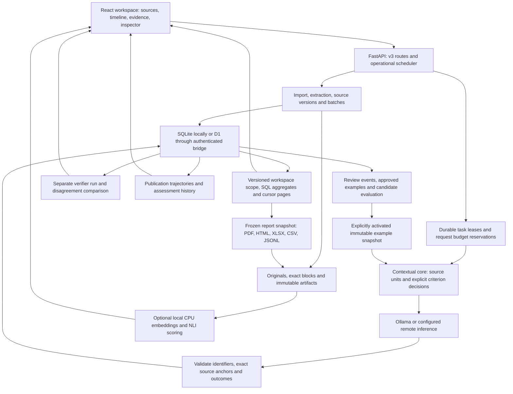

# DOXA v3 architecture and implementation boundaries

DOXA is a React/TypeScript workspace backed by a shared Python engine. Source ingestion, analysis, review and exports run locally with SQLite/filesystem storage, or through the supplied private Cloudflare deployment with D1/R2 persistence. Inference location is a separate choice: the default managed model receives selected source text only with explicit transfer consent; Ollama provides a fully local fallback. The reference deployment is **one shared private workspace**, not a multitenant SaaS.

## Module and contract map

| Boundary | Implementation | Owned records and invariants |
| --- | --- | --- |
| Browser workspace | `frontend/src/App.tsx`, `frontend/src/workspace/` | Linked source/query scope, paged results, evidence inspection and explicit operator actions; no browser provider keys. |
| HTTP and scheduling | `doxa/api.py`, `doxa/v3_api.py`, `doxa/imports.py` | Run creation, consent, trusted reviewer context, task leases, cancellation, resume, budget settlement and report routes. `/docs` and `/openapi.json` expose the API. |
| Persistence | `doxa/store.py`, `doxa/schema.sql`, `doxa/v3_schema.sql` | SQLite/filesystem or authenticated D1/R2 bridge; run-source membership, assessments, unit-status ledger, query snapshots and idempotent writes. |
| Sources and versions | `doxa/extraction.py`, `doxa/extract_worker.py`, `doxa/news.py`, `doxa/batches.py` | Exact extracted blocks, source/rights receipts, immutable content versions and explicit import membership; absence from a later import does not imply deletion. |
| Contextual analysis | `doxa/contextual.py`, `doxa/models.py`, `doxa/lenses.py` | Source-derived units/sentences, versioned rubrics and typed outcomes; the model selects identifiers and application code extracts quotations. |
| Inference adapters | `doxa/providers.py`, `doxa/model_registry.py` | Availability preflight, explicit model/runtime profile, structured generation, token receipts and cost basis; no silent model replacement. |
| Workspace queries | `doxa/workspace.py` | Validated `WorkspaceQuery`, scope hash, data revision, SQL aggregates and query-bound cursors; charts use server totals rather than downloaded finding pages. |
| CPU tools | `doxa/cpu_models.py`, `doxa/semantic.py`, `scripts/model_setup.py` | Explicitly installed, pinned CPU artifacts; exact passage anchors, bounded vector index and uncalibrated independent rubric scores. |
| Reviewed learning | `doxa/learning.py` | Original payloads, append-only reviews, approved examples, immutable snapshots, paired candidate reports, human activation and rollback. |
| Independent model comparison | `doxa/verification.py`, `scripts/verify_v3.py` | Frozen primary-unit selection, separate verifier output and bounded disagreement evidence; model agreement is not interpretation accuracy. |
| Time and evidence graph | `doxa/trajectories.py` | Scoped denominators, publication-time rates, review history, provisional spike candidates and bounded typed source/evidence links. |
| Reports and saved results | `doxa/reports.py`, `doxa/showcase_v3.py`, `scripts/package_v3.py` | Frozen export snapshots and streamed, hashed archive parts; saved results require exact source/anchor validation and do not incur new inference spend. |
| Historical compatibility | `doxa/analysis.py`, `doxa/showcase.py` | Legacy v1 analysis/findings and the evidence-only lexical baseline; historical findings remain `legacy_unclassified`, without semantic backfill. |
| Connector growth boundary | `doxa/connectors.py` | `Connector.enumerate/read/checkpoint` yields `SourceRecord` manifests/bytes; ingestion owns authorization, extraction, hashing and versioning. Future connectors do not emit findings. |

## Source, unit and assessment identities

Imports preserve credited authors, institutions, translators where supplied, publication dates, source URLs, rights notices and exclusions. A source identity and its content version are distinct: changed canonical blocks produce a new immutable document version, while older runs retain their original version. Exact-content deduplication is a declared query/index view; it must not erase distinct publication attribution. Batch membership records which versions an import actually supplied.

Blocks retain exact text and available page, paragraph and line locators. Offsets are Unicode code points with inclusive start/exclusive end; browser slicing respects that unit. The contextual builder combines adjacent source sentences across blocks into bounded units while retaining each original span. It owns every selected source character once and adds bounded neighboring context. Source/version hashes participate in stable unit/sentence IDs, so a changed version cannot inherit old anchors accidentally.

A v3 run freezes source membership, question, analytical perspective, selected rubric snapshots, model/profile, prompt/schema and approved-memory version. Changed selected rubrics or a concrete model revision block ordinary continuation; managed model revisions can remain explicitly unresolved. Source-cohort corrections use an audited fork that reuses only unchanged source checkpoints and preserves original runs and billing provenance.

`Criterion.kind` is registry-owned: `indicator`, `boundary` or `descriptive`. `Assessment.result` is explicit: `meets_criterion`, `does_not_meet`, `uncertain` or `not_applicable`. Only a matching indicator contributes to an indicator count. Speaker attribution, speech role, proposition, speaker/document stance and hypothetical status remain separate. Quotation, political-expression boundaries and descriptive framing are not automatically author endorsement or prejudice.

Every selected unit has a status: `pending`, `partial`, `failed` or `accepted`. Accepted coverage requires every requested criterion outcome; missing or invalid output is never an implicit negative. Task completion, fully accepted units, source characters, settled documents and complete documents remain separate denominators. Lexical coverage is also separate from semantic coverage.

## Contextual inference, accounting and recovery

The v3 path first requests compact, complete decision vectors, then grounded details for provisional positive/uncertain pairs. Code validates the exact requested unit/criterion identifiers and source-sentence references, including a sentence owned by the scored unit. A detailed re-evaluation may disagree with its provisional vector; the trace retains both. Accepted peers survive retries, and cached outcomes require the same source anchors and analytical configuration hash. Compact negative rows can hydrate quotations from persisted originals for review/export without inventing text.

Source text and examples are untrusted data. The analysis core has no tool execution, shell, arbitrary source fetching or credential access. Provider endpoints/credentials are configured on the server, not by browser requests. Availability checks establish model presence, while exact-runtime structured-output checks and source validation establish separate properties. New managed Cloudflare GPT-oss runs default to the tested low-reasoning/2,048-token allowance only for omitted fields; explicit choices and historical runs remain unchanged.

Before each request, an atomic reservation checks both the run cap and shared monthly ledger. Idempotent settlement records actual reported usage or conservatively charges the reserved maximum when billing is unknown. Provider invoice uncertainty remains visible; historical reuse does not debit the monthly ledger again. Token estimates, application accounting and total vendor/platform charges are different quantities.

Only the current lease can commit. Cancellation invalidates it, preventing late observations from being published; resume refreshes counters before new work starts. Local-state Ollama defaults to **1,800 seconds** per task, configurable through `DOXA_LOCAL_TASK_TIMEOUT_SECONDS` within **480–7,200**, with lease duration at least deadline plus **120 seconds**. Applied limits/history are operational metadata, not a prompt or unit change. Remote inference with local state retains **480 seconds**; the cloud-container task limit remains **420 seconds** under its eight-minute HTTP limit. See [model operations](models-v3.md).

## Immutable query and report flow

`POST /api/v3/projects/{project_id}/query` validates a shared scope: run or corpus, selected sources/batches, dates and date basis, lenses/criteria, authors/types, outcome, speech role, stance, review and duplicate policy. The saved query contains a `query_id`, `scope_hash`, `snapshot_version` and server aggregates. Source/finding pages return `items`, `total`, `next_cursor`, `query_hash` and revision; limits are capped at **200 rows**. Cursors belong to one query/resource and become invalid after the workspace revision changes. Restoring an old query reapplies its scope at the current revision rather than rewriting the historical snapshot.

Source/context responses are bounded independently of full-document storage: the context route returns at most eleven neighboring blocks. Facets/matrix cells have server caps, while totals are computed over the selected scope. The UI does not fetch all source bodies or all findings to draw a chart. Large source/filter sets use `json_each(?)`, and bounded scans chunk identifiers, avoiding a 5,000-placeholder SQL statement that exceeds D1 parameter limits. The internal SQL bridge caps a request at 2 MiB and 100 statements.

Export revalidates the query revision and captures selected source, assessment, review and method data into a frozen report snapshot. Later workspace changes do not rewrite an existing export. PDF/HTML appendices disclose display limits; structured exports retain the selected source register and outcomes. Full report generation can materialize the selected snapshot on the server: paged UI responses are not a constant-memory guarantee for large exports. Archive packaging streams up to 100 documents per checksummed gzip part below 50 MiB; restore rejects unfinished archives, changed sources and invalid anchors.

## CPU retrieval, reviewed learning and two clocks

Optional MiniLM embeddings support passage retrieval; DeBERTa NLI scores explicit source/hypothesis pairs independently. Similarity does not establish shared beliefs, and NLI scores are not calibrated prejudice probabilities. Setup explicitly downloads pinned, hashed, pickle-free artifacts; health/startup do not fetch weights. Index builds preserve exact offsets, reuse unchanged bundles and publish a completed scope manifest. The baseline caps are 10,000 ready sources, 250,000 passages and 512 MiB active index data; oversize scopes fail rather than truncate. See [CPU profiles and measured results](models-v3.md).

Human corrections retain original model payloads and an audit history. Approved examples enter immutable project snapshots, with same-source/story and heldout exclusions; prompt retrieval is bounded to four examples/4,800 UTF-8 JSON bytes. A candidate needs a complete, scope-matched paired report and explicit human activation; rollback is recorded. Eligibility and agreement do not prove improved interpretation, and this workflow does not update model weights.

Verification freezes every unit with a raw indicator `meets_criterion`/`uncertain` outcome, plus a deterministic, document-stratified sample of other fully accepted units (5% by default). The verifier is a separate run with explicit transfer consent/budget; comparisons preserve original outputs and expose missing pairs. Its result never overwrites the primary assessment or substitutes for independent annotation.

Publication-time trajectories describe the selected source collection; assessment/review history uses analysis time. Changing method or coverage must not appear as a change in an author's published discourse. Rates retain eligible/covered/reviewed denominators, uncertainty, duplicate policy and speech role. Missing periods are gaps; spike candidates require baseline/coverage/composition checks. Graph edges are bounded, typed evidence/provenance links, not inferred private beliefs or actor-to-actor “bias similarity.”

## Deployment scale and growth boundaries

Local operation uses one Python service with SQLite leases and filesystem artifacts. Its normal managed-inference run loop has four workers; the benchmark CLI can overlap up to **48 managed-inference tasks**. CPU-only Ollama remains single-worker. These are operational options for a local application calling cloud inference, not promises of linear scaling or cloud production capacity.

The Cloudflare reference profile routes to one deterministic Python Container, `pool-0`, and serializes its Queue consumer with concurrency one. A message is acknowledged only after HTTP 200 confirms committed bounded work; HTTP 202 is insufficient. A recovery cron re-enqueues stranded dispatches. D1/R2 remain authoritative across container sleep/replacement. Scaling the container pool or coordinating multiple tenants would require additional routing, isolation and load verification.

Uploads support 8 MiB parts up to 500 MiB per file. Extraction uses a subprocess with resource limits and a credential-stripped environment; optional OCR requires explicit installation/prefetch. Cloud Access JWTs protect browser routes, service authentication protects storage/inference bridges, and origin/host checks protect writes. Disk exhaustion returns an actionable HTTP 507; disk headroom must cover originals, versions, indexes, outputs, WAL and build cache. See [deployment](deployment.md).

The current 5,000-source evidence concerns an audited real corpus, local application/query/index behavior and configured cloud inference. Contextual completion remains the recorded run's status; these checks are not a production Cloudflare 5,000-document load benchmark or independent interpretation-accuracy result. Historical v1 counts/benchmarks remain separately labelled. See [verification](verification-v3.md), [benchmark artifacts](../benchmarks/README.md) and [research basis](research-v3.md).

Growth should extend the existing boundaries: source adapters yield manifests, models implement provider/profile contracts, new lenses retain versioned criteria and boundary conditions, and new storage adapters preserve immutable identities and atomic accounting. English-first analytical workspaces, explicit model selection and review remain the present scope. Authenticated connectors, production pool scaling, multilingual validation and fine-tuning need their own implementation and evaluation; none is implied by a protocol stub or a model registry entry.
