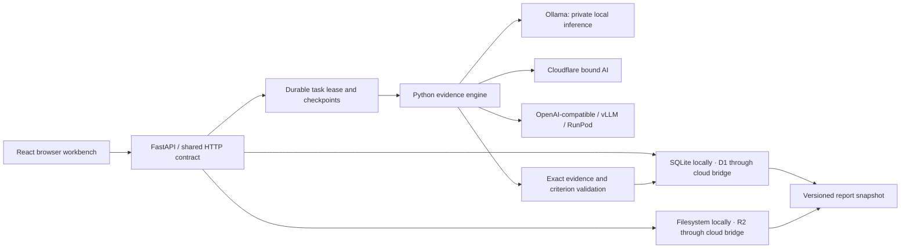

# Architecture and implementation boundaries

DOXA has one analysis implementation in Python. The HTTP adapter and cloud router arrange durable work; neither duplicates the interpretation pipeline. The reference deployment is a single private workspace, not a multi-tenant service.

## Source and analysis records

- Projects contain imported batches and documents. Originals and extracted blocks are artifacts, rather than large metadata rows. Content hashes identify exact duplicates; corrected metadata does not change source text.
- Extracted blocks have stable identities, exact text, and a page or paragraph locator. Offsets are Unicode code points, inclusive start and exclusive end. Browser code uses code-point-aware slicing.
- A run freezes the inquiry, reviewer perspective, lens versions, source digests, model profile, prompt version, generation settings, and budget. Hosted providers may not expose an immutable weight revision; this remains explicitly unresolved.
- Tasks contain bounded source ranges, leases, attempt records, results, coverage, and usage. A lease owner must still be current when committing. Findings have run-scoped identities; replay cannot duplicate counts.
- Human review is a separate append-only audit. Retrying a partial result preserves reviewer decisions. Report snapshots are immutable exports of a specified run and filter state.

## Processing and scale

Uploads use 8 MiB parts up to 500 MiB per file. Extraction runs in a subprocess with a memory/CPU/time limit and an environment that omits inference and storage credentials. Optional OCR requires local, prefetched artifacts; no source URL or HTML image is fetched by parsing.

Every supplied source block receives an outcome. Adjacent windows are packed while preserving each original locator. The laptop profile uses an explicit 8K context; the managed Gemma profile uses a bounded 32K context. Context and output limits cause smaller continuations or visible incomplete coverage, never silent truncation.

Local jobs use SQLite leases. In cloud mode, Queues calls a named Python Container synchronously for one bounded task and acknowledges only after durable work commits. D1/R2 remain authoritative when a container sleeps. A recovery cron re-enqueues stranded dispatches. The first cloud deployment uses one container; model endpoints can scale separately.

Request reservations atomically check run and monthly budgets. Settlements are idempotent; an interrupted remote request can have uncertain billing, conservatively recorded against its reserved maximum. Vendor invoices, storage and platform charges remain distinct from token-rate estimates.

## Interfaces

The API is inspectable at `/docs` and `/openapi.json`. Core finding models live in `doxa/models.py`; dynamic response schemas additionally constrain the requested block, lens, and criterion IDs. Provider construction, health, generation, usage and provenance are separate from analysis. `doxa/connectors.py` defines a streaming collection boundary for future authenticated sources.

Browser requests cannot configure inference URLs or send provider secrets. Endpoint URLs and credentials belong in server environment variables. Cloud Access JWTs protect browser routes; scoped service authentication protects SQL, R2 and bound-AI bridges. The Worker checks the browser origin before forwarding to the authenticated container.

## Deliberate v1 boundaries

English research preview, batch comparisons, private workspaces, explicit model selection and manual review. No demographic audience simulator, automatic author-identity inference, universal prejudice score, silent model fallback, connector credential UI or fine-tuning interface. Future training requires independently reviewed annotations, source-separated evaluation and a measured improvement over the frozen baseline.
