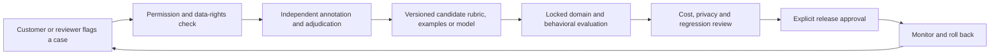
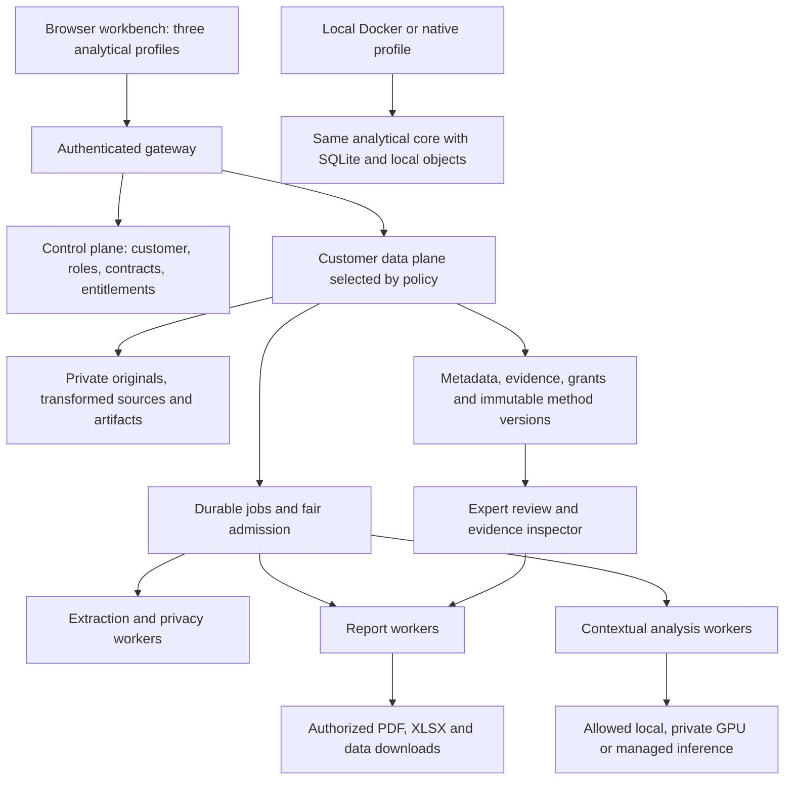

# DOXA by TACITUS: commercial service roadmap

**Research and repository review: 17 November 2026. Status: proposed work, not implemented service capabilities.**

**Implementation update:** [v0.5's native pilot foundation](managed-pilots-v05.md) now implements three inquiry profiles, individual access/project grants, selected writing and mail intake, source pseudonymization with encrypted maps, privacy-policy enforcement, live-project erasure, expanded annotation forms and [guided reports](pilot-reports-v05.md). The audit below records the original v0.4 baseline. The full commercial milestones remain open: independent interpretation evaluation, qualified customer delivery, real OAuth connectors, billing, shared tenancy and production scale/residency qualification are still required.

DOXA's commercial promise is **Bias Detection as a Service: evidence-led analysis of language, framing and change**. Customers should be able to ask a useful question, authorize a bounded collection, understand the method and price, inspect the findings, and receive a report they can substantiate.

The founder confirmed three decisions on 17 November 2026:

- **Launch company language audits, political/media analysis and personal email review together.** Each is a separate analytical profile on one platform, with its own evidence requirements and evaluation.
- **Start with guided paid pilots and expert-reviewed reports**, then introduce self-service subscriptions.
- **Launch in the United States first**, then expand internationally with separate legal, language and hosting readiness gates.

The launch is a managed analytical service using a portable engine. It is not an immediate promise of unrestricted mailbox access, million-document throughput or an academically certified universal bias score. The plan below retains local operation and builds toward subscriptions and larger installations.

## 1. What exists, and what prevents commercial launch

The audited baseline is v0.4, commit `43d92194f074e56873562c26f39e027f8589c6de`. See the [system card](model-card.md), [evaluation status](evaluation-v04.md), [verification record](verification-v04.md) and [deployment contract](deployment.md).

| Area | Existing evidence | Work needed before the corresponding commercial claim |
| --- | --- | --- |
| Evidence engine | Versioned sources, exact spans, distinct criterion outcomes, context, casebooks and reproducible reports | Validate that interpretations, attribution and explanations are correct for each sold use case |
| Demonstration scale | 5,000 real Global Voices articles; 204,342 retained decisions; 79 unresolved decisions | Independent reference labels; additional publishers and company/email data; representative production load measurements |
| Human evaluation | Prepared 200-case news review pack and 120 authored functional fixtures | Actual independent annotations and adjudication; execute model tests; expand annotation schema and domains |
| Customer isolation | One private deployment; projects are folders inside a shared workspace | Separate customer installations for pilots; trusted user identity, roles and grants; subsequently tested SaaS tenant isolation |
| Privacy | Explicit remote-inference consent; bounded local request journals | Pseudonymization, identity vault, retention, complete derivative erasure, customer-specific destinations and access policy |
| Connectors | Generic source/checkpoint interface | Actual OAuth adapters, encrypted tokens, incremental synchronization, source permissions, revocation and deletion propagation |
| Email | General document extraction | EML/MBOX ingestion, thread reconstruction, sender/quotation attribution, attachment boundaries and mail-specific evaluation |
| Models | Local/managed providers, CPU retrieval and NLI experiments | Domain validation, commercial-license inventory, calibrated routing, reproducible model revisions and measured operating cost |
| Operations | Durable jobs, retries, resumable downloads and correctness tests | Fair scheduling, observability, recovery drills, security review, support processes and load-tested limits |
| Revenue | Application-level inference budget accounting | Customer contracts, prices, payment collection, entitlements, usage ledger, margins and renewal evidence |

**The principal scientific gap is interpretation validity.** Exact quotations establish where text came from; software tests establish implementation behavior. Neither establishes whether a prejudice criterion applies or whether a communication will be perceived in a particular way. The existing news collection is from one publisher and cannot validate company or email interpretations.

**The principal service gap is isolation and lifecycle control.** Cloudflare currently admits users to one shared workspace, forwards a shared service credential, and uses an operator-configured reviewer identity. Document deletion does not erase every derived assessment, review, casebook, report, index, memory example, journal or backup. These are concrete engineering gaps, not deployment settings customers can safely infer.

## 2. Three launch packages on one platform

| Package | Initial buyer and question | Guided-pilot deliverable | Initial boundary |
| --- | --- | --- | --- |
| **DOXA Company** | Communications, governance and research teams: “How does our authorized company language vary across channels and time?” | Reviewed organizational briefing; patterns by document type, channel and period; evidence appendix; coverage and uncertainty; optional policy alignment | Authorized uploads first; aggregate analysis by default; no employee league tables or inferred private beliefs |
| **DOXA Public** | Researchers, public-affairs teams and institutions: “How do comparable sources frame the same issue?” | Matched-cohort framing report; source/voice representation; stance toward declared propositions; trajectories; competing interpretations | Licensed public sources; comparison scope stated; no factuality or omission verdict from an isolated document |
| **DOXA Personal** | Individuals and small professional teams: “How might my selected writing be read?” | Private annotated writing/thread report covering directness, clarity, requests, hedging and possible ambiguity; user goal and audience retained | Pasted text or selected uploaded threads; transient option; assess language, not a person's inner emotional state |

All three must be available in the first paid-pilot release. A profile that has not met its interpretation gate remains an explicitly expert-led assessment; it must not borrow accuracy claims from another profile. Paid expert review itself needs qualified reviewers, scope, consent to access selected material and recorded sign-off.

Where appropriate to the authorized question, packages can include separately declared antisemitism, anti-Muslim hostility, other prejudice and political-framing lenses. A broad request such as “political correctness” must become explicit, reviewable criteria and a stated perspective; it is not a self-explanatory scientific label. Frameworks validated on public news do not automatically transfer to private conversation.

### One-page customer workflow

Keep the existing linked workbench and progressively disclose technical detail:

1. **Question and audience:** choose package, analysis goal, language, declared framework and intended report reader. Translate “persona” into an explicit analytical perspective and communication context, not a simulated demographic identity.
2. **Sources and permissions:** upload or choose an authorized connector scope; show dates, owners, extraction quality and excluded material.
3. **Privacy and destination:** choose original or pseudonymized processing, preview substitutions, see where inference will run, choose retention and who can reveal identities.
4. **Estimate and scope:** show word/token/page estimates, selected criteria, OCR needs, expected completeness, customer price cap and a clearly bounded pilot statement of work.
5. **Analyze and review:** persistent progress, pause/cancel/retry, exact context, unresolved work and expert review queue.
6. **Results:** linked overview, timelines, comparisons and evidence inspector; every statistic opens its underlying eligible cases.
7. **Report and lifecycle:** downloadable briefing and data annex, review status, method card, invoice/usage, retention date and erase controls.

Supporting methodology, pricing, security, help and account pages can sit outside the one-page analytical workbench. Preserve accessible keyboard navigation, meaningful empty/error states, non-color status indicators and usable small-screen evidence inspection. The existing 8-bit Quest remains an optional explainer; the professional workspace and reports use the established readable design.

## 3. A methodology that can support paid work

### Separate what is being measured

The method registry must distinguish constructs rather than collapse them into “bias.” Measurement assumptions are part of the product contract; [Jacobs and Wallach's measurement framework](https://arxiv.org/abs/1912.05511) provides a foundation for examining whether an operational measure represents its intended construct.

| Construct | Evidence and output | Interpretation limit |
| --- | --- | --- |
| Linguistic form and pragmatics | Directness, qualification, requests, commitments, address forms and reader-perceived tone, with passages and context | A direct request is not automatically rude; a tone label is not proof of emotion or intent |
| Target-specific stance | Expressed support, opposition or uncertainty toward a stated proposition; speaker and document stance separated | Topic mention or source identity does not establish stance or personal political identity |
| Framing and rhetoric | Problem definitions, causal attributions, value appeals, policy frames and foregrounded actors | A frame's presence alone does not establish prejudice, deception or factual error |
| Framework-specific prejudice | Criterion, target, attribution, endorsement, context, alternatives and outcome under the named framework | IHRA, Jerusalem Declaration, Nexus and other lenses retain their different definitions and boundary conditions |
| Organizational policy alignment | Passage compared with a versioned, customer-supplied policy | Alignment is specific to that policy; it is not a legal compliance certification |
| Comparative asymmetry or omission | Matched events/opportunities, declared comparator and evidence of relevant coverage differences | Absence in one source is not proof of deliberate suppression |
| Trajectories and spikes | Rates with eligible denominators, collection completeness, topic/channel mix, method version and uncertainty | A spike is a review candidate; it does not establish an event's cause or individual culpability |

Use [politeness research](https://aclanthology.org/P13-1025/) for context-sensitive communication features, the [Media Frames Corpus](https://aclanthology.org/P15-2072/) for explicit frame annotation, and [BASIL](https://aclanthology.org/D19-1664/) for the distinction between lexical and informational bias. Their tasks and corpora are research foundations, not validation of DOXA or blanket licenses to reuse their underlying texts commercially.

### Required analysis record

Extend existing frozen methods and outcomes rather than replace historical results. A new assessment profile must record:

- Construct, criterion and rubric version; intended use and excluded interpretations; language and domain; selected perspective and customer policy where applicable.
- Source revision, original/transformed text identity, exact evidence spans and independently assessable surrounding context.
- Target entity and explicit proposition; attributed speaker; nested reporting chain; quoted/reported/endorsed/condemned/hypothetical role; document stance.
- Categorical criterion outcome: criterion met, criterion not met, not applicable, or uncertain. **Unprocessed work is a separate execution state**, never silently a negative. Tone/perception instruments instead retain their specified ordinal or continuous scale, perspective and individual reader-rating distribution; do not force them into the prejudice outcome taxonomy.
- Evidence sufficiency, context sufficiency, alternative readings, disagreement, calibration status and reviewer provenance.
- Model/artifact revision or explicitly unresolved provider identity; prompt/schema/memory versions; extraction and transformation versions; processing coverage.

Human annotation needs structured target/proposition, reporting chain and evidence-span fields in addition to the current category/stance/adequacy forms. Reviewer notes alone cannot quantify these components reliably.

### Context before scoring

Preserve section/document context and messages' conversational order. Identify new authored text, quotations, forwards, signatures, disclaimers, recipients and attachments separately. Deduplicate repeated quoted material without losing the fact that a later sender selected or commented on it. Do not attribute reported abuse to the reporter automatically. A thread with missing replies or uncertain participants receives an explicit context warning.

For political comparisons, freeze event/topic/time/source eligibility and the comparison rationale before interpreting differences. Offer within-source trends, matched-event comparisons and source-mix-adjusted summaries separately. Publish raw counts alongside normalized rates. Historical and translated material retain their historical/translation context.

Pilot monitoring provides descriptive trajectories and human-reviewed change notes. Before offering inferential spike alerts, preregister time bins, baseline, minimum eligible counts, collection coverage, source-composition checks and the multiplicity/sequential-testing policy; test false-alert rates and sensitivity prospectively and under declared simulations. A dashboard label such as “significant spike” stays disabled until that gate passes.

For organizational aggregates, suppress small contributor groups by default: at least 10 distinct contributors and 20 eligible items per displayed cell. Apply complementary suppression and restrictions on differencing across filters; these are disclosure controls, **not a claim of formal anonymization or differential privacy**. Named author views require a separate authorized purpose and permission; public attributed bylines and a person's own writing are different contexts.

### Independent evaluation program

1. **Finish the existing news protocol** using two genuinely independent, model-blind reviewers and a third adjudicator. Retain initial disagreements and multiple defensible outcomes. Public parent outputs mean the existing held-out pack is not secret; record exposure.
2. **Build three new domain panels**, initially 1,000 independently sampled source/thread clusters per package, with one primary contextual case per cluster and optional separately reported supplemental units. Obtain explicit rights for private material. Use multiple organizations/authors/source families; include natural negatives and hard cases. This is a collection target, not adequate sample size for every rare criterion.
3. Before model tuning, split each panel 40% development, 20% calibration and 40% locked test by company, thread/story and near-duplicate groups. Prevent company/thread leakage; add later temporal/customer holdouts. Record any unavoidable limits on organization diversity.
4. Two trained reviewers label all panel cases independently, with adjudication and rationale. Supplement communication-perception work with at least three reader ratings per selected item; preserve their distribution instead of treating one reader as universal truth. Establish reviewer qualifications and compensation; separate annotation from sales ownership.
5. Keep a probability sample for population rate/error estimates and a separately reported enriched diagnostic sample for rare positives and boundary cases. Record inclusion probabilities; never report an enriched positive rate as corpus prevalence.
6. Audit extraction, evidence spans, speaker/target/proposition, framework outcomes, abstention and report summaries separately. Include per-criterion precision/recall, false attribution, false accusations, coverage, uncertainty, reviewer agreement and confidence intervals clustered by source/thread and, where relevant, organization, publisher or event. Record independent organization/source-family counts: 400 threads from one company do not establish performance across 400 companies. Calibrate only on calibration data; test under domain and time shift.
7. Execute the 120 existing functional fixtures after rubric review; add threading, quoting, negation, counterspeech, satire, translation, dialect, OCR, PII leakage and source-instruction tests. [HateCheck](https://aclanthology.org/2021.acl-long.4/) informs behavioral testing; [Sap et al.](https://aclanthology.org/P19-1163/) motivate explicit dialect/error analysis. Identity substitutions need semantic review because context can legitimately change an interpretation.
8. Preregister outcome definitions, error severity, confidence methods, sample/stopping rules and release gates. Do not repeatedly inspect a locked test and keep tuning against it. New versions need fresh confirmatory data or an explicitly limited reused-test claim.

**Proposed release policy:** guided reports require expert verification of every substantive highlighted claim and quotation; publish sampling scope and review coverage. A self-service criterion may use the label “supported finding” only after a locked domain test has a one-sided 95% lower confidence bound of at least 0.95 for precision of that label, with at least 100 independently reviewed predicted-positive cases from the intended distribution, plus separately published recall and abstention. Use the one-sided exact binomial bound only when the independent-case design supports it; otherwise use the preregistered cluster-aware procedure. Do not manufacture this denominator by counting many correlated spans in one thread as independent. If the gate is unmet, keep the label experimental/review-required. These thresholds are product decisions, not academic consensus or achieved performance. Reputational allegations and comparative omission conclusions retain human sign-off even when a screening criterion passes.

For marketed automated **detection**, require a predeclared task-specific recall and decision-coverage gate as well. Initial beta defaults are a one-sided 95% recall lower bound of at least 0.80 and at least 80% non-abstained decision coverage of the preregistered eligible criterion-unit population; extraction failures and uncertainty remain in the disclosed denominators. More consequential tasks can require stricter gates. A high-precision discovery mode that misses these floors must be named and sold as selective discovery, with its measured coverage, rather than full detection. Numerical gates cannot be lowered after reading the test results to turn a failure into a pass.

Tone reports have a different target: perceived readings under a stated context, not an objective positive/negative truth. Evaluate usefulness, context adequacy and reader-rating distributions separately. If optional rewriting is later introduced, test facts, commitments, dates, amounts and intended firmness independently; require a one-sided 95% upper bound below 1% for consequential meaning changes on representative independent cases. Zero such errors in 299 cases narrowly meets that particular binomial bound; it does not prove absence of other errors.

No gate permits unsupported “bias-free,” “neutral,” “99% accurate,” or human-equivalent claims. [Davani et al.](https://aclanthology.org/2022.tacl-1.6/) supports retaining meaningful annotation disagreement. [NIST's generative AI risk profile](https://doi.org/10.6028/NIST.AI.600-1) informs evaluation and monitoring; using it is not NIST certification.

### Supervised improvement, not model self-endorsement

Model disagreements prioritize review; model agreement is not a reference label. Customer corrections affect that customer's workspace first. No cross-customer learning or training on private/API-connected data by default. Fine-tuning requires a documented legal basis, permitted data/model licenses, approved training corpus, independent holdout, change record and rollback. Compare rubric repair, retrieval examples and task-specific training; promote only the candidate with demonstrated benefits for its intended task.

## 4. Privacy, models and service architecture

### Optional identity handling

Offer three explicit modes: authorized originals, pseudonymized analysis, and transient selected-text review. Reversible placeholders are **pseudonymization**, not guaranteed anonymity.

Combine deterministic recognizers, customer dictionaries and a validated PII model. Offer two explicitly different boundaries: optional customer-device/local processing with preview **before upload to DOXA**, and regional server-side processing with preview **before transfer to an inference provider**. The latter has already uploaded originals to DOXA and must say so. Cover names, emails, IDs, URLs, filenames, headers, metadata, quotations and attachment text. Use stable placeholders within the approved workspace/context; store reversible maps separately encrypted with reveal-specific grants and audit events. Preserve original-to-transformed span mappings. Reports must clearly distinguish transformed quotations from unchanged originals.

Evaluate missed identifiers, excessive masking and analytical distortion. Removing identity terms can remove evidence needed to apply a prejudice criterion; the user must see that tradeoff. A passed PII benchmark does not guarantee de-identification of all future text. A browser interface connected to a local Python/model server is local operation; it should not be marketed as entirely in-browser inference.

Pilot defaults: no raw text in operational logs; metadata-only request journals; private source/report storage; 30-day raw and derived retention after final delivery unless the contract chooses a shorter period; backup expiry disclosed and capped at 35 days after live erasure; no identity reveal for report viewers by default. Implement and test these defaults before advertising them. Transient personal processing must state whether memory, local disk, provider retention and crash recovery retain anything; the “no save” mode must not create durable source or report artifacts.

Erasure must inventory and remove live originals, extracted units, transformations/maps, indexes, assessments, examples, casebooks, reports and request captures, cancel dependent jobs, and leave a text-free deletion receipt. Restores must reapply deletion tombstones before serving data. Immutable evidence history cannot override contracted deletion. Disclose that already-downloaded customer copies cannot be remotely erased.

### Model candidates and licensing gates

Models are task-specific components, not interchangeable bias detectors. Pin artifact revisions, licenses, upstream artifacts, tokenizer/quantization, supported inputs and measured resources. Repository license declarations are not a complete legal chain-of-title audit.

| Role | Candidate or current capability | Commercial planning decision |
| --- | --- | --- |
| Retrieval | Existing MiniLM passage index | Preserve CPU option; evaluate retrieval relevance and permissions; similarity is not prejudice |
| PII detection | [Gretel GLiNER small](https://huggingface.co/gretelai/gretel-gliner-bi-small-v1.0), declared Apache 2.0 | Benchmark on realistic headers, documents and threads; combine with rules and preview; synthetic-card metrics do not prove field recall |
| Contextual interpretation | Existing Qwen/Ollama and managed provider adapters | Compare pinned profiles on new panels; use local CPU for bounded jobs and private/managed GPU inference for sustained volume |
| NLI | Existing DeBERTa hypothesis scoring | Research feature; entailment scores remain uncalibrated for DOXA criteria until domain validation |
| Pragmatic-task challenger | [GLiClass small](https://huggingface.co/knowledgator/gliclass-small-v1.0/blob/21edefaf7951f68c68c505f9139ba536d3b448f7/README.md), declared Apache 2.0 | Compare against the existing DeBERTa for explicit requests/commitments and multiple labels per pass; synthetic training does not establish company-email accuracy or CPU throughput |
| Text-expressed affect cues | [SamLowe GoEmotions RoBERTa](https://huggingface.co/SamLowe/roberta-base-go_emotions), declared MIT, optional ONNX INT8 artifact | Experimental auxiliary feature only; [GoEmotions](https://aclanthology.org/2020.acl-main.372/) labels perceived writer-expressed emotion, not recipient reactions or a person's actual emotional state |
| Formality research baseline | [s-nlp formality ranker](https://huggingface.co/s-nlp/roberta-base-formality-ranker), CC BY-NC-SA 4.0 | Exclude from paid default without separate commercial permission; seek permitted alternatives or train on cleared data |
| Lexical media-bias research baseline | [Pinned RoBERTa lexical card](https://huggingface.co/mediabiasgroup/roberta-anno-lexical-ft/raw/55191cb305c07c8f5ae52648b03835709e4b95d5/README.md), CC BY-NC 4.0 | Exclude from paid default without permission; do not extrapolate lexical bias to political identity, factuality or omission |

The [pinned Piiranha PII card](https://huggingface.co/iiiorg/piiranha-v1-detect-personal-information/blob/255acde67a2f34cf452eb42e365b24d2957352fc/README.md) declares CC BY-NC-ND 4.0; exclude this artifact from paid defaults without appropriate permission. A model's name, download count or a permissive runtime library does not establish commercially usable weights. For future small-task adaptation, compare regularized classifiers on frozen embeddings and [SetFit](https://huggingface.co/docs/setfit/en/conceptual_guides/setfit) learning curves using cleared, independently reviewed examples before attempting a large fine-tune.

Start with a measured cascade: validate extraction → identify language/domain → retrieve relevant context → apply the requested rubric → route uncertainty, disagreement and review samples to deeper analysis → expert review for delivered claims. A cheap screen may prioritize work; it must not silently exclude text from a promised full-corpus assessment. Report screened, deeply assessed, human-reviewed and unresolved denominators separately; audit random screen negatives to estimate misses.

The [actual local study](local-study-v04.md) found substantial structured-output failures and very limited document completion on bounded CPU runs. Local availability is demonstrated; fast complete large-corpus CPU analysis is not. Measure CPU, Apple silicon and declared GPU profiles under repeatable conditions before publishing speed/cost claims. Benchmark vLLM batching, prefix caching and constrained output against actual prompts; adopt only when output parity, privacy boundaries and net cost improve. Cache identity includes tenant, source, transform, method, model revision and approved memory; never share private prompt caches between customers.

**Dependency clearance is also a launch gate.** DOXA code is Apache 2.0, but the current PDF dependency [PyMuPDF has AGPL/commercial licensing](https://pymupdf.readthedocs.io/en/latest/about.html#license-and-copyright). Choose a compliant distribution/service arrangement, obtain a commercial license, or replace it with a compatible cleared extractor after extraction regression testing. Produce an SBOM and separate code, model, dataset and corpus-rights inventories. Changing extractors creates a new source-text version; never silently recompute historical quotation offsets.

### Deployment path

**Guided pilot:** one isolated US customer data deployment per organization, with separate stores, secrets, model policy and backups. Default sensitive pilot processing to the existing native Docker profile on a dedicated US-region VM with encrypted persistent storage and private US-region object backups; SQLite and one bounded worker remain installation-local. Do not place the native database on ephemeral container disk. Add verified individual identity and project grants before team access; Cloudflare Access membership alone does not provide these roles. Personal accounts receive a separate personal tenant/workspace by default; an employer's billing or administrator status grants no access to personal writing. Expert access is explicitly authorized for selected cases and expires with that review. Keep a small control plane free of raw content; use invoice/payment-link collection and manual provisioning initially.

**Subscription service:** retain React and the Python analytical core. Add managed US PostgreSQL with tenant-scoped repositories and row-level security; private object storage; durable, checkpointed workers; and a managed OIDC identity provider. Default the shared-service data plane to GCP `us-central1`, using Cloud Run/Jobs, Cloud SQL and Cloud Storage, subject to service/quota and procurement verification before provisioning. Use non-owner, `NOBYPASSRLS` runtime roles and transaction-local tenant context for requests and background jobs; [PostgreSQL RLS](https://www.postgresql.org/docs/current/ddl-rowsecurity.html) is defense in depth, not a substitute for endpoint and worker authorization. Use a transactional job/outbox design and bounded dispatch rather than treating an HTTP request as a durable job. A small deployment can be cheaper than a distributed stack at pilot volume; compare measured total cost before migration.

Cloudflare can host public UI and control-plane routing. For a contract requiring US-only content processing, direct uploads, sensitive API calls and downloads to authenticated regional endpoints or a separately verified regional gateway; do not pass content through an unqualified global control plane. Keep payment payloads and customer metadata out of content processing paths where unnecessary. Failover to another region requires an approved policy and tested recovery path.

Preserve the existing D1/R2/container profile as a documented private-workspace option. It is not the default shared SaaS database. Current `pool-0`/single-consumer routing must not be sold as independently measured 100,000- or million-document cloud capacity. The [Cloud Run GPU job documentation](https://docs.cloud.google.com/run/docs/configuring/jobs/gpu) establishes supported infrastructure, not DOXA performance or guaranteed capacity. Runpod and other endpoints remain optional only after region, retention, contractual and cost review.

A data region label must cover originals, derivatives, databases, queues, inference, logs, support access and backups. Regional compute alone is insufficient. Before international launch, introduce a separately assessed regional cell and reassess transfers, subprocessors, employment uses, local laws and native-language performance. Do not relabel a US service “EU resident” by changing one bucket or container setting.

### Public contracts and migration

Add versioned service boundaries for `Principal`, `Tenant`, `Membership`, `ProjectGrant`, `PrivacyPolicy`, `Artifact`, `TransformVersion`, `Connection`, `SyncCursor`, `RemoteObjectVersion`, `DeletionTombstone`, `Entitlement`, `CostEstimate`, `UsageEvent` and `CreditReservation`. Use separate role permissions for source reading, identity reveal, expert annotation, export and billing. An analyst role alone must not grant every capability.

New tenant-scoped endpoints cover connections/sync jobs, privacy previews/transforms/erase jobs, estimates/analysis jobs, reports and usage. Require idempotency keys for paid job submission and durable billing events. Derive tenant and user authority from verified server claims and grants; a browser-supplied tenant ID is not authorization. Long work returns a persistent job resource with progress, terminal coverage and download links.

Migrate each legacy workspace into one explicitly selected tenant. Preserve historical source/result bytes, hashes and analytical identities through tenant-scoped aliases. Do not infer ownership from names, rewrite frozen runs, or silently combine private examples. Test database **and object** backup/restore, migration rollback, report compatibility and the installed local wheel before cutover.

### Connectors, in order

1. **Pilot uploads:** TXT/PDF/DOCX/HTML plus new EML and MBOX import; pasted personal text. Selected uploads avoid broad mailbox authorization but still require appropriate rights and privacy handling.
2. **First subscription connectors:** selected SharePoint/OneDrive files using [Selected permissions and resource grants](https://learn.microsoft.com/en-us/graph/permissions-selected-overview), and Google Drive Picker-selected files with [`drive.file`](https://developers.google.com/workspace/drive/api/guides/api-specific-auth). Add Microsoft 365 delegated read-only mail, with an application-side selected-folder scope and a clear disclosure that the OAuth grant itself can be broader than that selection. Add Gmail selected-message interaction for Personal subject to the approved integration design. No send/delete permission is needed for analysis.
3. **Continuous organizational collection:** Gmail/Workspace and broader Drive scopes, then Slack/Teams, based on signed pilot demand and security approval. Whole-mailbox access is a separate scope and readiness gate, not automatic enrollment when a user signs in. Qualify Slack's [commercial distribution and history/replies limits](https://docs.slack.dev/changelog/2025/05/29/rate-limit-changes-for-non-marketplace-apps/) before promising historical backfill throughput.

Every adapter needs encrypted per-owner credentials, refresh/revocation, cursor recovery, source revision IDs, permission snapshots, tombstones and provenance. Preserve thread and sender identity through approved pseudonyms. ACL removal must prevent retrieval/export immediately; derivative erasure follows policy. Revalidate access at download, not only at import. Test expiring subscriptions, stale cursors, rate limits, webhook duplication, missed events and full resynchronization.

[Google's Gmail scopes](https://developers.google.com/workspace/gmail/api/auth/scopes) classify full-mailbox read access as restricted and require a security assessment when restricted data is stored or transmitted by servers, subject to applicable exceptions. [Workspace policy](https://developers.google.com/workspace/workspace-api-user-data-developer-policy) also limits permitted uses, transfers and human access. Expert review of API-derived selected messages needs the required explicit agreement; do not reuse retrieved private mail to train a generalized model. [Microsoft Graph delta](https://learn.microsoft.com/en-us/graph/api/message-delta) supports incremental collection, but tokens, folder scope and removals must be handled correctly. OAuth consent is neither a universal employment-law basis nor proof that an employer can inspect every message.

Connector-specific approved uses, caching and retention rules can be stricter than the default upload policy. Frozen-report provenance does not authorize permanent copies of provider content. Resolve those terms before enabling the adapter and document what may be retained after disconnect.

## 5. Reports and dashboards customers can understand

Every report should answer: what was supplied, what question was asked, what method was applied, what was observed, what remains uncertain, and which passages substantiate the conclusion.

| Layer | Required content |
| --- | --- |
| Executive briefing | Question, collection scope, three to five reviewed observations, practical relevance, limitations and review sign-off |
| Dashboard | Sources/words/eligible units, extraction quality, outcome distributions, coverage, dates/channels and privacy-aware comparisons |
| Trajectory view | Raw counts and normalized rates, baseline/comparison interval, source mix, missingness, method changes and alert rationale |
| Commented cases | Exact source/transformed passage, surrounding context, target/proposition, speaker, rubric, alternatives, reviewer and unresolved status |
| Technical annex | Sources and rights, rubric/prompt/model versions, sampling design, validation applicability, known errors, inference destination and transformation policy |
| Data annex | XLSX plus CSV/JSONL or partitioned archive, data dictionary, stable IDs, included selection and integrity manifest |

Example report briefs for the first release:

- **Company:** compare a customer's authorized policies, public communications and selected internal messages by channel and quarter; identify whether apparent differences persist after document-type mix is considered. Include quoted third-party complaints separately from company-endorsed language. Present a policy-alignment question only against a supplied policy.
- **Public:** compare multiple publishers covering matched events, with attribution, story selection and publication time frozen. Explain why one article's quoted allegation differs from its editorial position. Frame distribution and target-specific stance remain separate from a claim of factual inaccuracy.
- **Personal:** examine a deliberately selected thread and the user's draft reply; explain a request, ambiguous reference or abrupt transition using exact text. Show multiple plausible readings. Later suggestions require a separate opt-in and must preserve the intended facts and user goal; detection/reporting works without rewriting.

Produce one fully reviewed example per package, with genuine permission to publish, plus an explicitly synthetic confidential-company/thread demo when real data cannot be shared. Synthetic examples are not evidence of field performance. Publish an accessible PDF, browser view, workbook and concise “how to read this” page. Keep the existing real-source case atlas and partial-output disclosures.

Large outputs need partitioned downloadable data rather than an unreadable million-row PDF. Make PDF briefings bounded and explicitly disclose appendix selections. Respect XLSX row/sheet limits, repeated-text expansion, temporary-disk demand and renderer deadlines. Show exclusions and shard manifests; do not quietly truncate a paid export. Separate counts of unique messages, source units and criterion decisions.

## 6. Pricing, pilots and commercial operations

**Sell a question and a substantiated deliverable.** Initial buyers should understand whether they are buying a research audit, communications analysis or private writing review. “Bias Detection as a Service” remains the umbrella; the package description states the actual task and limits.

Start with fixed-scope contracts, a delivery date, named reviewer, approved data scope, expected word/criterion volume, retention, allowed subprocessors and a customer price cap. Collect payment by invoice or hosted checkout; keep card data outside DOXA. Customer availability of a feature does not automatically make all uploaded data eligible for expert inspection.

Pricing hypotheses for US discovery, **not published prices or verified willingness to pay**:

- Company/Public guided pilot: test **$2,500–$7,500 per bounded project**, with word volume, frameworks and expert-review hours stated. Exclude extensive OCR, unrestricted connectors and custom research from the base quote.
- Personal guided pilot: recruit a small cohort and test **$49–$149 per bounded selected-text review**, with a fixed review allowance. Measure whether review/support economics justify a later subscription; do not subsidize unbounded inbox audits at a consumer price.
- Subscription discovery after pilots: test organizational platform fees plus included analysis capacity and optional expert-review credits; test Personal separately. Enterprise private deployment, SSO and contractual commitments are separately priced.

These bands are hypotheses for interviews and paid conversion tests, not a claim about competitors or a completed market study. Obtain at least two paid pilots in **each** package and record buyer problem, preparation time, report usefulness, error corrections, delivery cost, renewal intent and actual renewal/repeat purchase. Interview at least five prospective buyers per package before locking tiers.

Meter internally by actual work: input/output tokens, words and eligible units, selected criteria, OCR pages, retries, storage/retention, compute lifecycle, export work, review and support time. Document counts alone hide extreme length differences. Estimate first, reserve entitlements, stop at the agreed cap, reconcile actual usage, and make adjustment/refund policy explicit. Customer prices and internal provider costs are separate ledgers.

Track gross margin including inference, GPU cold/idle time, OCR, storage, database, network, payment fees, review and support. Record R&D/benchmarking separately from customer delivery cost. The earlier corpus inference estimate is not commercial cost of goods or a vendor invoice. Prefer a margin floor of 50% for guided delivery and a modeled 70% for software subscriptions before expanding sales; these are business targets to test, not achieved margins.

For subscriptions, add checkout/customer portal, entitlements, quotas, prepaid/contract caps, cancellation and signed idempotent billing webhooks. Preserve DOXA's own immutable usage ledger. Current [Stripe documentation](https://docs.stripe.com/billing/subscriptions/usage-based) recommends Metronome for new usage-based integrations; choose that integration only when metered billing is needed. Fixed-price pilot collection does not require building a sophisticated billing platform.

Before accepting sensitive customer material, complete US counsel review of data rights, state privacy/communications rules, employee notices and intended use; publish terms, privacy notice, DPA/service-provider terms, subprocessor list, retention/deletion policy and incident contact. Conduct a risk assessment and security review for the actual deployment. Assess CCPA/CPRA applicability rather than asserting every pilot is covered. [California's current regulation materials](https://www.cppa.ca.gov/regulations/ccpa_updates) include phased automated-decisionmaking and risk-assessment requirements; monitor changes before expanding the use case.

Keep the initial service away from automated employment selection, disciplinary decisions or individual political-belief profiling. If requested later, treat those as new products requiring legal and scientific review, not a toggle. [EEOC selection-procedure guidance](https://www.eeoc.gov/laws/guidance/employment-tests-and-selection-procedures) explains why employment uses need separate attention. Maintain a claims register linking each marketed capability and efficacy statement to measured evidence; the [FTC's Workado action](https://www.ftc.gov/news-events/news/press-releases/2025/08/ftc-approves-final-order-against-workado-llc-which-misrepresented-accuracy-its-artificial) illustrates the need for substantiation in detection-product claims.

## 7. Delivery milestones and release gates

All three packages enter the guided-pilot release together; do not sequence a later package out of that launch. Engineering and research can run in parallel, but unfinished validation is not completed by a calendar date.

| Milestone | Deliverables | Exit evidence |
| --- | --- | --- |
| **M0: scope and method** | Three package contracts/codebooks; rights and dependency inventory; reviewer protocol; price experiments; threat/data-flow model | Expert approval of each codebook; licensed evaluation collection plan; explicit customer promises and excluded uses |
| **M1: privacy-managed pilot platform** | Individual identity/roles; isolated customer deployments; transforms/vault; full erasure; EML/MBOX; estimate and capped jobs; three report templates | Security and lifecycle tests pass; experts can inspect exact original/transformed context; local mode still runs |
| **M2: validate and launch all three pilots** | Independent panels/functional tests; reviewed published examples; payment/contracts; support workflow; six or more paid pilots across the three packages | Review sign-off on every delivered substantive claim; published validation scope; measured delivery cost and customer feedback |
| **M3: self-service subscription beta** | Tested tenant control/data planes; billing/usage; initial connectors; permission-aware search/reports; 100,000-document qualification workload | Tenant/ACL isolation, billing replay, recovery and deletion pass; every automated claim meets its domain gate; repeat customer demand |
| **M4: scale and international expansion** | Regional cells; larger worker pools; million-document qualification; additional connectors/languages; approved adaptation | Measured load envelope and cost; jurisdiction/provider review; native-language independent evaluation; explicit rollback and support capacity |

Planning assumption for M0–M2: two full-time engineers, one applied NLP/methodology lead, paid independent reviewers, and fractional security/privacy/legal support. Initial effort is roughly **12–16 weeks**, to be re-estimated after codebook pilots, licensing decisions and dataset access. This is a staffing-dependent estimate, not a delivery commitment. OAuth verification, customer procurement and annotation availability can be critical paths. A single engineer should narrow throughput and automation promises rather than pretend the same schedule is credible.

### Test and qualification matrix

| Test family | Required scenarios and acceptance |
| --- | --- |
| Interpretation | Blind domain tests; quote/endorsement, target/proposition, negation, counterspeech, satire, dialect, framing/comparator and thread context; publish denominators, uncertainty and known failures |
| Extraction | Licensed clean/scanned/mixed PDFs, tables, headings, Unicode, mail charsets/HTML, corrupt/encrypted files, huge attachments; source units and exclusions auditable; no silent loss |
| Privacy transforms | Repeated identities, aliases, headers, paths, signatures, URLs, contextual re-identification, multilingual identifiers and masked evidence; preview and span mapping verified; no guaranteed-anonymity claim |
| Tenant and user security | Adversarial reads/writes/search/jobs/caches/indexes/report ranges/identity reveal across tenants and project grants; no unauthorized access in the tested matrix; independent penetration review before self-service |
| Untrusted inputs | Parser isolation, archive bombs/path traversal, malicious HTML, prompt injection, SSRF/egress, spreadsheet formulas and report injection; models cannot execute document instructions or retrieve unauthorized sources |
| Lifecycle | Erase while importing/running/reporting; all derivative stores and maps inventoried; tombstones survive restore; disclosed backup expiry; exported-copy limitation visible |
| Connectors | Minimal scopes, explicit selection, refresh/revocation, changed ACLs, deletes, duplicate webhooks, rate limits, lost cursor/history and full resync; no duplicate billing or stale unauthorized retrieval |
| Paid execution | Estimate/reservation, hard customer cap, provider errors, retries, cancellation and partial results; signed duplicate/out-of-order payment events; usage/customer/provider reconciliation |
| Reliability | Queue redelivery, worker death/cold start, expired leases, object/database faults, partial upload, full disk, migration rollback and restore; committed work resumable and incomplete work visible |
| UI/report quality | Guided first-run task, keyboard/screen-reader paths, mobile context, privacy preview, disclosure comprehension, evidence-to-chart navigation and downloaded PDF/XLSX inspection; all headline claims trace to eligible records |
| Local portability | Fresh Docker and wheel install, no credentials, no network/model auto-download, offline recorded examples, bounded CPU profile and local retention/erase controls |
| Scale and economics | Qualify 10,000-document isolated pilots, then 100,000 and 1,000,000 source records with declared word/page/criterion distributions; separate replay/load tests from real inference and reviewed quality |

For each scale tier record concurrency, tenants, source sizes, tokens/criteria, completed/partial/failed counts, queue age, throughput, p50/p95 interactive latency, peak memory/disk, recovery time and total cost. At M3, target p95 under two seconds for bounded dashboard/filter APIs on the qualification workload, no lost committed work under tested worker/process failures, and no duplicate customer debit under injected retries. Separately, target a tested disaster-restore objective of RPO 24 hours/RTO 8 hours; this permits loss within the backup window and requires explicit disclosure and billing/job reconciliation. These become external service commitments only after repeatable staging and operational evidence. Never extrapolate a fast replay to fresh model inference.

Public release artifacts should include a versioned method handbook, annotation instructions and schema, benchmark manifests/licensing, task/domain model cards, validation report, evaluated model profiles, security/data-flow overview, three commented example reports, cost-study assumptions, failure catalog and a concise customer FAQ. Publish only approved public or synthetic data; keep private pilot corpora, tokens and identity maps out of GitHub.

## 8. How to judge whether DOXA is ready to grow

Growth requires four kinds of evidence together: independent support for the advertised interpretations, controlled handling of customer information, reliable delivery inside an observed resource envelope, and customers who pay and return. Adding another model or connector cannot substitute for any of them.

Maintain a release scorecard with per-package validation, privacy/security gates, successful paid deliveries, repeat purchase, support/review hours, gross margin, connector authorization status and measured processing limits. Every changed rubric, model, extraction method or privacy transformation must state whether prior validation still applies. Extend the [refinement roadmap](refinement-roadmap.md) with observed failures; keep exploratory ideas separate from capabilities customers can buy.

## 9. Additional primary research for the method handbook

These sources expand the existing [v0.4 research map](v04-research-map.json). A citation is a rationale for a method choice, not evidence that DOXA has reproduced the study or inherited its validity. Dataset/component rights must be checked independently before bundling or training.

| Source | Application to DOXA | Boundary to preserve |
| --- | --- | --- |
| [Cohen et al., 2004: Learning to Classify Email into “Speech Acts”](https://aclanthology.org/W04-3240/) | Annotate observable requests, proposals and commitments | An expressed act does not reveal a private motive |
| [Danescu-Niculescu-Mizil et al., 2013: Computational Politeness](https://aclanthology.org/P13-1025/) | Context-sensitive request markers and multiple reader ratings | Request politeness and extreme-quartile classifiers are not general workplace civility scores |
| [Kruger et al., 2005: Egocentrism over E-mail](https://doi.org/10.1037/0022-3514.89.6.925) | Distinguish intended tone from reader interpretations | Experimental findings do not identify a particular recipient's reaction |
| [Buechel and Hahn, 2017: EmoBank](https://aclanthology.org/E17-2092/) | Declare annotation perspective and retain rating variation | Third-party “writer” judgments are not self-reported emotional states |
| [Pavlopoulos et al., 2020: Toxicity Detection: Does Context Really Matter?](https://aclanthology.org/2020.acl-main.396/) | Test context selection and missing-context errors explicitly | More supplied context is not automatically a better model |
| [Sap et al., 2019: Racial Bias in Hate Speech Detection](https://aclanthology.org/P19-1163/) | Audit dialect-related false positives and annotator instructions | Do not infer protected identities from writing to create audit labels |
| [Sap et al., 2022: Annotators with Attitudes](https://aclanthology.org/2022.naacl-main.431/) | Record relevant annotation perspectives and disagreement | Majority votes do not settle contested constructs universally |
| [Davani et al., 2022: Dealing with Disagreements](https://aclanthology.org/2022.tacl-1.6/) | Preserve individual reviews and defensible alternatives | Model consensus is not independent adjudication |
| [Ovadia et al., 2019: Can You Trust Your Model's Uncertainty?](https://proceedings.neurips.cc/paper_files/paper/2019/file/8558cb408c1d76621371888657d2eb1d-Paper.pdf) | Evaluate calibration under domain and time shift | In-domain confidence does not transfer automatically |
| [Srinivasan and Choi, 2022: TyDiP](https://aclanthology.org/2022.findings-emnlp.420/) | Plan native-language politeness diagnostics and translation checks | Politeness differs from formality; translated task performance does not establish native-language validity |

Potential benchmark resources: [Stanford Politeness documentation](https://convokit.cornell.edu/documentation/wiki_politeness.html) declares CC BY 4.0; [TyDiP](https://github.com/Genius1237/TyDiP) declares CC BY 4.0 data/MIT code; [EmoBank](https://github.com/JULIELab/EmoBank) declares CC BY-SA 4.0; [GoEmotions](https://huggingface.co/datasets/google-research-datasets/go_emotions) declares Apache 2.0. Preserve attribution and inspect original-source terms and privacy implications rather than treating repository metadata as exhaustive clearance. [Enron's official distribution page](https://www.cs.cmu.edu/~enron/) does not establish general commercial reuse permission; exclude it from the commercial default corpus pending a separate rights review.
