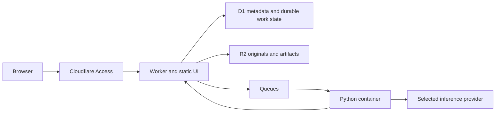

# Run DOXA locally or in the cloud

DOXA runs one Python API/worker and a static browser interface. Local state lives in SQLite and files. The Cloudflare profile uses the same Python analysis code with D1 metadata, R2 originals/checkpoints/reports, and durable Queues dispatch. Inference is a separate, explicitly selected provider. A lexical demonstration works without downloading a model; it does not perform semantic analysis.

## Local Docker

Prerequisites: Docker with Compose, at least 6 GB RAM for document processing, and additional RAM/VRAM for your chosen local model. No GPU is required to start the application.

For the full 5,000-article collection together with local model weights, retained analysis history, indexes, report exports and Docker builds, **at least 30 GB of free disk space is recommended before starting**. This is operating headroom, not a storage guarantee: an observed 32 GB execution filesystem filled during builds and export/fork work because images, build cache and SQLite WAL shared the same disk. Larger models, more versions or concurrent exports can require more. Monitor both the data volume and temporary/build storage. Preserve source documents and checkpoints; back up the data volume before removing anything, and review unused build cache or old export copies separately. An API **HTTP 507** response means storage was exhausted before a response could be generated; free space and retry the operation.

```sh
cp .env.example .env
docker compose up --build -d
```

Open <http://localhost:8000>. Load the bundled 20-document example, inspect its sources, and select a provider before starting an analysis. The app binds to localhost by default. The named `doxa-data` volume persists your documents and work; `docker compose down` preserves it. Back up this volume before upgrades. `docker compose down -v` deletes it.

Behind a corporate TLS inspection proxy, supply your organization's CA bundle as a temporary BuildKit secret: `docker build --secret id=doxa_build_ca,src=/path/to/company-ca.pem -t doxa:local .`. The build uses it for npm/pip TLS verification without copying it into the image or disabling certificate checks.

The runtime image uses a non-root user (UID 10001). If replacing the named volume with a bind mount, grant that UID read/write access to the directory. Browser downloads export copies; they do not back up the entire application state.

Base Docker builds install the platform-aware, hashed pins in `infra/requirements-runtime.lock`; Node dependencies use their committed npm lockfiles. Regenerate the Python base lock intentionally with `uv pip compile pyproject.toml --universal --python-version 3.11 --generate-hashes --output-file infra/requirements-runtime.lock`, then rerun tests and the image smoke check. OCR and development extras are separate installations and are not included in this base runtime lock.

### Local models

Native Ollama is preferred on macOS because it uses Metal. Install Ollama, start it, then explicitly download a model:

```sh
scripts/prefetch-models.sh qwen3.5:4b
```

For native DOXA, the Ollama endpoint is `http://127.0.0.1:11434`. For the Docker app with native Ollama, use `http://host.docker.internal:11434`; Compose supplies this default and the Linux host mapping. Native Ollama must listen on an interface reachable from Docker. Keep port 11434 private and use your host firewall when changing its bind address.

An optional CPU-only Ollama service is included:

```sh
DOXA_OLLAMA_BASE_URL=http://ollama:11434 docker compose --profile ollama up --build -d
docker compose --profile ollama exec ollama ollama pull qwen3.5:4b
```

Ollama is pinned to 0.40.16, the verified release on 16 November 2026. GPU passthrough is host-specific; the Compose profile does not require NVIDIA drivers. Large models and context caches need more memory than their weight file alone. Record the model digest and quantization captured by the provider health check.

### Native Python development

```sh
python -m venv .venv
.venv/bin/python -m pip install --upgrade 'pip>=26.2,<27'
.venv/bin/python -m pip install -e '.[dev]'
npm --prefix frontend ci
npm --prefix frontend run build
.venv/bin/python -m doxa.cli --host 127.0.0.1 --port 8000 --data-dir data
```

Windows: use `.venv\Scripts\python.exe`. During UI development, run `npm --prefix frontend run dev` alongside the Python server; Vite proxies `/api` to the local API.

Text PDFs, DOCX, HTML, Markdown, plain text and supported structured files use the base extractor. Scanned PDFs need the optional Docling OCR extra and prefetched OCR models; missing OCR produces an explicit extraction warning/failure and incomplete page coverage. To enable it in Docker, set **both** `DOXA_OCR=true` (install at build time) and `DOXA_ENABLE_OCR=1` (permit processing), then rebuild. Set `DOXA_DOCLING_ARTIFACTS=/models/docling` to your prefetched model directory; the named `doxa-models` volume persists it. Native installation: `pip install -e '.[ocr]'`, followed by `scripts/prefetch-ocr.sh /absolute/model/directory` and `DOXA_ENABLE_OCR=1 DOXA_DOCLING_ARTIFACTS=/absolute/model/directory`. In the OCR-enabled Docker image, explicitly run `docker compose exec app docling-tools models download --output-dir /models/docling`. DOXA does not automatically download OCR models. This processing profile limits OCR to 200 pages/file and runs extraction in a subprocess with memory/time limits. Larger scanned files must be split before OCR.

## Cloudflare private workspace

The supplied cloud profile is **one shared private workspace**. Everyone permitted by its Cloudflare Access policy can access the same projects. It is not a multi-tenant public SaaS. Deploy an isolated instance for each group that needs separate data. Provider credentials stay in server secrets and never enter the browser bundle.



The Worker verifies the Access JWT signature, issuer, audience and expiry. Trusting an email header alone is insufficient. Internal persistence/callback endpoints require a separate random service secret. Browser state changes reject cross-origin requests. The Worker strips browser credentials before forwarding to the container and injects its internal secret.

All code paths route to the single deterministic container ID `pool-0`; the queue consumer concurrency is one. The native Durable Object scheduling policy does not accept `max_instances` in Wrangler 4.163.0, so this limit is enforced by fixed routing rather than an invalid configuration field. Each work invocation has an eight-minute HTTP limit and requests a bounded checkpoint. A queue acknowledgment follows a committed HTTP 200 response; an HTTP 202 acceptance is retried. D1 tracks pending dispatch and a five-minute recovery schedule retries stale work. Exhausted dispatch attempts remain visible in D1 and the dead-letter queue for operator review.

Container disk is ephemeral. SQLite files inside the cloud container are not used as the durable database. Python uses the authenticated D1/R2 bridge; source files, task outputs and report snapshots survive container replacement. Originals up to **500 MiB** upload as **8 MiB parts**, each with recorded size/ETag, bypassing the 100 MB single-request limit. Completed originals are registered directly from their immutable R2 key. Do not use a single 500 MiB multipart form request through the Worker.

Generated artifacts larger than 32 MiB use a separate service-only multipart bridge with known-length parts of at most 8 MiB. This also supports large XLSX/JSONL files and immutable report snapshots without a single request exceeding the zone upload limit. SQL requests are bounded at 2 MiB; full-text rows are fragmented to at most 6,000 characters, and full source manifests live in R2 rather than a growing SQL configuration row.

### Provision and configure explicitly

No cloud resources are created by installing dependencies or running tests. Deployment requires an account, enabled paid services, an explicit resource setup, and your own authentication configuration. Review current charges before running the commands below.

1. Install dependencies and authenticate Wrangler: `npm --prefix infra/cloudflare ci`, then `npm --prefix infra/cloudflare exec -- wrangler login`.
2. Create a D1 database, private R2 bucket, work queue and dead-letter queue with your account's CLI or dashboard. Example CLI commands follow. Copy the resulting identifiers/names into `infra/cloudflare/wrangler.jsonc`.
3. Replace `DOXA_PUBLIC_ORIGIN` with the actual Worker/custom-domain origin. It must be reachable by its container. Replace the Access team domain and application audience.
4. Create a Cloudflare Access application and restrict it to the intended users. Protect the app's actual domain, including `workers.dev` if enabled. Ensure its policy lets the container reach `/internal/storage/*` and `/internal/inference/*` with the service secret: use narrowly scoped Access bypass applications/policies on these paths, while the Worker still verifies the secret. A blanket bypass for the entire app is unnecessary.
5. Generate a random secret of at least 32 characters, then set it interactively with `wrangler secret put DOXA_SERVICE_TOKEN`. Pass it to neither build arguments nor frontend environment variables. The Worker injects it into the container at startup. Rotate it and restart containers together.
6. Workers AI uses the Worker's **AI binding**. The container receives a private OpenAI-compatible service URL and its service secret automatically, so it needs no broad Cloudflare API credential. The proxy permits only the configured Gemma 4 / GPT-oss candidates, caps request/output sizes, disables Gemma thinking, and sets `store:false`. Model health calls check the live catalog without inference. For other providers, set the appropriate `DOXA_OPENAI_API_KEY` or `RUNPOD_API_KEY` server secret and configure the endpoint/model in the application. Adding a secret alone does not run inference. Native/local deployments can use their own scoped Cloudflare account ID/token instead.
7. Run local checks and deploy explicitly:

```sh
npm --prefix infra/cloudflare exec -- wrangler d1 create doxa
npm --prefix infra/cloudflare exec -- wrangler r2 bucket create doxa-private
npm --prefix infra/cloudflare exec -- wrangler queues create doxa-work
npm --prefix infra/cloudflare exec -- wrangler queues create doxa-work-dead
npm --prefix infra/cloudflare exec -- wrangler secret put DOXA_SERVICE_TOKEN --config infra/cloudflare/wrangler.jsonc
scripts/deploy-cloudflare.sh --check
scripts/deploy-cloudflare.sh --apply
```

The create commands are examples of explicit provisioning, not steps run by the check script. The `--apply` script applies both the shared Python schema and the infrastructure migrations to remote D1, then builds/pushes the Python image and deploys the Worker. A Docker engine is required. Resource names must match your edited configuration. Provisioning can take several minutes after first deployment.

`DOXA_WRANGLER_CONFIG` selects a separate configuration file when deploying independent installations. Keep its paths relative to that file consistent. The committed config contains placeholders and cannot be deployed successfully until edited.

### Operating and testing

Version 0.4 upgrades a native workspace to schema 4 only after creating and checking a private SQLite backup under its data directory's `backups/`. It rejects an unsupported future schema. Back up object files alongside the database before an operator upgrade; a database backup alone does not contain originals or saved report inputs.

An existing remote D1 workspace requires an operator-created backup before its first schema-4 startup. Export D1 and preserve the matching R2 objects, check the export, then add `DOXA_MIGRATION_BACKUP_RECEIPT` to the Worker's configuration with a meaningful backup identifier or immutable receipt URL. The container forwards this value to the migration guard. This value records the operator's receipt; DOXA does not claim to create or verify a production D1 backup itself. A fresh empty database initializes automatically. Configure `DOXA_REVIEWER_ID` for a trusted operator identity before remote human review; browser-supplied identities cannot elevate review records.

Report jobs persist their queue state, frozen selection, bounded compressed input parts, and verified artifacts in SQLite/files locally or D1/R2 remotely. Native startup recovers unfinished jobs. Cloud Queues dispatch typed report work, and the scheduled recovery finds queued or expired jobs; acknowledgment follows a committed checkpoint, never an acceptance response. Native capture holds a coherent SQLite read view. Remote capture rejects a workspace revision change during its bounded reads, rather than claiming a transaction across HTTP requests. A completely frozen job can restart without fresh inference or reading a changed source. Rendering runs in a cancellable child process with a bounded work deadline. Extremely large selections can exceed that deadline and must be narrowed; no production D1 capacity guarantee follows from emulator tests.

Completed artifact downloads support `HEAD`, strong SHA-256 `ETag`, conditional requests and single byte ranges. The authenticated Cloudflare route streams immutable files directly from R2. The native route streams files from disk. The historical synchronous export remains available for compatibility; the new job path does not make a bounded-memory claim for that older endpoint.

```sh
npm --prefix infra/cloudflare run types
npm --prefix infra/cloudflare run typecheck
npm --prefix infra/cloudflare test
```

Tests use the Workers runtime with emulated D1/R2, not your production account. They cover authentication rejection, transaction rollback, persistent artifacts, bounded multipart metadata, and queue acknowledgment semantics. Container/API integration additionally needs the Docker smoke test and an authenticated cloud staging run after deployment; unit tests do not establish cloud service provisioning or real inference quality.

Monitor failed run counts, stale dispatch rows, dead-letter messages, parser failures, coverage, container time, inference tokens and estimates. Configure account budgets/alerts and provider concurrency limits; application inference budgets do not cap all storage, container, subscription or networking charges. Worker Logs and Traces are sampled and omit raw source content. Periodically export/back up D1 and R2; deleting a project must remove its originals, extracted blocks, findings and exported reports. Verify deletion and backup restore before uploading sensitive production corpora.

Cloudflare's November 2026 pricing lists Workers Paid from $5/month, R2 Standard at $0.015/GB-month after its allowance with no direct egress charge, and container included allowances. The default inexpensive cloud candidate is Gemma 4 26B A4B at $0.10/M input and $0.30/M output tokens. Under the illustrative 20-document assumption of 300k input/20k output tokens, inference arithmetic is $0.036; for 15M/1M it is $1.80. These are not measured corpus completion costs. OCR, reasoning, retries, several lenses and document length change usage. Qwen3-30B-A3B on Workers AI retires 20 November 2026 and is deliberately excluded as a default.

Sources, checked 16 November 2026: [Workers pricing](https://developers.cloudflare.com/workers/platform/pricing/), [R2 pricing](https://developers.cloudflare.com/r2/pricing/), [Containers pricing](https://developers.cloudflare.com/containers/platform/pricing/), [Gemma 4](https://developers.cloudflare.com/workers-ai/models/gemma-4-26b-a4b-it/), [retirements](https://developers.cloudflare.com/changelog/post/2026-11-05-planned-model-deprecations/).

## GPU cloud and GCP alternatives

For occasional custom models, keep the web/API local or on Cloudflare and select a remote inference endpoint. Runpod Serverless flex workers can scale to zero. Set active workers to zero and maximum workers to one initially; choose hardware that fits weights plus context/KV cache, and record quantization and revisions. Pin a tested vLLM container/model rather than automatically choosing the newest package. Use the provider's OpenAI-compatible endpoint through the OpenAI provider adapter, or the configured Runpod adapter for its supported queue response contract. Always perform the health/schema check before analysis; arbitrary third-party handler envelopes are not interchangeable.

For a vLLM deployment, the operator creates a private GPU instance/container, installs the pinned model, serves `vllm serve MODEL --host 0.0.0.0 --port 8000 --api-key ...`, and exposes it only through authenticated HTTPS. Configure that `/v1` endpoint in DOXA and put the matching secret in `DOXA_OPENAI_API_KEY`. The model server's API key is a runtime secret, not an image build argument. Do not expose an unauthenticated inference port publicly.

Runpod bills initialization, inference and idle timeout. Official current Serverless rates include 24 GB L4/A5000/3090 at $0.00019/s and 48 GB A6000/A40 at $0.00034/s. Async results are retained only 30 minutes; DOXA's own committed artifacts remain the source of truth. See [billing](https://docs.runpod.io/serverless/pricing) and [settings/rates](https://docs.runpod.io/serverless/endpoints/endpoint-configurations).

The same Python container can run on GCP Cloud Run. Use Cloud Run Jobs for long processing, durable external metadata/object storage, and the existing bounded task contract; do not store a production SQLite database on its ephemeral filesystem. L4 GPU Jobs need at least 4 CPU/16 GiB memory and offer 24 GB VRAM. At checked `us-central1` ordinary Jobs rates, the minimum L4 configuration is approximately $1.047/hour before CPU/RAM allowances, storage, builds and networking. A GPU job has a 12-hour maximum task timeout and still needs checkpoints. [GPU Jobs](https://docs.cloud.google.com/run/docs/configuring/jobs/gpu) · [pricing](https://cloud.google.com/run/pricing). A native GCP durable-storage/dispatch adapter is a growth path; the supplied deploy script targets Cloudflare only.

## Installed wheel and external demonstration data

The v0.4 release wheel contains the compiled browser application and Python engine. From an empty directory, install the downloaded wheel with `python -m pip install ./doxa_by_tacitus-0.4.0-py3-none-any.whl`, then run `doxa --host 127.0.0.1 --port 8000 --data-dir ./doxa-data`. Python dependencies still install normally; native PDF rendering can require system libraries, for which Docker supplies the documented environment.

The full corpora and recorded results remain repository/release artifacts rather than inflating the application wheel. To expose those import collections from an installed application, set `DOXA_ASSET_ROOT` to a clone of this repository containing `corpus/` and `benchmarks/`. Keep `--data-dir` separate for your mutable workspace. The installed UI is always loaded from the wheel; external data does not replace it.

## Optional private visible-request capture

Default attempt journals contain operational metadata. To retain visible input/output for **new contextual runs** on a native local workspace, the operator must set `DOXA_ENABLE_PRIVATE_JOURNAL=true` and the run request must explicitly set `request_journal_mode` to `visible_io`. Operator enablement alone does not turn capture on. Remote D1/R2 workspaces reject this mode.

`DOXA_PRIVATE_JOURNAL_MAX_BYTES` limits each run (default 67,108,864 bytes; supported range 4,096–1,073,741,824). Each entry is limited to 4 MiB. The local SQLite quota reservation prevents simultaneous requests exceeding the run limit; interrupted reservations remain conservative. Files are written beneath `DATA_DIR/private-request-journals/RUN_ID/` with private directory/file permissions. They are not served by HTTP or included in reports. The operator chooses retention/deletion.

Capture accepts visible messages, schemas and allowlisted provider settings/responses, excluding credentials, headers and hidden reasoning. A quota/capture failure remains explicit and may leave the run partial. Historical prompts that were never captured stay `not_recorded`; reconstructed templates are not actual request logs.
