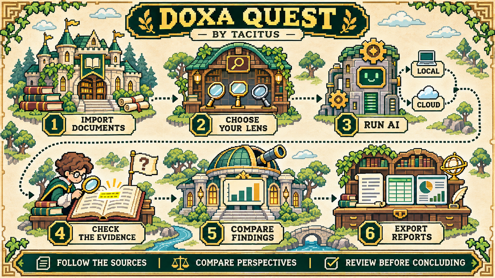

# DOXA Quest: a practical walkthrough

The map follows the actual application workflow. Your aim is a defensible interpretation whose evidence another reader can inspect.

## Level 1 — Build your library

Start DOXA, open **http://localhost:8000**, and click **Load research collection**. You receive twenty real public documents and a saved Gemma run. The saved run makes no new inference requests. Its partial coverage and historical usage remain visible.

For your own inquiry, choose **Import documents**. Add PDF, DOCX, TXT, Markdown or saved HTML. Small files form bounded import groups; large files use resumable parts. After an interrupted large upload, select the same file to continue. Inspect the library for extraction failures and correct author, institution, date and document type. Use **Import metadata CSV** to update many sources by filename, document ID or checksum.

## Level 2 — Declare the lens

Open **Analysis runs**. State the question you want to investigate. Select one or several analytical frameworks, a reporting profile, and any additional reviewer priorities. You can add your own rubric with explicit criteria and context requirements.

For example: “How do these institutions balance protecting religious minorities with protecting political expression? Identify expressed values, distinctions between criticism and hostility, and passages requiring wider context.”

IHRA, Jerusalem and Nexus remain distinct lenses. Their findings are interpretations under named criteria. A political-correctness inquiry examines contested language norms; it does not produce an objective correctness score.

## Level 3 — Choose the engine

- **Lexical baseline:** inspect exact term matches without installing a model. These matches provide navigation, not conclusions about prejudice or endorsement.
- **Ollama:** use `qwen3.5:4b` for private local inference on the conservative laptop profile. CPU processing takes time; the run monitor shows real progress.
- **Cloudflare:** select the configured managed model for metered cloud inference. Documents leave your computer only when you explicitly select a remote provider.
- **OpenAI-compatible / RunPod:** use a server-configured model endpoint for larger-model experiments.

Check provider readiness, set a run budget, and start. You can cancel or resume eligible live runs. Saved showcase snapshots remain fixed; start a new run to compare another engine.

## Level 4 — Inspect the evidence

Open **Evidence workbench** and select an observation. The source pane highlights its exact passage. Read the surrounding context, named criterion, attributed speaker, stance, alternative interpretation and uncertainty.

Check whether the source author endorses a statement, reports it, opposes it, or presents a hypothetical example. Confirm, reject or annotate the observation. Automated citation checks establish where the words occur; they do not establish that the interpretation is correct.

The saved cloud run contains 1,071 retained observations. It remains partial: 5,788 of 8,999 blocks passed all analysis checks. This is a research preview with visible rejected ranges, not an independently validated detector.

## Level 5 — Compare carefully

Use **Compare perspectives** to inspect framework criteria, author/institution patterns and competing interpretations. Counts belong to one selected run. Author coverage helps you distinguish missing analysis from an absence of observations.

The **Imported batches** tab compares additions, changed content and repeated sources. “Not included in this import” means exactly that; incremental uploads do not establish that a document was deleted. Exact duplicates retain one source identity while appearing in both batch histories.

## Level 6 — Carry the research out

Choose **Reports & exports**. Select the same run and filters used in the workbench, then choose research, briefing or teaching emphasis.

- **PDF / HTML:** a readable narrative record, charts, sources and an explicitly bounded evidence appendix.
- **XLSX:** filterable evidence and source registers, authors, lenses, run information and charts.
- **CSV / JSONL:** complete selected data for further analysis, including provenance and source references.

The report profile changes presentation and emphasis. It does not change the underlying calculations or source evidence. Saved report snapshots stay reproducible after later review or metadata changes.

## What the checks establish

The repository includes actual local and cloud model runs, an exhaustive lexical scan of all twenty real documents, a 1,000-document scheduling test, an actual 500 MiB resumable-upload test, browser flows and container/export checks. [Benchmark summaries](../benchmarks/README.md) identify samples, incomplete coverage, errors and hardware. Interpretation accuracy remains unmeasured without independent human reference annotations.

Continue with the [research dossier](research.md), [methodology](methodology.md), [architecture](architecture.md), [deployment instructions](deployment.md), or [example PDF](../examples/doxa-public-institutions.pdf).
