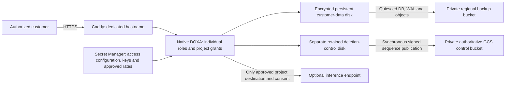

# Dedicated hosted pilots

DOXA's first online service uses the same browser workbench on **one native installation per customer**. The supplied GCP recipe creates an isolated US VM, retained customer-data and deletion-control disks, a dedicated service account, private regional storage and HTTPS. Personal review receives its own installation.

This repository supplies deployable infrastructure and local validation. **No customer VM, paid inference, live certificate or production recovery drill was created by these tests.** Customer handover requires an actual staging deployment, security/rights review, qualified reviewers and measured recovery. This is guided delivery with manual invoices, not shared SaaS, public signup or subscription billing.



## Prepare an installation

Use an existing billed GCP project, operator `gcloud` authentication, Terraform, Docker, a controlled DNS name and a private Artifact Registry repository in the selected US region. The operator needs the rights to manage the declared resources; the VM receives only its own secret access, repository read and bucket create/read grants. It receives no service-account key file or project-wide Editor role.

Start with the [private native provisioning guide](managed-pilots-v05.md). Create an operator identity and customer identities with explicit grants. Keep the plaintext login tokens in their original private delivery file; they are **not** uploaded in the infrastructure recipe. Administrative/root operation is privileged access, not cryptographic exclusion of the service operator. Restrict expert access to authorized pilot material and document that access contractually.

Create a private pricing file outside Git from [the schema example](../infra/gcp/pricing.example.json). Replace the placeholder model, revision and illustrative numbers with approved current provider prices. Bind every paid entry to its exact provider, model and HTTPS endpoint. `1.0` and `2.0` in the example are not researched prices or a customer offer. Local-only wording/saved-result use needs no paid-model entry.

Prepare files locally, without creating cloud resources:

```sh
chmod 600 ~/.config/doxa/approved-pricing.json
.venv/bin/python infra/gcp/prepare_secrets.py \
  --source-directory ~/.config/doxa/pilot-001 \
  --output-directory ~/.config/doxa/hosted-pilot-001 \
  --pricing-file ~/.config/doxa/approved-pricing.json \
  --operator-id operator --new-installation
```

The output directory must be new, private and outside a source checkout. The helper preserves the existing identity-vault key, copies hashed access configuration and approved pricing, and creates a stable installation ID and ledger-signing key only with the explicit new-installation flag. It never prints keys or copies `credentials.json`. Preparing a restored installation must retain its previous installation ID, ledger key **and** vault key; never regenerate them to bypass a failed restore check. An incomplete preparation remains private and must not be used as a complete deployment package.

The private `pilot.env` can include approved provider credentials and `DOXA_REVIEWER_ID` where appropriate. `DOXA_COMMERCE_OPERATOR_IDS` names real server-authorized administrators who may issue quotes. `DOXA_AUTOMATIC_RETENTION` remains false unless deliberately enabled with project policies and an agreed lifecycle. Model destinations and consent remain project-controlled.

Store the three files as separate existing Secret Manager secrets, using user-managed replication in the chosen US region. For example, after setting your own project and resource names:

```sh
gcloud secrets create doxa-pilot-001-access \
  --replication-policy=user-managed --locations=us-central1 \
  --data-file="$HOME/.config/doxa/hosted-pilot-001/access.json"
gcloud secrets create doxa-pilot-001-environment \
  --replication-policy=user-managed --locations=us-central1 \
  --data-file="$HOME/.config/doxa/hosted-pilot-001/pilot.env"
gcloud secrets create doxa-pilot-001-pricing \
  --replication-policy=user-managed --locations=us-central1 \
  --data-file="$HOME/.config/doxa/hosted-pilot-001/pricing.json"
```

These are deliberate provisioning commands, not commands run by the repository tests. Existing secrets use new versions rather than recreation; preserve key continuity and review rotations. No secret payload is passed through Terraform variables or state.

## Build, pin and review the deployment

Build the reviewed repository revision with its Dockerfile and push it to your approved Artifact Registry repository. Supply the resulting immutable image URI, such as `us-central1-docker.pkg.dev/PROJECT/doxa/app@sha256:...`. Pin the official Caddy image by its reviewed digest as well. Tags and placeholder digests are not deployment identities.

Keep **one separate Terraform state per customer**. Copy the tracked infrastructure into a private operator directory, rather than changing customers in the same state:

```sh
umask 077
mkdir -p ~/doxa-deployments/pilot-001
git archive HEAD infra/gcp | tar -x -C ~/doxa-deployments/pilot-001 --strip-components=2
cd ~/doxa-deployments/pilot-001
cp terraform.tfvars.example terraform.tfvars
```

Edit project, opaque customer ID, hostname, workspace kind, three secret IDs and real image digests. Defaults are `us-central1`, `us-central1-a`, `e2-standard-2`, a 50 GB data disk, a 10 GB control disk and a 20 GB boot disk. Customer data and Docker/OS storage are separate. These sizes are initial operating choices, not measured inference capacity. Use a separately provisioned Personal installation, state, secrets and buckets; changing an organization's label does not isolate its data.

Run the non-provisioning checks, then review an actual plan before applying:

```sh
./check.sh
terraform plan -out=pilot.tfplan
terraform apply pilot.tfplan
```

`check.sh` downloads the locked provider schema and validates syntax; it does not provision. `plan` reads the authorized cloud account, and **apply creates billable resources**. The initial empty installation additionally requires `initialize_empty_workspace=true`. Formatting is refused if an authoritative remote ledger already exists or the disk has a recognized different filesystem. Existing customer storage is never intentionally reformatted. After successful initialization set this flag false and review/apply the metadata change.

Point the hostname's DNS A record to the output address. Only ports 80/443 are public; SSH is restricted to Google's IAP address range and requires operator IAM. The app's port 8000 is not published. Caddy obtains TLS certificates; the application trusts forwarded headers only from the fixed private proxy address. The rendered `DOXA_PUBLIC_ORIGIN` is the authoritative HTTPS hostname, overriding missing/stale secret settings.

The app runs as UID 10001 with a 4 GiB container limit, one parser/heavy slot and no automatically installed generation model. Secrets and the external ledger have matching private ownership. HTTP access logging is disabled in Uvicorn; operational logs remain private and need content/security review. Regional disks/buckets use Google's default encryption at rest. This does not claim customer-managed field keys, audited residency or protection from a compromised operator.

For controlled image/configuration updates, change the pinned image or secret versions and review Terraform's plan. Startup script updates are ordinary metadata changes, avoiding the provider's force-replacement startup-script attribute. Rerun the VM's metadata startup runner through authorized IAP SSH, or perform a planned restart, to fetch secrets and apply the new Compose configuration. Back up database **and objects** before an application upgrade. Revocation requires refreshing the access configuration on the VM; publishing a Secret Manager version alone does not instantly refresh a running installation.

## Quote, upload, analyze and publish

The workbench retains the three profiles, selected-source intake, declared perspective, source privacy controls, exact evidence and report downloads. The hosted recipe requires an accepted quote before analysis/publication admission. Source uploads remain subject to authorization and declared retention; uploading does not imply payment or automatic approval for expert access.

An authorized service operator issues a quote through `POST /api/pilot/projects/PROJECT/quotes`, specifying a unique idempotency key, profile, fixed USD price in cents, internal processing cap in micro-USD, validity and explicit source/character/criterion/OCR limits. Customer administrators accept the exact offered `scope_sha256`. Browser-estimated prices and claimed operator identities are never accepted as authority. Acceptance records agreement, **not payment**; collect and reconcile a manual invoice separately.

Scope limits are **per admitted operation**. The processing cap accumulates across the quote. They are not a cumulative document allowance, unlimited analysis or a guarantee of completed interpretation. Registered source versions are counted distinctly across repeat admissions; transformations can create new source versions. Usage counts admissions separately from completed work. A future cumulative entitlement product requires its own explicit contract.

| Interface | Behavior |
| --- | --- |
| `GET .../quotes` | Offers/status, whether quotes are required, manual billing disclosure |
| `POST .../quotes` | Admin plus server-configured service operator issues immutable commercial terms |
| `POST .../quotes/QUOTE/accept` | Customer admin accepts the exact scope hash |
| `POST .../quotes/QUOTE/revoke` | Admin cancels further authority using a bounded reason code |
| `GET .../usage` | Internal reserved/settled costs, category quantities and registered source-version counts |

The full prefix is `/api/pilot/projects/PROJECT`. Supported revoke reasons are `customer_cancelled`, `scope_changed` and `security_review`. Revocation stops subsequent reservations and queued publication; an already sent provider request can still incur cost.

Hosted paid inference uses only the private `DOXA_COMMERCE_RATES_FILE`, matched to the exact endpoint/model. Browser-supplied non-null token prices, including zero, are rejected before provider health or inference. Workers reread pricing before execution and each reservation; a price change pauses the run for newly authorized execution rather than silently changing its frozen rate assumptions. Unknown paid models/rates fail closed. Token-rate accounting is an estimate, not a provider invoice, and does not price GPU idle time automatically.

Provider and quote reservations settle in the same native transaction. Redelivery is idempotent. Unknown vendor usage retains the conservative reservation. A real overrun is recorded and blocks further work; it is not erased to manufacture compliance with the cap. Review, support, OCR, compute, storage and export can be recorded by trusted server-side delivery tools using `reserve_usage`/`settle_usage`; they are not all automatically measured. Their quantities have distinct units and must not be summed as one workload measure.

## Backups and deletion-aware restoration

The separate control disk and private control bucket are outside ordinary customer backups. Every signed ledger sequence is synchronously published to an immutable GCS object before deletion acceptance/completion succeeds. The VM may create and read these objects, but cannot overwrite or delete them. Publication checks the full history, exact bytes and contiguous sequence; outage/conflict blocks success. The app verifies signatures. Bootstrap/recovery preserves a newer local pending intent instead of replacing it with an older cloud copy.

`/opt/doxa/backup.sh` briefly stops app writes and captures SQLite, WAL and all objects together. It restarts the app before streaming the compressed archive to GCS, verifies the uploaded object length/MD5, records its SHA-256 identity and removes private scratch copies. The daily timer runs at 06:00 UTC with a small randomized delay. This introduces a maintenance interruption and has not been measured as a production SLA. Backup objects have a configured age-35-day lifecycle rule; actual expiry must be observed before advertising a guaranteed retention period.

Recovery is an explicit operator action, with the app stopped and the customer-data directory empty:

```sh
sudo /opt/doxa/restore.sh backups/TIMESTAMP-SHA256.tar.zst
```

The script fetches the authoritative remote ledger into a private temporary file, merges it without discarding newer local intent, verifies the backup's hash, rejects unsafe archive members, restores database and objects, then executes `privacy_lifecycle_v06.py restore-check` before restarting the HTTP app. Missing/corrupt ledgers, keys, conflicting histories or incomplete erasure keep traffic closed. Preserve failed restored data for operator inspection; the script does not overwrite or silently clear an existing directory. Recovery on entirely new unformatted disks requires deliberate operator storage preparation.

Control records retain opaque project identifiers, timestamps and digests for resurrection prevention; content-free is not a claim of anonymization. Key loss, backup/provider retention, previously downloaded copies and physical-media wiping remain separate concerns. Do not restore a customer backup by bypassing the guard or inventing a new installation identity.

## Evidence required before customer handover

The [hosted validation receipt](../infra/gcp/validation-receipt.json) records local Terraform/provider-schema, rendered startup/Compose and actual Caddy validation. Automated transport tests use isolated in-memory cloud objects; they do not establish GCP IAM propagation, provisioning success, expiry or disaster recovery.

Before confidential pilots, exercise two separate organizational staging installations and a separate Personal installation. Test customer-ID/URL isolation, worker/download revocation, real TLS, secret refresh, source/report hashes, provider destination consent, a full DB/object restore, unpublished-ledger retry and deletion replay. Complete terms, data rights, dependency/model/corpus inventory, vulnerability/security review and authorized expert access. Independent interpretation accuracy still requires the actual reviewer studies.

Measure the complete economics: VM/idle time, retained disks, backup/control storage and operations, network/static address, inference, OCR, report work, review, support and payment fees. The fixed customer price, internal processing cap and vendor invoice are distinct. No monthly price, capacity, margin or uptime claim is established by this recipe. Scale one installation's declared workload only after measurement; shared customer tenancy and OAuth/subscriptions remain future work.
