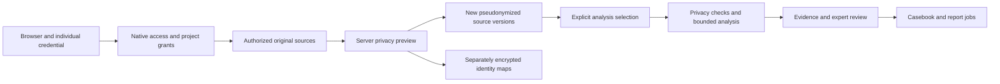

# Operate a guided native pilot

DOXA's guided-pilot workflow adds three inquiry profiles, individual access, project privacy policies, outbound pseudonymized source versions and resumable whole-project erasure. It preserves the local evidence workbench. **Independent interpretation accuracy remains unmeasured**: service profiles say `reference_pending`, observable wording rules are not calibrated bias or tone judgments, and substantive delivered conclusions require qualified expert review.

Use a dedicated installation for each customer. Personal review uses a separate personal installation; an organizational administrator must not receive personal writing through an implicitly shared project. This is native managed-pilot access, **not public multitenant SaaS, OAuth, OIDC/JWT login, subscription billing or a connector service**. The existing Cloudflare profile remains a shared private workspace and rejects these native managed-pilot workflows.

## Install and provision

Use Python 3.11+, Node 24 for the source interface build, native PDF prerequisites from the [deployment guide](deployment.md), and a POSIX system for private pilot provisioning. From the repository:

```sh
python -m venv .venv
.venv/bin/python -m pip install -e .
npm --prefix frontend ci
npm --prefix frontend run build
.venv/bin/python scripts/configure_pilot.py init \
  --directory ~/.config/doxa/company-a \
  --owner operator --kind organization
.venv/bin/doxa --env-file ~/.config/doxa/company-a/pilot.env \
  --data-dir ~/doxa-workspaces/company-a
```

The provisioning directory must be new and outside Git checkouts. Keep it separate from application data and customer-data backups. The helper creates a `0700` directory containing `0600` files:

| File | Purpose |
| --- | --- |
| `access.json` | Individual credential hashes, roles, grants and a session-signing secret |
| `credentials.json` | Original individual login tokens for private delivery by the operator |
| `pilot.env` | Managed-mode configuration path, installation kind and AES-256 identity-vault key |

The helper prints paths and status, never credentials or encryption keys. Read a user's token privately and deliver only that token through an appropriate secure channel. Do not paste these files into GitHub, screenshots or support logs. Initialization refuses to overwrite an existing directory; changing an access token never rotates the vault encryption key. Protect the encryption key separately: losing it makes retained identity maps unreadable.

Open `http://127.0.0.1:8000`. In **Open your private workspace**, enter the user's token under **Your individual access credential**, then choose **Open private workspace**. Login establishes an eight-hour HttpOnly session cookie; configuration is rechecked on requests, so revocation and role changes take effect without waiting for cookie expiry.

The default listener is loopback. Remote managed access requires HTTPS and a correctly configured trusted TLS proxy/ASGI scheme. Do not trust arbitrary forwarded headers or expose an unauthenticated inference endpoint. TLS, host hardening, backups, provider contracts and customer authorization remain operator responsibilities. An ordinary local installation without managed configuration retains the local-operator workflow.

Native metadata upgrades to schema 5 through the ordered migration and checked pre-upgrade backup. Cloud persistence remains at schema 4. Preserve database **and object files** before upgrading; database/migration backups can retain private material after live-project erasure and need their own lifecycle policy.

For Personal, provision another directory and data root with `--kind personal`; changing an existing company installation's label does not separate its stored sources. Use the same startup commands with that personal installation's files.

## Roles and credential maintenance

Owner and admin can manage the dedicated installation; analyst can read, edit, analyze and export; reviewer can read, review and export; viewer can read. Non-global users need explicit project IDs. Only owner/admin can receive explicit all-project access. **Identity-map reveal is an additional permission, absent even from owner/admin defaults**, and also requires the project's policy to allow reveal.

After creating a project, copy its ID and provision a reviewer:

```sh
.venv/bin/python scripts/configure_pilot.py add-user \
  --directory ~/.config/doxa/company-a \
  --user reviewer --role reviewer --project-id PROJECT_ID
.venv/bin/python scripts/configure_pilot.py rotate-token \
  --directory ~/.config/doxa/company-a --user reviewer --confirm
```

Rotation revokes that user's old token and sessions while preserving other users, the session secret and vault key. Replacing an existing user's role/grants requires `add-user --replace-user`; it issues a new token. Removing the last global owner is rejected. To disable a user, an operator can remove its user record from the private access configuration; do not remove the final owner. Keep the credential-delivery file consistent before using the provisioning helper again.

Interrupted credential-file updates leave a private journal. Complete the already-requested update with `recover --directory … --confirm`; recovery refuses to overwrite unrelated operator changes. No server account creation or cloud identity-provider changes occur.

## Run the three inquiry workflows

In the one-page workbench choose **DOXA Company**, **DOXA Public** or **DOXA Personal**, then **Question, privacy & estimates**.

1. In **Inquiry brief**, state the question, audience, perspective and frameworks. Company can include a versioned policy; Public can declare comparator groups and eligibility rules; Personal states the selected-writing goal and context. Save with **Save inquiry brief**. Supplied policies and comparators remain unverified research inputs.
2. Import authorized documents or saved EML/MBOX messages. Personal also offers **Paste selected writing as a source** and **Save selected writing as source**: this explicitly persists the text until erased; it is not transient processing. Mail roles and reconstruction can be incomplete. No OAuth connector, automatic inbox collection or message sending is implemented.
3. In **Scope & estimate**, inspect the first-N-of-M query scope and choose **Estimate query preview**. These bounded tools use the first saved-query page, not a separately paged source rail; narrow the query or focus a source to change that selection. Wording observations identify rule-matched requests, qualifications and time expressions, not politeness, prejudice, intent or actual recipient reaction. Estimates are heuristic planning arithmetic, not tokenizer-exact quotes, invoices or complete delivery costs.
4. Choose **Continue to analysis** for the existing analysis drawer. Select a configured local or remote provider, review transfer consent and budget, and select the saved service brief. Native operation does not require a GPU; large CPU inference remains slow and may be partial.
5. Inspect exact passages, speaker/context limits, unresolved decisions and competing readings. **Generate a guided service report** offers PDF, HTML, XLSX and JSON for the bounded query preview; **Add a commented evidence case** uses the currently inspected block and exact quotation. A permitted operator can sign commentary; the signature remains a self-declaration, not verified expert qualification or independent validation. Existing casebook/report jobs support larger evidence deliveries. Preserve separate processing, model-decision and human-review denominators.



## Privacy controls and a pseudonymization walkthrough

In **Privacy controls**, an authorized administrator can save allowed inference families, original/pseudonymized processing, identity-map reveal, export permission, request-journal mode and retention targets. Managed installations and new profiled runs default to local inference and metadata-only journals even without a saved policy. Legacy unprofiled local runs retain their explicitly consented workflow until a policy is saved. Destination checks are **not geographic residency enforcement**; verify endpoint, inference, logs, support and backup locations separately. Retention dates are manual-review targets; no automatic purge scheduler is implemented.

To test optional masking on a small selection:

1. Enter known names/aliases as explicit literal terms and choose **Preview pseudonymization**. Inspect every outbound field and the declared limitations. This is a server-side preview: originals have already reached DOXA. It does not demonstrate masking in the browser before upload.
2. Check the first-N-of-M query scope and choose **Create pseudonymized versions · query preview**. The operation creates new sources and an AES-256-GCM-encrypted identity map. It preserves original/transformed hashes and Unicode code-point span mappings; a changed quotation is not presented as unchanged original text.
3. Explicitly select the new versions for analysis. A pseudonymized policy refuses originals and unsupported historical learning-memory transfer; creating versions does not silently replace the analysis selection.

Rules recognize selected email, phone, identifier, URL and similar patterns; names need supplied terms or a separately installed future detector. **GLiNER/model-based PII detection is not implemented or downloaded by this workflow.** Rules can miss identifiers, over-mask and lose context. The interactive preview and transform operations have explicit source, field, size and time limits; narrow an oversized selection rather than omit fields.

Originals remain readable to users with that project's read access. This feature controls outbound inference inputs; it does not provide anonymized viewer access or hide originals from project administrators. Reversible placeholders and contextual clues also mean it is pseudonymization, not guaranteed anonymity. Private identity files sit outside ordinary object downloads; reveal requires both the explicit user capability and project policy.

## Erase and verify

Open **Erase this project's live application data**, type the exact project name in **Confirm project name**, and choose **Erase live project data**. This is whole-project erasure, not a recoverable document hide. The durable job blocks new project work, requests cancellation, drains tracked activities and inventories dependent live records, report captures, indexes, private maps and files. Inspect its receipt; if it is waiting, finish or stop remaining work and use the available resume action. A process restart does not prove the job completed.

The receipt reports live logical deletion and explicit limitations. It does not securely wipe hardware, remove migration/operator backups, erase inference-provider retention or revoke copies people already downloaded. Operators must apply their separate backup/provider policies and replay deletion obligations before serving restored data. Keep text-free receipts separately from customer content. Legacy artifacts that cannot be attributed safely need operator review; a failed/waiting job is not a successful erasure.

## Verify the installation

The relevant tests cover access boundaries, real encrypted-map round trips, tampering, source mappings, private-file provisioning/rotation, populated derivative erasure and profile semantics:

```sh
.venv/bin/python -m pip install -e '.[dev]'
.venv/bin/python -m pytest tests/test_access_v05.py \
  tests/test_privacy_v05.py tests/test_configure_pilot_v05.py \
  tests/test_privacy_lifecycle_v05.py tests/test_service_profiles_v05.py \
  tests/test_pilot_api_v05.py tests/test_pilot_reports_v05.py -q
```

Run the repository's wider CI/browser checks before release. Passing these tests verifies specified software behavior, not interpretation accuracy, regulatory certification, customer demand or production throughput. The [commercial roadmap](commercial-service-roadmap.md) records the independent evaluation, connectors, billing, tenancy and scale work still required.
