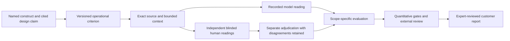

# From academic references to executable validation

DOXA v0.6 adds measurement cards, scoped reference panels, preregistered evaluation, an explicit functional-model runner and prospective alert-review campaigns. These are implemented research instruments. They do not supply qualified reviewers, licensed customer data, independent labels or newly established interpretation accuracy.

## What a criterion means

Every new service brief freezes the complete method-card text and hashes for its requested lenses. A card identifies the construct, operational rule, unit, required context, exclusions, alternative readings, permitted wording and limits. Scholarly references state the specific design claim they support and what they do **not** establish. Framework definitions are marked separately from empirical validation.

| Foundation | Design choice in DOXA | Limit |
| --- | --- | --- |
| [Jacobs and Wallach, Measurement and Fairness](https://arxiv.org/abs/1912.05511) | Declare the intended construct, operational measure and validity assumptions | A citation does not validate DOXA's implementation |
| [Entman, Framing](https://doi.org/10.1111/j.1460-2466.1993.tb01304.x) and the [Media Frames Corpus](https://aclanthology.org/P15-2072/) | Distinguish problem definition, cause, evaluation and remedy | A frame is not automatically unfairness or prejudice |
| [SemEval stance task](https://aclanthology.org/S16-1003/) | Require an explicit target/proposition and distinguish stance from sentiment | Missing stance evidence is not neutrality or political identity |
| [BASIL](https://aclanthology.org/D19-1664/) | Keep lexical/informational patterns and matched-source comparison distinct | An isolated source cannot establish intentional omission |
| [Plank on human label variation](https://aclanthology.org/2022.emnlp-main.731/) and [Artstein and Poesio on agreement](https://aclanthology.org/J08-4004/) | Preserve independent readings, adjudication and disagreement | Agreement is not proof of accuracy or reviewer independence |
| [CheckList](https://aclanthology.org/2020.acl-main.442/) and [HateCheck](https://aclanthology.org/2021.acl-long.4/) | Test explicit linguistic behaviors and failure modes | Authored fixtures are not observed model successes or population samples |

[Inspect every frozen card](../benchmarks/v06-method-cards.json). New briefs use contract1.1; stored1.0 briefs retain their original machine fields and fingerprints. Frozen1.1 cards remain usable after a registry update. Historical results are not relabeled with a new measurement contract.



## Independent reference panels

The existing200-case news scaffold is outcome-balanced diagnostic material; its public parent outputs and exposure limits remain disclosed. It cannot be relabeled as a representative probability sample.

The new native endpoint `POST /api/v3/projects/{project_id}/evaluation-panels` accepts `{run_id, manifest}`. The manifest declares a Company/Public/Personal profile, domain, population, collection-frame hash, sampling design, inference cluster key, seed and5–1000 externally collected primary cases. Each case supplies scoped source/unit/criterion IDs, a primary cluster, whole-group split identity, inference-cluster identity, equal inclusion probability and a rights-record hash. It accepts no model output or reference labels.

The server loads actual decisions from the selected run, resolves the exact text and rubric, rejects duplicate primary sources/clusters and exact duplicate source versions, and freezes case hashes. Recorded run members without model output remain explicitly unprocessed. Rights and grouping declarations are retained as operator attestations, **not automatically verified legal rights or sampling facts**.

Whole company/thread/story groups receive deterministic40/20/40 development/calibration/locked-test assignments. One inference cluster cannot span split groups. Unequal group sizes produce different case counts, which the manifest reports. Calibration and heldout sources are excluded from reviewed-example memory. First-pass forms omit model outcomes; calibration decisions stay hidden until calibration adjudication is complete, and heldout forms never expose them.

The [collection template](../benchmarks/v06-study-protocol.json) retains the roadmap's target of1,000 independent clusters per domain. Its zero counters describe an unfilled template, not live project progress. Real collection requires authorization, multiple organizations/source families, qualified compensated reviewers, an exposure record, and adequate rare-positive sample sizes. A thousand correlated passages cannot replace independent clusters.

Before entering any initial label, freeze the plan with `POST .../evaluations/{evaluation_id}/preregistration`. It binds the domain, frame, profile, cluster key, confidence procedure, reviewer-protocol hash and seed. Existing labels cannot be followed by a backdated registration. Protocols and initial reviews are immutable; a preregistered study requires a distinct adjudicator.

## What the metrics establish

`GET .../evaluations/{evaluation_id}/report` keeps old diagnostic agreement and adds per-criterion confusion matrices, precision/recall, abstentions, unprocessed work, coverage, attribution agreement, Unicode span concordance and initial-reviewer agreement. Span comparison excludes software fallback anchors; exact quotation agreement is not an explanation-quality judgment. Entire heldout metrics stay hidden until every heldout case is adjudicated.

Ambiguous reference labels remain visible and are excluded from binary negatives. Abstained or unprocessed reference-positive cases reduce recall. Nominal cluster bootstrap bounds resample complete clusters; a degenerate rare/zero-error bootstrap cannot pass a gate without a separately prespecified valid procedure. Exact one-sided binomial bounds are used only for a one-primary-case-per-independent-cluster design.

The preregistered product gates require a precision lower95% bound of at least0.95 and at least100 reviewed predicted-positive clusters. Automated detection additionally requires a recall lower bound of at least0.80 and non-abstained coverage of at least80%. Enriched sampling, missing references, incomplete tests, unresolved reference ambiguity and missing independent review structure block promotion. These are declared product thresholds, not academic consensus or achieved performance.

Even a numerical pass does not automatically authorize publication. Reviewer qualifications and real-world independence, source rights, sampling validity and expert sign-off remain external checks. `GET .../evaluations/{evaluation_id}/readiness` derives its status from server-read evidence; the browser cannot submit a readiness certificate. No universal accuracy score is produced.

Reader-perception annotations use a separate optional `reader_perception` object: an explicit audience/goal/relationship context, the frozen ordinal scale, and1–5 ratings for declared dimensions such as clarity or perceived respect. Each rating comes from its authenticated review identity. The report preserves distributions by case, context and dimension, reports whether at least three reader IDs contributed, and never turns them into the writer's actual emotional state or a universal tone score. Distinct IDs do not prove distinct people or audience representativeness.

## Explicit functional execution

[The existing120 fixtures](../benchmarks/evaluation-v04/functional-casebook.json) remain authored proposals awaiting human rubric review. Run the offline preflight:

```sh
.venv/bin/python scripts/run_functional_v06.py --limit 5
```

This creates no provider, download, network request or label. [The recorded preflight](../benchmarks/v06-functional-preflight.json) is preparation, not execution.

Actual execution additionally requires `--execute`, a human rubric-review file bound to each exact fixture hash, a private mode0600 provider configuration, an output path, a finite spend cap and explicit remote-transfer permission for remote endpoints. It verifies that the frozen rubric still matches the execution registry. Every request consumes a conservative reservation; unknown prices are refused. The output preserves partial work, actual validated decisions and errors. Behavioral adjudication remains pending and `passed` stays null; approval of an expectation is not a fabricated reference answer.

Reproduce the published contracts and offline preflight with `python scripts/build_methodology_v06.py`. This command does not alter a research workspace or call inference.

## Prospective alert review

`POST /api/v3/projects/{project_id}/alert-review-campaigns` freezes the run/method/model/rubric, relevance question, a future observation window and1–24 scheduled look times. The server saves the existing trajectory as a **historical baseline**, not a prospective observation. Follow-up capture accepts a run and registered look index; changed analytical settings or model identity require another campaign.

The existing trajectory engine supplies source/coverage/composition gates and Fisher/Holm tests. The campaign allocates the0.01 family alpha across registered looks with Bonferroni and preserves Holm within each look. Only server-generated candidates for publication months in the registered future window can be reviewed. Duplicate observations of one alert month count once. Unresolved provider weights remain unresolved; a method hash cannot manufacture model immutability.

Reviewers enter relevance, context sufficiency and a note under their server-assigned identity. Initial readings are immutable and disagreements remain visible. Before actual observations and reviews, the report says `not_measured`; subsequently it reports descriptive operator-assessed relevance and review coverage, while independently validated alert utility remains unmeasured. This does not prove causal attribution, population prevalence or classifier accuracy.

Optional sensitivity scenarios specify hypothetical fractions of observed positive/negative cases reclassified. They are explicitly assumptions, not calibrated error rates, corrected prevalence or extra statistically qualified alerts. Campaigns, snapshots and reviews remain project-scoped and are part of live-project erasure.
