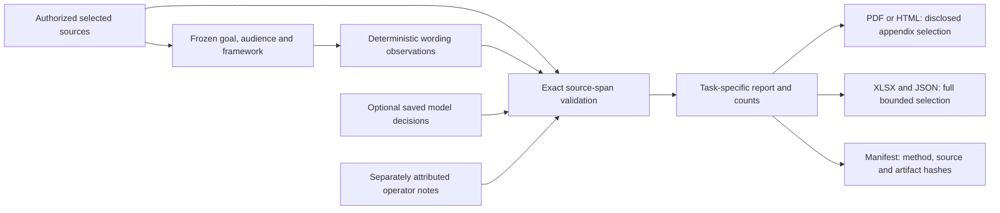

# Guided-pilot reports: scope, examples and evidence

The Company, Public and Personal service profiles share a bounded report builder. It produces an actual PDF, offline HTML, XLSX and complete selected JSON snapshot, with a separate integrity manifest. This is a synchronous, deliberately bounded publication path; the existing [casebook/background report workflow](report-jobs.md) remains available for larger saved research selections.

**Interpretation references remain pending.** The new wording layer uses deterministic English rules. A request marker is evidence of wording; it does not establish rudeness, prejudice, a recipient's reaction, a private belief or an actual promise. Contextual model decisions can be included only as supplied, source-anchored provisional records. Human commentary has separate provenance.

## Open three runnable examples

These examples contain **fictional authored documents**, **zero model requests**, **zero independent human reference labels** and **zero signed operator reviews**. They demonstrate software behavior and publication structure, not semantic accuracy. The public example includes a reported anti-Muslim slogan and explicit condemnation to show why the full source and attribution matter; the renderer makes no prejudice judgment about it.

| Package | PDF | Other formats and reproduction inputs |
| --- | --- | --- |
| **Company** | [Organizational language example](../examples/v05-pilot-demo-company.pdf) | [Offline HTML](../examples/v05-pilot-demo-company.html) · [XLSX](../examples/v05-pilot-demo-company.xlsx) · [Selected JSON](../examples/v05-pilot-demo-company.json) · [Input](../examples/v05-pilot-demo-company.input.json) · [Manifest](../examples/v05-pilot-demo-company.manifest.json) |
| **Public** | [Political comparison design example](../examples/v05-pilot-demo-public.pdf) | [Offline HTML](../examples/v05-pilot-demo-public.html) · [XLSX](../examples/v05-pilot-demo-public.xlsx) · [Selected JSON](../examples/v05-pilot-demo-public.json) · [Input](../examples/v05-pilot-demo-public.input.json) · [Manifest](../examples/v05-pilot-demo-public.manifest.json) |
| **Personal** | [Selected email wording example](../examples/v05-pilot-demo-personal.pdf) | [Offline HTML](../examples/v05-pilot-demo-personal.html) · [XLSX](../examples/v05-pilot-demo-personal.xlsx) · [Selected JSON](../examples/v05-pilot-demo-personal.json) · [Input](../examples/v05-pilot-demo-personal.input.json) · [Manifest](../examples/v05-pilot-demo-personal.manifest.json) |

The [build receipt](../examples/v05-pilot-demo.receipt.json) records counts, hashes, zero inference and a deliberately fabricated quotation rejected by the publication engine. The [plain-text source fixtures](../examples/pilot-v05-inputs/) are retained for inspection. Rebuild locally, without inference or network requests:

```sh
.venv/bin/python scripts/build_pilot_examples_v05.py
```

For an isolated output directory, pass `--output /tmp/doxa-pilot-examples`. Frozen snapshot hashes are reproducible from unchanged inputs and methods. PDF/XLSX bytes may differ with local fonts, library versions and generated metadata; each build records its actual artifact checksums.

For actual recorded model readings on real public sources, use the [political-framing report](../examples/political-framing-commentary.pdf), [institutional-context report](../examples/institutional-context-commentary.pdf), [news-monitoring report](../examples/news-monitoring.pdf) and [15-case atlas](../examples/v04-case-atlas.pdf). Those retain partial processing and AI-commentary disclosures; they are not independent human validation either.

## How publication works



The renderer detaches and validates its inputs. It recomputes wording counts from the selected source blocks, verifies supplied observation spans, and checks all supplied model quotations and evidence references. Altered text, out-of-selection references, conflicting source identities, unknown criteria and historical rubric mismatches fail explicitly. Existing historical casebooks retain their own frozen-rubric path; this renderer does not rewrite them using today's rubric.

The three profiles have different report sections:

- **Company:** declared document-type mix, customer policy title/version, organizational scope, evidence and policy-alignment limitations. Supplying a policy does not establish that alignment was evaluated.
- **Public:** declared comparison question and inclusion rules; group IDs present or absent in the selected report; attributed model decisions when provided. An unverified comparison declaration is not proof of matching, deliberate omission or a double standard.
- **Personal:** selected writing, stated goal and audience, available thread roles, observable wording and context limits. Quoted, forwarded and signature blocks are excluded from authored-unit marker counts. Sender headers and role heuristics do not prove authorship or endorsement.

Every version retains `reference_pending`. A server-attributed operator signature is an accountable self-declaration, not proof of professional qualifications, independent annotation or interpretation accuracy. The renderer accepts trusted review metadata only through its explicit server parameter; the API adapter must authenticate the operator and authorize the selected sources.

## What the files retain

The XLSX contains sources and recorded provenance, complete selected text split across cells, wording observations, supplied contextual decisions, separate exact evidence rows, operator notes and the frozen method/coverage record. It disables automatic formulas and hyperlinks. Text longer than an Excel cell is split into located fragments; fields that cannot be represented safely fail with an explicit error and an instruction to use JSON.

PDF/HTML include at most **30 wording cases, 30 contextual decisions and 30 operator notes**, each with shown/total counts. Their source listing covers the bounded selected documents. Complete selected records remain in XLSX/JSON; a concise appendix is not silently presented as a complete evidence archive.

The manifest records the artifact SHA-256 and byte count, frozen input digest, service brief, source selection, original hashes supplied as metadata, independently computed extracted-block hashes, privacy disclosure and coverage. The renderer does **not** re-read original file bytes, verify customer permissions, enforce privacy processing, store an identity vault or create a durable queue job. Those controls belong to the authenticated service adapter and deployment.

When the adapter supplies actual contextual-run provenance, JSON, XLSX and the manifest preserve the run ID, recorded provider/model/revision, method fingerprint, question/perspective, brief fingerprint and selected-source scope. PDF/HTML show a concise technical record. The original run's processing counts and the selected sources' unit/retained-decision counts keep separate scopes; missing counters and expected decision counts are never reconstructed. A partial result cannot become a negative or complete finding through export. Missing provenance stays absent, and an unresolved model revision is not replaced with an invented identity. The authenticated adapter must separately verify that the run's frozen brief and prompt-visible source metadata match the selected sources.

Current synchronous limits are **100 documents, 2,000 blocks, 500,000 source characters, 10,000 wording observations, 2,000 contextual decisions and 200 operator notes**. Quotes and total evidence are additionally bounded; the artifact cap is **16 MiB**. Exceeding a bound requires a narrower selection or the existing background export path. There is no implicit sampling of input documents.

PDF rendering uses an installed local TrueType font and fetches no fonts or images. Docker includes DejaVu Sans; Unicode Latin/Greek examples are exercised in tests. Missing glyphs are disclosed in the PDF and manifest; complete Unicode source text remains in JSON/XLSX/HTML. The offline HTML uses escaped text and a restrictive content-security policy, with no scripts or external resources.

## Model and methodology boundary

The observable rules detect examples of request, future-commitment, time-constraint, qualification and imperative wording. They are incomplete English heuristics with no measured precision/recall. No match does not mean no relevant language, and marker frequency is not a quality score. [Email speech-act research](https://aclanthology.org/W04-3240/) and [context-sensitive politeness research](https://aclanthology.org/P13-1025/) motivate separate communicative tasks; these rules have not inherited those studies' validity.

The cost estimator counts actual current source units when extracted blocks are available, and clearly identifies metadata-only unit estimates. Token ranges are unmeasured English-oriented planning heuristics covering classification and possible detail passes, not guarantees or tokenizer measurements. Modeled inference costs require explicit input/output rates and exclude expert review, retries, storage, OCR, exports, support and other delivery costs. They are neither customer prices nor provider invoices.

See the [commercial roadmap](commercial-service-roadmap.md) for independent evaluation, privacy lifecycle, connector, security, paid-pilot and scale gates. These report artifacts establish a working publication path; customer readiness still depends on those separately measured requirements.
