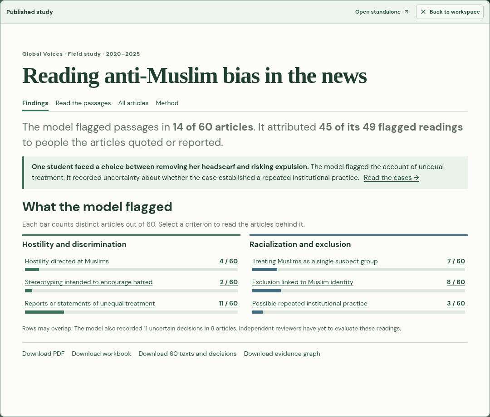

# Reading anti-Muslim bias in 60 news articles

**Who is speaking when a news story contains an account of prejudice?** In this sample, DOXA’s recorded model flagged passages in **14 of 60 articles**. Of the **49 flagged decisions**, it attributed 44 to reported speakers, one to a quoted speaker and four to article authors. Reporting that a student experienced discrimination can trigger a flag. A reader has to examine what the writer actually says about that treatment.

**[Open the interactive study](https://doxa-public-study.giuliocatanzariti.workers.dev/)** · [Study PDF](../frontend/public/studies/muslim-coverage/report.pdf) · [Complete evidence workbook](../frontend/public/studies/muslim-coverage/evidence.xlsx) · [60 attributed texts and original decisions](../frontend/public/studies/muslim-coverage/sources.zip) · [Manifest and checksums](../examples/muslim-coverage.manifest.json).



## Three readings to try

1. **A concrete condition of access.** In Elmira Lyapina’s article on Ramadan in Czechia, a principal reportedly pressured a student to remove her hijab or face expulsion. The model flagged unequal treatment and marked the institutional-pattern question uncertain. The next paragraph describes how lower courts and the Supreme Court reached different decisions. Evidence for one case and evidence for a repeated practice answer different questions. [Original article](https://globalvoices.org/2021/05/29/czechias-muslim-women-celebrated-ramadan-with-mixed-experiences/).
2. **A flag worth challenging.** Davi Jacobs describes women being barred from medical care in Afghanistan. The model flagged exclusion linked to Muslim identity. The cited paragraph identifies a gender restriction. It gives no religious condition for the restriction. The count preserves the flag so readers can examine this possible error in context. [Original article](https://globalvoices.org/2025/08/06/withering-roots-the-waning-health-and-resilience-of-the-women-left-behind-in-afghanistan/).
3. **An apparent absence worth checking.** A report about a Uyghur mother describes how mainstream media portrayed Uyghurs as “motherland separatists” or “terrorists.” The model marked the group-stereotyping criterion unmet for that unit. The reader identifies the exact sentence and preceding group description. An independent reviewer would need to examine the intersection of ethnic and religious targeting. This example illustrates one way a model can miss a passage. [Original article](https://globalvoices.org/2020/12/04/dont-come-back-or-you-will-disappear-uyghur-mother-pleads-with-her-daughter-abroad/).

The walkthroughs are AI-authored editorial readings. The original article, exact quotation, recorded model rationale when available, and alternative interpretation remain separately identifiable. The two possible errors have no independent adjudication.

## Review a reading

1. **State the criterion before opening the outcome.** In the school case, write down what would satisfy an unequal-treatment reading and what would support an institutional pattern. The second question needs evidence about a pattern of decisions or practices. [School case](https://doxa-public-study.giuliocatanzariti.workers.dev/#case-school-hijab)
2. **Read the full paragraph and the adjacent context.** Identify the person who reportedly imposed the condition and how the author represented it. Record whether the surrounding account changes the target, the author's position or the evidence for repetition.
3. **Write an independent outcome with a passage.** Save the original words and the location. Identify what additional evidence would resolve uncertainty. Once you have written your reading, compare it with the archived decision and the editorial question. [Graph record and offline query](evidence-graph.md)
4. **Compare independent readings at the article or story level.** For a validation study, preregister the frame and required evidence, recruit qualified independent reviewers, record first-pass outcomes before showing model outputs, and retain adjudication and disagreements. Report results by criterion with the number of independent groups, unresolved cases and coverage. [Reference panels and evaluation gates](methodology-v06.md)

## What the model counted

| Framework | Reading question | Articles with a flag | Uncertain articles without a flag for this criterion |
| --- | --- | ---: | ---: |
| Hostility | Hostility directed at Muslims | 4 / 60 | 0 |
| Hostility | Stereotyping intended to encourage hatred | 2 / 60 | 2 |
| Hostility | Reports or statements of unequal treatment | 11 / 60 | 0 |
| Structural racism | Treating Muslims as a single suspect group | 7 / 60 | 0 |
| Structural racism | Exclusion linked to Muslim identity | 8 / 60 | 1 |
| Structural racism | Possible repeated institutional practice | 3 / 60 | 5 |

A row counts an article once even if several passages triggered the same criterion. A story may appear in several rows. Within a row the article states are mutually exclusive. A flag takes priority, followed by missing decisions, an uncertain decision, at least one checked unit without a flag, and all units outside the criterion. The workbook retains uncertainty even when another unit in the article triggered a flag.

Across **137 source units and 822 decisions**, the original model recorded **49 flags, 11 uncertain, 525 criterion unmet and 237 outside the criterion**. The 11 uncertain decisions occurred in eight articles. All 822 expected decisions for the selected six criteria are present. The wider 5,000-article parent run recorded 79 missing decisions. There are no independent human labels for the selected readings.

## Sensitivity within the selected articles

Two checks clarify how the design affects each criterion count. First, add every
as-yet unflagged article whose criterion is uncertain or has missing decisions.
This is the maximum if those unresolved rows all became flags. Already-flagged
articles contribute once. For institutional practice, the observed count is
**3 of 60** and that scenario gives **8 of 60**.

Second, rerun the observed count six times, dropping one publication year each
time. Compare the resulting fractions against the retained 50 articles. This
shows whether one year's ten articles drive the count in this selection. The
workbook records all six exclusions for each criterion so readers can inspect
which year changes the count. Both checks retain the saved model decisions and
make no inference about a wider population or the frequency of model error.
[Interactive table](https://doxa-public-study.giuliocatanzariti.workers.dev/#sensitivity)

## How the 60 articles were selected

The starting point was the frozen English-edition Global Voices corpus. Eligibility required genuine CC BY 3.0 articles in the development split. Canonical holdout story groups and locked evaluation cases and story groups were excluded. A case-insensitive whole-word search of **article body blocks** for *Muslim*, *Muslims*, *Islamophobia* or *Islamophobic* yielded **248 candidates** across six years. This rule also admits incidental mentions and can miss relevant articles that use other words.

| Publication year | 2020 | 2021 | 2022 | 2023 | 2024 | 2025 |
| --- | ---: | ---: | ---: | ---: | ---: | ---: |
| Eligible articles | 47 | 39 | 31 | 53 | 43 | 35 |
| Selected | 10 | 10 | 10 | 10 | 10 | 10 |

Within each year, SHA-256 sorted the seed `doxa-muslim-coverage-1` and source ID joined by a vertical bar. The first ten unique story groups and content hashes were taken in ascending year order **before opening any model results**. Together the articles contain 68,773 words. Equal allocations give every year room in the sample. They cannot establish a rise in hostility over time or an outlet-wide prevalence rate.

DOXA reused the archived Gemma readings from the same source versions. It checked them against the frozen rubric, source-unit identities, Unicode offsets and text. The six selected criteria have **16,855** exact reference occurrences. A sentence can occur in several records. For compact negative or inapplicable decisions the software attached the unit’s sentences. When the reader highlights one of those sentences, it labels that editorial choice. [Original run and part hashes](../benchmarks/v3-news/showcase.json).

## The academic basis

| Source | Design decision |
| --- | --- |
| [Bleich, 2011](https://doi.org/10.1177/0002764211409387) | Define what is being measured before counting it. The unit here is a textual reading under an explicit criterion. |
| [Blodgett et al., 2020](https://aclanthology.org/2020.acl-main.485/) | Specify the harm and the affected group. A broad score would hide differences between a stereotype, a report of discrimination and a policy claim. |
| [Mohammad et al., 2016](https://aclanthology.org/S16-1003/) | Specify the target of a stance. An author may support the claim that discrimination occurred while opposing the discrimination itself. |
| [Artstein and Poesio, 2008](https://aclanthology.org/J08-4004/) | Use independent annotations and examine disagreement before claiming reliable classification. |
| [England’s anti-Muslim hostility guidance](https://www.gov.uk/guidance/a-definition-of-anti-muslim-hostility) and [Runnymede Trust](https://www.runnymedetrust.org/publications/islamophobia-towards-a-working-definition) | Keep the two retrospective analytical frameworks and their different evidence requirements visible. Extending either framework across jurisdictions does not establish legal findings. |

## Open it locally or reproduce it

In DOXA v0.8.0, choose **Read the 60-article study** on the main dashboard. Select a criterion, filter by publication year and follow a case to its frozen method and exact passage. The reader opens without a model, credentials or an upload. [Mobile reader](images/muslim-coverage-mobile.png)

For standalone use, unzip the **offline study** from the release and open `index.html` in a browser. Keep the sibling reader script, PDF, workbook, source ZIP and JSON-LD graph together for local downloads. The source ZIP includes 60 original attributed TXT files and `study.json`, with source blocks, the six original rubric criteria, unit statuses, full selected model records, archive locators and editorial notes. Other criteria from the parent run are available in the original archive. [Release downloads](https://github.com/sargonxg/DOXA-by-TACITUS/releases/tag/v0.8.0)

From a repository checkout with DOXA’s Python dependencies installed, verify the edition against the frozen corpus:

```sh
python scripts/build_bias_study.py
```

Use `--write` to regenerate it or `--offline-zip /tmp/doxa-study.zip` to package the verified edition. The default command reselects the articles, verifies the original analysis, reproduces the graph, dashboard and uncompressed archive contents, and checks the distributed file hashes. PDF rendering depends on installed fonts and library versions. [Study builder](../scripts/build_bias_study.py)

The public reader serves the released HTML, filtering script and four downloads from a dedicated Cloudflare Worker. Local DOXA reads its packaged copy. The Worker accepts GET and HEAD for the study and downloads. [Public reader configuration](../infra/cloudflare/wrangler.study.jsonc)
