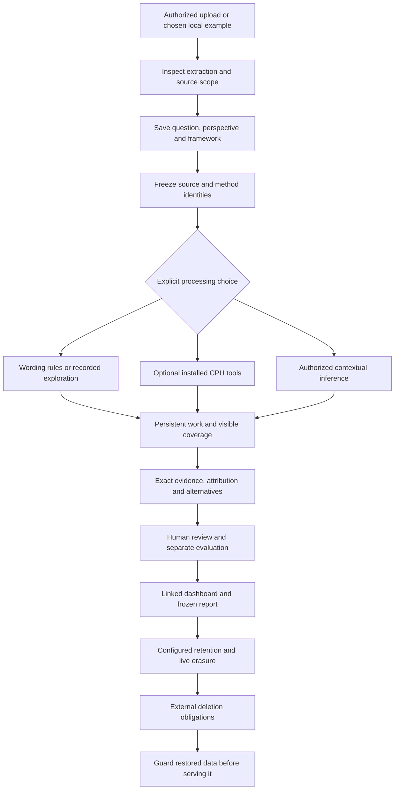
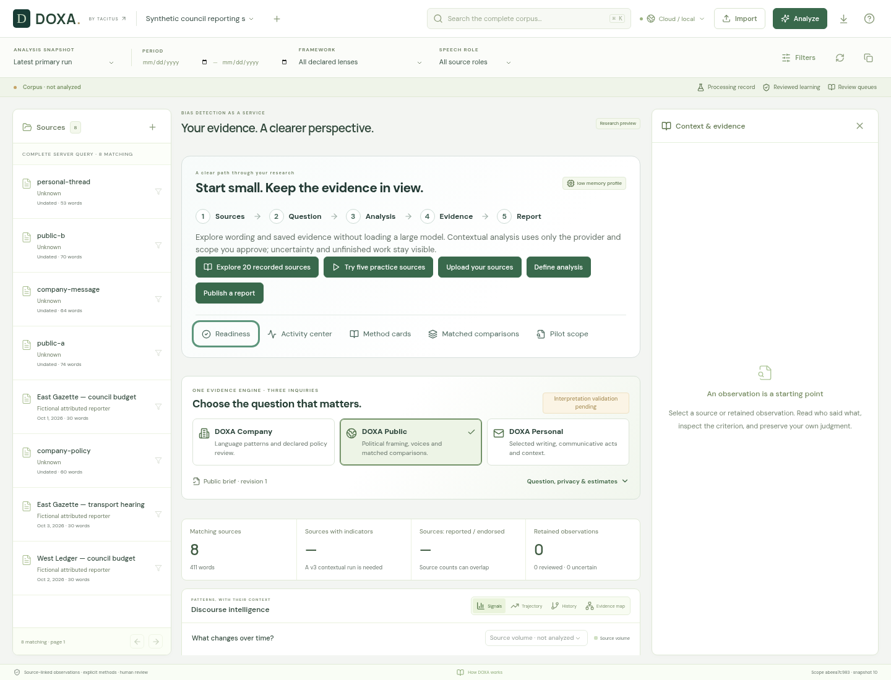
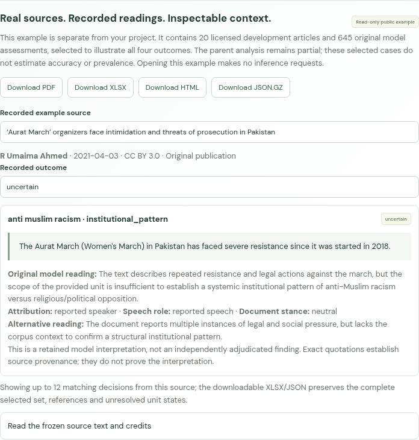
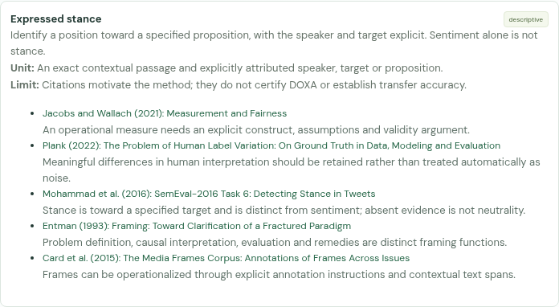
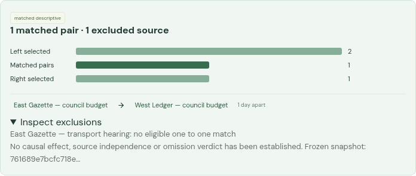

# v0.6 refinements: from a small local workflow to dedicated pilots

DOXA keeps one browser workbench for Company, Public and Personal inquiries. v0.6 improves the path from authorized sources to a readable, inspectable report. It adds executable methodology and service controls while retaining the original source/model record. **Independent interpretation accuracy remains unmeasured.** A bibliography, successful quotation check, software test or operator signature cannot establish that a judgment is correct.

The release targets an 8 GB computer for the lightweight workflow and dedicated native installations for initial online pilots. Its container budget and deployment recipe are configured boundaries. Whole-host usability, real-artifact ONNX performance and production customer operations need their own measured evidence. See the [verification record](verification-v06.md) for completed checks, and the [commercial roadmap](commercial-service-roadmap.md) for remaining human, contractual and operational gates.

## Ten implemented refinements

| Improvement | What the application now does | Boundary to retain |
| --- | --- | --- |
| **1. First use and diagnostics** | A five-step workflow, content-free doctor/readiness checks, a small recorded explorer and explicitly fictional practice inputs. | Readiness inspects configuration; it does not execute OCR/inference or certify a future PDF. |
| **2. Lightweight local execution** | Low-memory defaults, one parser/heavy operation, bounded CPU batches and a separate optional ONNX candidate adapter. | Docker supplies the 4 GiB aggregate process-tree limit; native Python does not. External model servers and browser memory are separate. |
| **3. Extraction quality and licensing** | pdfminer.six text extraction, pypdf inspection, scan/layout warnings and versioned exact Unicode text. | New extraction creates a new source identity; old source text and offsets are not silently recomputed. |
| **4. Academic measurement cards** | Frozen rules, constructs, context requirements, exclusions, sources and permitted conclusions, including report annexes. | Sources motivate the operational measure; they do not endorse DOXA or validate transfer to another domain. |
| **5. Reference-study tooling** | Rights/group-aware panel import, preregistration, per-criterion diagnostics, agreement and explicitly gated interpretation claims. | Real qualified reviewers, rights clearance and independent adjudication remain external work. Blank forms are not reference evidence. |
| **6. Structural context** | Optional anchored headings, supplied mail ancestry and quotation markers, with omissions and policy identity recorded. | Context sufficiency remains review-required; the system does not fetch missing mail or infer verified speakers from quote markers. |
| **7. Comparisons and trajectories** | Frozen event/topic/genre/date matching, explicit exclusions and prospective alert-review campaign tooling. | A match is descriptive and declared, not proof of independence, omission, causation or intent. Existing trajectory tests are reused. |
| **8. Persistent work and publication** | Durable ZIP intake, indexing and guided reports, grouped activity status, cancellation/restart and verified downloads. | Upload, extraction, index completion, model coverage and human review remain different quantities. |
| **9. Lifecycle and recovery** | Optional whole-project retention, signed deletion obligations outside ordinary backups and a restore guard before traffic. | Backups, provider copies and downloads have separate expiry obligations; a ledger entry does not verify their deletion. |
| **10. Dedicated online-pilot tooling** | One-customer native GCP recipe, separate Personal deployments, operator-issued quotes, exact-scope acceptance and internal usage caps. | No live customer deployment, payment integration, subscriptions, shared SaaS or audited residency is claimed. |

## Follow the evidence through the system

Question, framework, source selection and interpretation remain inspectable together. User-defined perspectives guide the inquiry; they are not simulated demographic identities. A quotation can express a represented speaker's position while its containing document rejects that position. Missing decisions remain unfinished work rather than negative labels.

The [8-bit Quest](guide.md) remains an optional illustrated introduction to these steps. The working interface and reports use the professional layout shown below.

The accompanying [mobile view](images/workspace-v06-mobile.png) is captured at 390 pixels. These are real interface captures, not design mockups, and contain no newly inferred findings.

## Two small starting points, with different origins

### Twenty real sources with their recorded model readings

The [PDF](../examples/v06-recorded-example.pdf), [HTML](../examples/v06-recorded-example.html), [complete XLSX](../examples/v06-recorded-example.xlsx), [JSON snapshot](../examples/v06-recorded-example.json.gz) and [manifest](../examples/v06-recorded-example.manifest.json) retain twenty actual Global Voices development articles from 2020–2025. Original author/translator credits, source links and CC BY 3.0 notices travel with the exact text and recorded outputs.

The subset contains **645 retained decisions and 11,280 exact source references**, with 33 accepted units and one partial unit. It was deliberately selected to illustrate different outcomes and incomplete work. Its selection uses recorded outcomes and is **not** a representative sample, accuracy estimate or fresh benchmark. It excludes canonical held-out and locked evaluation sources/story groups. The 5,000-source parent run remains partial with 79 missing decisions.

[Mobile recorded reader](images/recorded-example-v06-mobile.png) · [actual PDF preview](images/v06-recorded-example-preview.png).

The human-readable PDF/HTML show eight selected cases and separately identified application/AI-authored reading guidance. XLSX/JSON preserve all selected records. The read-only explorer creates no mutable project, remaps no historical identity, and requests no new inference. Its compressed package and downloads are checked against published hashes. Rebuilding the example requires the pinned original corpus/result packages; ordinary exploration uses the packaged subset offline.

### Five fictional practice texts

**Explore 20 recorded sources** opens the real read-only explorer above.

**Try five practice sources** uploads the five published [synthetic TXT inputs](../examples/pilot-v05-inputs/) through normal intake. They support practice with briefs, wording cues, evidence notes and reports; they supply no model outputs or human reference labels. Their provenance is separate from the real recorded-source explorer.

The [local guide](local-v06.md) explains installation, doctor output, models and memory boundaries. The [activity guide](activity-jobs-v06.md) explains durable work and its recovery contract.

## Methods that can be evaluated

Each new measurement card identifies the question being operationalized, the context needed, acceptable output categories and interpretations the evidence cannot establish. These contracts make an assessment falsifiable and reviewable; they do not make it correct merely because it cites a paper.

| Foundation | Application in DOXA | What is not established |
| --- | --- | --- |
| [Jacobs and Wallach, *Measurement and Fairness*](https://arxiv.org/abs/1912.05511) | State the construct and how the operational observation represents it. | That a universal bias score exists or that this implementation is valid. |
| [Card et al., *Media Frames Corpus*](https://aclanthology.org/P15-2072/) | Separate explicit frame annotation from prejudice and factuality. | Commercial rights to all underlying news texts, or performance on company/email data. |
| [Fan et al., BASIL](https://aclanthology.org/D19-1664/) | Distinguish lexical/informational bias and require relevant comparisons. | A deliberate-omission verdict from one isolated document. |
| [Ribeiro et al., CheckList](https://aclanthology.org/2020.acl-main.442/) and [Röttger et al., HateCheck](https://aclanthology.org/2021.acl-long.4/) | Execute reviewed behavioral cases for negation, reporting, counterspeech and related failures. | Success on DOXA's unexecuted fixtures or all target groups/domains. |
| [Artstein and Poesio, inter-coder agreement](https://aclanthology.org/J08-4004/) and [Plank, human label variation](https://aclanthology.org/2022.emnlp-main.731/) | Preserve reviewer disagreement, sampling design and multiple defensible readings. | That model agreement, one reviewer or an operator acknowledgement is independent ground truth. |

The existing 200-case news study remains an enriched diagnostic scaffold. New Company/Public/Personal panels target 1,000 primary source/thread clusters each, with rights and grouping records and a declared 40/20/40 development/calibration/test split. A panel's size and a recorded sampling attestation do not independently establish representativeness. Qualified model-blind annotations and separate adjudication are required before drawing interpretation-quality conclusions.

Preregistered release gates require the stated sampling/confidence assumptions and sufficient independent evidence. The initial product policy requires a one-sided 95% precision lower bound of at least 0.95 and at least 100 independently reviewed predicted-positive clusters for a “supported finding”; marketed detection additionally requires a recall lower bound of at least 0.80 and at least 80% non-abstained coverage. Clustered cases need the declared cluster-aware procedure. These are product thresholds, **not academic consensus or achieved performance**, and cannot be lowered after reading the held-out results. Reader-perceived tone needs its separately stated rating target and reader variation.

The explicit functional runner can prepare a bounded execution without model calls; actual execution requires an approved rubric, provider configuration and explicit scope/budget. The [twelve additional structural-context challenges](../benchmarks/v06-context-challenges.json) remain authored protocol proposals without gold labels or executed model results. See [extraction and context](extraction-v06.md) and the [evaluation contract](evaluation-v04.md).

## Compare only what the evidence permits

Matching snapshots retain the question, source versions, declared event/topic/genre metadata, date gap and exclusions. The v0.9.1 matcher maximizes eligible one-to-one pairs with deterministic date-gap ordering. Earlier frozen packets retain their original nearest-date pairs. Relevant metadata is declared by the operator or source and remains open to review. [Current matching method](research-scorecards.md#read-the-measurements)

The depicted example has two left sources, one right source and only one eligible pair. The unrelated hearing remains excluded. Removing the eligible left source returns “comparison not established.” A frozen comparison retains its original snapshot if later source metadata changes. Counts from a selected recorded run remain model-decision counts with unresolved coverage, not adjudicated population prevalence.

Prospective alert-review campaigns reuse the existing support, coverage, composition and multiple-testing controls. New reviews must be gathered prospectively under a registered method/schedule; hypothetical classification-error scenarios stay labeled sensitivity analyses. Neither a plotted change nor available campaign tooling establishes its cause or a measured prospective false-alert rate.

## Operate and recover deliberately

Local operation starts without an account or model. Dedicated hosted pilots use one native installation per customer, separate stores/secrets/backups and a separate Personal installation. The [GCP recipe](hosted-pilots-v06.md) needs an explicit operator deployment and actual recovery/security qualification before confidential customer use. The existing Cloudflare private-workspace profile remains separate.

A quote records the operator's fixed customer price, exact scope and distinct internal processing cap. Acceptance records that scope hash, not payment or a paid invoice. Provider reservations and actual usage remain accountable without converting client-supplied estimates into spend authority. Subscription billing and OAuth connectors are later work.

Retention stays manual by default. Automatic whole-project erasure requires both installation and project opt-ins and the configured external ledger. The deadline uses the earliest raw/derived interval from the **latest policy save**, not a timer beginning after report delivery. A restored database must apply externally retained deletion obligations before serving content. Provider/backup expiry is separate and not independently verified by an operator ledger entry. See [privacy and recovery](privacy-lifecycle-v06.md).

The release's native schema is 6; Cloudflare's private-workspace schema remains 4. Stop old writers and back up database **and objects** before upgrading. Shared SaaS tenancy, public subscriptions, independent interpretation validation and actual qualified customer delivery remain explicit commercial milestones.

## Verification evidence and its limits

The real [refinement browser workflow](../tests/browser_refinement_v06.py) passed **twelve checks**, with zero page errors, mocked routes or new inference requests. It exercises doctor output, fictional uploads, academic cards, actual real-source recorded exploration and PDF checksum/download, matching/exclusions, quote acceptance, persisted activity, keyboard focus and a 390-pixel layout. A queued publication stays unexecuted in this particular browser fixture; actual job execution/recovery is checked separately. No reviewer qualifications or analytical correctness are established by these UI checks.

The separate [10,000-source software exercise](scale-v06.md) passed 22 checks for short synthetic TXT parsing/persistence, replay, 100 result pages and a complete [XLSX](../examples/v06-scale-10000.xlsx). It includes a separately scoped 128-task lexical scheduler recovery test, not 10,000 contextual analyses. The [receipt](../benchmarks/v06-scale-10000.json) records 118.49 seconds overall in its actual environment. The runner had a 16 GiB cgroup limit; no physical 8 GB usability or large-model throughput claim follows from this proof.

The [release verification record](verification-v06.md) records the complete regression/build/container checks as they finish. Scientific interpretation studies and production cloud recovery/security qualification retain their separate evidence requirements.
