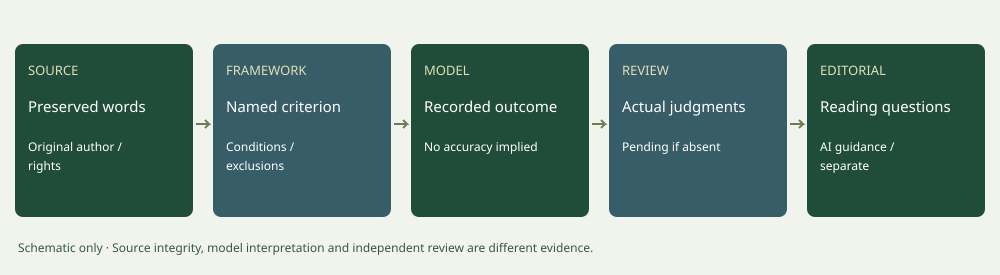

# Fifteen real cases: an evidence atlas

AI-authored walkthrough guidance; not independent human adjudication or an interpretation-accuracy benchmark.

<!-- page -->

## 01. Fifteen real cases: an evidence atlas

Source → framework → recorded model → review state → editorial questions

This atlas preserves real source text and original saved assessments from the institutional, political and news runs. Its fifteen cases include all four explicit outcomes and one separately represented unresolved decision. Three cases show a second recorded model reading.

The cases were purposively selected for teaching and methodological contrast. They are not independent human labels, a prevalence sample or a model-ranking benchmark. Commentary is AI-authored guidance. Original results, source-unit states and missing capture remain visible.

<!-- page -->

## 02. Case index and outcome key

| Case | Teaching question | Original result |
| --- | --- | --- |
| case-01 | Protective guidance contains an example voice | meets_criterion |
| case-02 | A committee reports discrimination | meets_criterion |
| case-03 | A political-expression boundary is not an indicator | meets_criterion |
| case-04 | Reported harm and unestablished intent | uncertain |
| case-05 | An evaluative metaphor in an executive order | meets_criterion |
| case-06 | An explicit policy remedy | meets_criterion |
| case-07 | A definition versus an instance | meets_criterion |
| case-08 | A statistical association and an Israel-related criterion | not_applicable |
| case-09 | The author, a post and a quoted video | meets_criterion |
| case-10 | News reporting contains hostile expression | meets_criterion |
| case-11 | A news political-expression boundary | meets_criterion |
| case-12 | An institutional-pattern hypothesis stays uncertain | uncertain |
| case-13 | A real explicit negative without a detailed rationale | does_not_meet |
| case-14 | Not applicable is a distinct recorded outcome | not_applicable |
| case-15 | An unresolved decision is not a negative | Unresolved / no accepted decision |

Positive means a named criterion was met under the recorded method. Indicator, boundary and descriptive kinds remain distinct. An uncertain result is not a negative; not_applicable is a separate applicability judgment. A gap has no accepted result to display.

<!-- page -->

## 03. How each two-page case is organized

| Layer | What is shown |
| --- | --- |
| Source | Exact bounded quotation, block-relative offsets, context, credits and license |
| Framework | Frozen operational criterion, conditions, exclusions and version |
| Model | Original result/stance/attribution and recorded explanation, if any |
| Review | Actual recorded state; independent judgments remain pending |
| Editorial | AI reading note and questions, separately labelled |
| Lineage | Original payload hash and explicit historical-request-capture status |

A display excerpt may be shorter than the source unit and is selected editorially for layout. The complete selected source blocks and all recorded references remain in v04-case-atlas.snapshot.json.gz. Exact offsets describe the displayed text, not a generated paraphrase. Source context available to a reader now must not be confused with an actual historical request capture.

When a compact negative supplied no detailed rationale, the model layer says not recorded. The editorial layer can ask how to assess it but cannot supply a retrospective model explanation. The unresolved case similarly contains no invented criterion result or assessment ID.

<!-- page -->

## 04. 01 / Evidence · Protective guidance contains an example voice

SOURCE LAYER · original text, not model-authored prose

> Moreover, because notions about customer preference (real or perceived) do not establish undue hardship, the client must make an exception to its dress code to let Jon wear his religious garb during front desk duty as a religious accommodation. 

Exact display locator: us07-b00050[998:1243]; page not supplied, paragraph 50. Zero-based, end-exclusive Unicode code points.

| Bibliographic field | Frozen value |
| --- | --- |
| Title | Religious Garb and Grooming in the Workplace: Rights and Responsibilities |
| Credited author | Equal Employment Opportunity Commission |
| Translator | None credited in source metadata |
| Publication date | 2014-03-06 |
| Source ID / license | us07 / US-PUBLIC-DOMAIN-GOVERNMENT-WORK |
| Frozen extracted hash | 984ac4f06c421f06d60d3288f9d8730ab8fe234a965df99e0a0686c9d2af5300 |

[Original source](https://www.eeoc.gov/laws/guidance/religious-garb-and-grooming-workplace-rights-and-responsibilities)

Framework layer · recorded operational criterion

discourse/framing · 1.0.0 · descriptive

Identify how a passage defines a problem, assigns causes or responsibility, invokes a value, or proposes a remedy.

Rubric origin: later text capture matching the historical selected-pack hash

Source mapping: entman1993: p52: problem definition, causal interpretation, moral evaluation and treatment recommendation. card2015: Annotation methodology and Table1 framing dimensions; coding disagreement.

Scope limitation: Descriptive research inquiry; no universal ideology, fairness or political-correctness scale.

<!-- page -->

## 05. 01 / Readings · Protective guidance contains an example voice

Model layer · original persisted reading

| Recorded field | Original value |
| --- | --- |
| Outcome / kind | meets_criterion / descriptive |
| Speaker / attribution | Equal Employment Opportunity Commission / author |
| Proposition | The tension between dress codes and religious practice. |
| Speaker / document stance | neutral / neutral |
| Hypothetical / certainty | False / ambiguous |
| Unit / review state | accepted / unreviewed |
| Model | @cf/google/gemma-4-26b-a4b-it |
| Assessment ID | 32459e910518c074c51980f089823604 |

Recorded explanation: The text frames the conflict as a legal obligation under Title VII, where customer preference or brand image does not constitute undue hardship, necessitating religious accommodation.

Recorded alternative: The text could frame this as a conflict between corporate branding and civil rights.

Editorial layer · AI-authored guidance, not independent human review

The protective rule and the illustrative character are different sources of a claim. A framing match does not mean the EEOC endorses a customer's discriminatory preference.

Review question: Which words state the rule, which belong to Jon's example, and is the hypothetical flag adequate for this mixed unit?

Human-review layer: independent judgments pending. Historical request capture: not recorded. A reconstructed template is not the actual request.

Context excerpt for reading: of public view, or if it required him not to wear his yarmulke or his tzitzit when interacting with customers. Assigning Jon to a position out of public view is segregation in violation of Title VII. Moreover, because notions about customer preference (real or perceived) do not establish undue hardship, the client must make an exception to its dress code to let Jon we

<!-- page -->

## 06. 02 / Evidence · A committee reports discrimination

SOURCE LAYER · original text, not model-authored prose

> Recommendation 16c With strong evidence about the rise of Islamophobia within wider society, and many individual Muslims coming forward with stories of discrimination and the fear of discrimination within the workplace, we believe there is a clear need for the Department for Work and Pensions to carry out research in this area. 

Exact display locator: uk07-p0020-b0007[283:613]; page 20, paragraph 7. Zero-based, end-exclusive Unicode code points.

| Bibliographic field | Frozen value |
| --- | --- |
| Title | Government Response to the Women and Equalities Committee Report on Employment Opportunities for Muslims in the UK |
| Credited author | Government Equalities Office |
| Translator | None credited in source metadata |
| Publication date | 2016-12-20 |
| Source ID / license | uk07 / OGL-UK-3.0 |
| Frozen extracted hash | c826adb7813babc836a8456fa9fb7c517710bb481b9548efb36710ee087c8f6e |

[Original source](https://assets.publishing.service.gov.uk/media/5a800a2b40f0b62305b88cee/58077_Cm9371_WEB.pdf)

Framework layer · recorded operational criterion

anti-muslim-hostility/discrimination_claim · 2026-03-operational-1 · indicator

Identify stated exclusion or unequal treatment directed at Muslims; do not pronounce legal unlawfulness from a passage.

Rubric origin: later text capture matching the historical selected-pack hash

Source mapping: Section 6, third definition paragraph; section 8 deliberately targeted subset of unlawful discrimination.

Scope limitation: Three textual operational criteria cannot establish every legal/contextual condition from one passage.

<!-- page -->

## 07. 02 / Readings · A committee reports discrimination

Model layer · original persisted reading

| Recorded field | Original value |
| --- | --- |
| Outcome / kind | meets_criterion / indicator |
| Speaker / attribution | Women and Equalities Committee / reported_speaker |
| Proposition | There is a rise in Islamophobia and stories of discrimination within the workplace. |
| Speaker / document stance | supports / supports |
| Hypothetical / certainty | False / ambiguous |
| Unit / review state | accepted / unreviewed |
| Model | @cf/google/gemma-4-26b-a4b-it |
| Assessment ID | 57bf8bbb0482381bb196ed6068feabc4 |

Recorded explanation: The text reports claims of rising Islamophobia and stories of discrimination/fear of discrimination experienced by Muslims in the workplace.

Recorded alternative: The text mentions the impact of discrimination on Muslim women wearing religious dress.

Editorial layer · AI-authored guidance, not independent human review

A government response reproduces a committee recommendation and reported experiences. Reporting a discrimination claim is distinct from expressing anti-Muslim hostility.

Review question: Trace the government, committee and witnesses separately. Does the model's supportive document stance apply to the right proposition?

Human-review layer: independent judgments pending. Historical request capture: not recorded. A reconstructed template is not the actual request.

Context excerpt for reading: ’ and working towards utilising more inclusive methods of identifying potential to ensure there is a clear pathway for all talented employees. The EHRC will respond separately on this recommendation. Recommendation 16c With strong evidence about the rise of Islamophobia within wider society, and many individual Muslims coming forward with stories of discrimination and

<!-- page -->

## 08. 03 / Evidence · A political-expression boundary is not an indicator

SOURCE LAYER · original text, not model-authored prose

> The individual claimed that that a pro-Palestinian organisation should “be working to end Zionism” and not fear about “hurt[ing] Zionist sensibilities”. 

Exact display locator: uk01-b01223[220:373]; page not supplied, paragraph 1223. Zero-based, end-exclusive Unicode code points.

| Bibliographic field | Frozen value |
| --- | --- |
| Title | Independent Review of Prevent |
| Credited author | William Shawcross CVO |
| Translator | None credited in source metadata |
| Publication date | 2023-02-08 |
| Source ID / license | uk01 / OGL-UK-3.0 |
| Frozen extracted hash | 4a791b1640104170d7e882c2515128103368e14a87bb5e5220b64da9f828d556 |

[Original source](https://www.gov.uk/government/publications/independent-review-of-prevents-report-and-government-response/independent-review-of-prevent-accessible)

Framework layer · recorded operational criterion

jda/political_expression_boundary · 2021-operational-1 · boundary

Differentiate anti-Jewish expression from political criticism. BDS, anti-Zionism, constitutional alternatives securing equality, and disproportionate criticism are not inherently antisemitic under this framework.

Rubric origin: later text capture matching the historical selected-pack hash

Source mapping: Guidelines 11–15 read together with 6–10; FAQ on free debate/legal use.

Scope limitation: Three operational criteria retain the political-expression boundary but do not replace all fifteen guidelines.

<!-- page -->

## 09. 03 / Readings · A political-expression boundary is not an indicator

Model layer · original persisted reading

| Recorded field | Original value |
| --- | --- |
| Outcome / kind | meets_criterion / boundary |
| Speaker / attribution | An unnamed individual (contextually linked to Lauren Booth via surrounding sentences) / reported_speaker |
| Proposition | Pro-Palestinian organizations should work to end Zionism and not fear hurting Zionist sensibilities. |
| Speaker / document stance | supports / neutral |
| Hypothetical / certainty | False / ambiguous |
| Unit / review state | accepted / unreviewed |
| Model | @cf/google/gemma-4-26b-a4b-it |
| Assessment ID | f93394d9d22c28b8127cd3970615b911 |

Recorded explanation: The text reports an individual's stance that pro-Palestinian organizations should work to end Zionism without fearing to hurt Zionist sensibilities, which falls under political expression regarding Zionism.

Recorded alternative: The individual's advocacy for ending Zionism is presented as a political position rather than inherent prejudice.

Editorial layer · AI-authored guidance, not independent human review

The JDA boundary is a limit on classification. A boundary match does not turn every surrounding statement into acceptable conduct or settle another framework.

Review question: Which political proposition falls within this boundary, and which separate claims need separate assessment?

Human-review layer: independent judgments pending. Historical request capture: not recorded. A reconstructed template is not the actual request.

Context excerpt for reading:  invited onto the podcast, this individual had been criticised in the Jewish press for condemning the Palestinian Solidarity Campaign’s dissociation from Gilad Atzmon over his record of antisemitism. The individual claimed that that a pro-Palestinian organisation should “be working to end Zionism” and not fear about “hurt[ing] Zionist sensibilities”. Atzmon has previo

<!-- page -->

## 10. 04 / Evidence · Reported harm and unestablished intent

SOURCE LAYER · original text, not model-authored prose

> “We’re not just being targeted verbally and being given the cold shoulder, dirty looks and fingers. 

Exact display locator: uk08-p0013-b0007[0:100]; page 13, paragraph 7. Zero-based, end-exclusive Unicode code points.

| Bibliographic field | Frozen value |
| --- | --- |
| Title | Action Against Hate: The UK Government's plan for tackling hate crime |
| Credited author | Home Office; Department for Communities and Local Government; Ministry of Justice |
| Translator | None credited in source metadata |
| Publication date | 2016-07-26 |
| Source ID / license | uk08 / OGL-UK-3.0 |
| Frozen extracted hash | d4b50d024dd09918f75ae46f5b0a5ef2cb612bdd8d69edb043e34010159473fa |

[Original source](https://assets.publishing.service.gov.uk/media/5f8db94a8fa8f56ad07d1152/2016_Hate_Crime_Action_Plan.pdf)

Framework layer · recorded operational criterion

anti-muslim-hostility/stereotyping_and_intent · 2026-03-operational-1 · indicator

Assess stereotyping intended to encourage hatred of Muslims. If intent is not established by context, explicitly mark insufficient_context rather than claiming it.

Rubric origin: later text capture matching the historical selected-pack hash

Source mapping: Section 6, second definition paragraph; section 8 discussion of intention and non-criminal conduct.

Scope limitation: Three textual operational criteria cannot establish every legal/contextual condition from one passage.

<!-- page -->

## 11. 04 / Readings · Reported harm and unestablished intent

Model layer · original persisted reading

| Recorded field | Original value |
| --- | --- |
| Outcome / kind | uncertain / indicator |
| Speaker / attribution | Veiled Muslim woman / quoted_speaker |
| Proposition | Hostile acts are occurring. |
| Speaker / document stance | unclear / neutral |
| Hypothetical / certainty | False / insufficient_context |
| Unit / review state | accepted / unreviewed |
| Model | @cf/google/gemma-4-26b-a4b-it |
| Assessment ID | 35a1cdcbaace24ccf9582edf493a8cf6 |

Recorded explanation: While the text describes hostile acts, it does not provide evidence of specific stereotyping intended to encourage hatred, nor does it establish the perpetrator's intent. Context is insufficient to meet this criterion.

Recorded alternative: The text lacks details on stereotyping or intent.

Editorial layer · AI-authored guidance, not independent human review

Testimony can report a harmful experience while a criterion-specific intent requirement remains unresolved. Uncertainty does not deny that harm occurred.

Review question: Which element is missing: target, conduct, stereotyping or intent? What additional source evidence could resolve it?

Human-review layer: independent judgments pending. Historical request capture: not recorded. A reconstructed template is not the actual request.

Context excerpt for reading: “We’re not just being targeted verbally and being given the cold shoulder, dirty looks and fingers. We’re also getting something that has moved slightly further and is a bit more dangerous.

<!-- page -->

## 12. 05 / Evidence · An evaluative metaphor in an executive order

SOURCE LAYER · original text, not model-authored prose

> Over the last 4 years, the previous administration trampled free speech rights by censoring Americans' speech on online platforms, often by exerting substantial coercive pressure on third parties, such as social media companies, to moderate, deplatform, or otherwise suppress speech that the Federal Government did not approve. 

Exact display locator: us04-b00005[245:573]; page not supplied, paragraph 5. Zero-based, end-exclusive Unicode code points.

| Bibliographic field | Frozen value |
| --- | --- |
| Title | Executive Order 14149: Restoring Freedom of Speech and Ending Federal Censorship |
| Credited author | President Donald J. Trump |
| Translator | None credited in source metadata |
| Publication date | 2025-01-20 |
| Source ID / license | us04 / US-PUBLIC-DOMAIN-GOVERNMENT-WORK |
| Frozen extracted hash | fc7fe1f1f99c8a8f1b0bc0948c9611307fff901f4c85c4e6f9c62313dfaefa1c |

[Original source](https://www.govinfo.gov/content/pkg/DCPD-202500116/html/DCPD-202500116.htm)

Framework layer · recorded operational criterion

political-framing/evaluative_language · 1.0.0 · descriptive

Identify evidenced appraisal, metaphor or legitimizing/delegitimizing wording, its target and textual function. Preserve quotation, negation, counter-speech and the responsible speaker. Apply the same descriptive rule across authors. Strong or emotional wording can be justified: it does not by itself establish falsity, unfairness, deceptive intent or equivalent conduct by compared actors.

Rubric origin: later text capture matching the historical selected-pack hash

Source mapping: recasens2013: Section2 categories of linguistic cues; appraisal is evidence to inspect, not proof of objective unfairness. entman1993: p52 moral evaluation function.

Scope limitation: Descriptive research inquiry; no universal ideology, fairness or political-correctness scale.

<!-- page -->

## 13. 05 / Readings · An evaluative metaphor in an executive order

Model layer · original persisted reading

| Recorded field | Original value |
| --- | --- |
| Outcome / kind | meets_criterion / descriptive |
| Speaker / attribution | President Donald J. Trump / unknown |
| Proposition | The previous administration's actions regarding speech and the nature of government censorship. |
| Speaker / document stance | opposes / opposes |
| Hypothetical / certainty | False / ambiguous |
| Unit / review state | accepted / unreviewed |
| Model | @cf/google/gemma-4-26b-a4b-it |
| Assessment ID | d6a4a1bf97d03d50b05186eeba945dd6 |

Recorded explanation: The text uses terms like 'trampled' to describe previous administration actions and 'intolerable' to characterize government censorship of speech.

Recorded alternative: The text employs strong language such as 'trampled' and 'intolerable' to describe government interference with speech.

Editorial layer · AI-authored guidance, not independent human review

A metaphor characterizes an opponent's alleged conduct. Detecting appraisal establishes neither factual falsity nor hidden motive.

Review question: What is asserted, who is evaluated, and what comparator would be needed for a claim of unequal standards?

Human-review layer: independent judgments pending. Historical request capture: not recorded. A reconstructed template is not the actual request.

Context excerpt for reading: the United States Constitution, an amendment essential to the success of our Republic, enshrines the right of the American people to speak freely in the public square without Government interference. Over the last 4 years, the previous administration trampled free speech rights by censoring Americans' speech on online platforms, often by exerting substantial coercive 

<!-- page -->

## 14. 06 / Evidence · An explicit policy remedy

SOURCE LAYER · original text, not model-authored prose

> It shall be the policy of the United States to combat anti-Semitism vigorously, using all available and appropriate legal tools, to prosecute, remove, or otherwise hold to account the perpetrators of unlawful anti-Semitic harassment and violence.

Exact display locator: us03-b00007[18:264]; page not supplied, paragraph 7. Zero-based, end-exclusive Unicode code points.

| Bibliographic field | Frozen value |
| --- | --- |
| Title | Executive Order 14188: Additional Measures To Combat Anti-Semitism |
| Credited author | President Donald J. Trump |
| Translator | None credited in source metadata |
| Publication date | 2025-01-29 |
| Source ID / license | us03 / US-PUBLIC-DOMAIN-GOVERNMENT-WORK |
| Frozen extracted hash | ec1701f0a98163e0c6739c24142977998dd41a2f9055b32d90bed535851bdcac |

[Original source](https://www.govinfo.gov/content/pkg/DCPD-202500196/html/DCPD-202500196.htm)

Framework layer · recorded operational criterion

political-framing/expressed_policy_position · 1.0.0 · descriptive

Identify an explicit position toward a named policy proposition, proposed action or remedy. State whose position it is and distinguish the attributed speaker's stance from the document's stance. Sentiment and topic mention alone do not establish stance; missing evidence of support or opposition does not imply neutrality. Do not infer a party, political identity or ideology from the position.

Rubric origin: later text capture matching the historical selected-pack hash

Source mapping: mohammad2016: Task definition and distinction between target-specific stance and sentiment. entman1993: p52 treatment recommendation function.

Scope limitation: Descriptive research inquiry; no universal ideology, fairness or political-correctness scale.

<!-- page -->

## 15. 06 / Readings · An explicit policy remedy

Model layer · original persisted reading

| Recorded field | Original value |
| --- | --- |
| Outcome / kind | meets_criterion / descriptive |
| Speaker / attribution | The President (via Executive Order) / unknown |
| Proposition | The United States shall use all available legal tools to prosecute or remove perpetrators of anti-Semitic harassment and violence. |
| Speaker / document stance | supports / supports |
| Hypothetical / certainty | False / supported |
| Unit / review state | accepted / unreviewed |
| Model | @cf/google/gemma-4-26b-a4b-it |
| Assessment ID | 2d44e6da2e3f70cb876ef6f1bdc4301b |

Recorded explanation: The document establishes a policy to vigorously combat anti-Semitism using legal tools to hold perpetrators accountable.

Recorded alternative: The text states the US policy is to combat anti-Semitism through legal prosecution and accountability.

Editorial layer · AI-authored guidance, not independent human review

An executive order supports a named legal-enforcement policy. A clear stance toward that remedy is more defensible than an inferred partisan identity.

Review question: Does this source exclude other remedies, or does the quotation show only one selected instrument?

Human-review layer: independent judgments pending. Historical request capture: not recorded. A reconstructed template is not the actual request.

Context excerpt for reading: Sec. 2 . Policy . It shall be the policy of the United States to combat anti-Semitism vigorously, using all available and appropriate legal tools, to prosecute, remove, or otherwise hold to account the perpetrators of unlawful anti-Semitic harassment and violence.

<!-- page -->

## 16. 07 / Evidence · A definition versus an instance

SOURCE LAYER · original text, not model-authored prose

> It is also the prejudicial stereotyping of Muslims, or people perceived to be Muslim including because of their ethnic or racial backgrounds or their appearance, and treating them as a collective group defined by fixed and negative characteristics, with the intention of encouraging hatred against them, irrespective of their actual opinions, beliefs or actions as individuals.

Exact display locator: uk10-b00029[0:377]; page not supplied, paragraph 29. Zero-based, end-exclusive Unicode code points.

| Bibliographic field | Frozen value |
| --- | --- |
| Title | A Definition of Anti-Muslim Hostility |
| Credited author | Ministry of Housing, Communities and Local Government |
| Translator | None credited in source metadata |
| Publication date | 2026-03-09 |
| Source ID / license | uk10 / OGL-UK-3.0 |
| Frozen extracted hash | 6d38441c34bc7f965f72f381e05ac305c88963677ea832c9b7800e743d1f2222 |

[Original source](https://www.gov.uk/guidance/a-definition-of-anti-muslim-hostility)

Framework layer · recorded operational criterion

anti-muslim-racism/racialization · 2025-operational-1 · indicator

Assess treating Muslims or perceived Muslims as a homogeneous, inferior, threatening, or inherently suspect population.

Rubric origin: later text capture matching the historical selected-pack hash

Source mapping: PDF p4/printed p3 longer definition and examples; PDF pp5–7 racialization discussion.

Scope limitation: Partial operationalization. Intersectionality, policy evidence and comparable outcomes require additional evidence. Full PDF is linked, not redistributed.

<!-- page -->

## 17. 07 / Readings · A definition versus an instance

Model layer · original persisted reading

| Recorded field | Original value |
| --- | --- |
| Outcome / kind | meets_criterion / indicator |
| Speaker / attribution | Ministry of Housing, Communities and Local Government / author |
| Proposition | Treating Muslims as a collective group defined by fixed and negative characteristics based on ethnic or racial backgrounds is anti-Muslim hostility. |
| Speaker / document stance | neutral / neutral |
| Hypothetical / certainty | False / ambiguous |
| Unit / review state | accepted / unreviewed |
| Model | @cf/google/gemma-4-26b-a4b-it |
| Assessment ID | 57a24379102d33225e54ecc89a0f444e |

Recorded explanation: The definition includes treating Muslims as a collective group with fixed negative characteristics based on ethnic or racial backgrounds.

Recorded alternative: Hostility includes treating perceived Muslims as a collective with fixed negative traits based on race or ethnicity.

Second recorded model · not adjudication

| Field | Verifier value |
| --- | --- |
| Result / attribution | does_not_meet / unknown |
| Speaker / document stance | not_applicable / not_applicable |
| Assessment ID | ca3e1d917bef47607e80e40a68d62bc1 |

Verifier explanation: No detailed model rationale was recorded.

Editorial layer · AI-authored guidance, not independent human review

The passage defines racialization. Whether a definition counts as an instance of the criterion depends on the declared measurement scope; this disagreement is not adjudicated here.

Review question: Are we counting defined concepts, represented conduct, or author-endorsed expression?

Human-review layer: independent judgments pending. Historical request capture: not recorded. A reconstructed template is not the actual request.

Context excerpt for reading: It is also the prejudicial stereotyping of Muslims, or people perceived to be Muslim including because of their ethnic or racial backgrounds or their appearance, and treating them as a collective group defined by fixed and negative characteristics, with the intention of encouraging hatred against them, irrespective of their actual opinions, beliefs or actions as indiv

<!-- page -->

## 18. 08 / Evidence · A statistical association and an Israel-related criterion

SOURCE LAYER · original text, not model-authored prose

> this increase was driven by a rise in hate crimes against Jewish people and to a lesser extent Muslims and has occurred since the beginning of the Israel-Hamas conflict

Exact display locator: uk04-b00011[0:168]; page not supplied, paragraph 11. Zero-based, end-exclusive Unicode code points.

| Bibliographic field | Frozen value |
| --- | --- |
| Title | Hate crime, England and Wales, year ending March 2024 |
| Credited author | Home Office |
| Translator | None credited in source metadata |
| Publication date | 2024-10-10 |
| Source ID / license | uk04 / OGL-UK-3.0 |
| Frozen extracted hash | dc043598fbaf8bd3198fd068da3d7d89cb179a4849850f67635a39268fb7b722 |

[Original source](https://www.gov.uk/government/statistics/hate-crime-england-and-wales-year-ending-march-2024/hate-crime-england-and-wales-year-ending-march-2024)

Framework layer · recorded operational criterion

ihra/israel_related_context · 2026-11-operational-1 · indicator

Assess relevant IHRA examples in overall context, including anti-Jewish tropes, discriminatory standards or denial of Jewish self-determination. Do not assume that policy criticism alone satisfies a criterion.

Rubric origin: later text capture matching the historical selected-pack hash

Source mapping: Context introduction and Israel-related examples; no criterion from Israel mention alone (access limitation retained).

Scope limitation: DOXA's three criteria are a partial operational summary, not the complete working definition.

<!-- page -->

## 19. 08 / Readings · A statistical association and an Israel-related criterion

Model layer · original persisted reading

| Recorded field | Original value |
| --- | --- |
| Outcome / kind | not_applicable / indicator |
| Speaker / attribution | Unknown / unknown |
| Proposition | Not recorded |
| Speaker / document stance | not_applicable / not_applicable |
| Hypothetical / certainty | False / insufficient_context |
| Unit / review state | accepted / unreviewed |
| Model | @cf/google/gemma-4-26b-a4b-it |
| Assessment ID | 4e5d1bc843d1e80f689cbc23df298a6f |

Recorded explanation: No detailed model rationale was recorded.

Recorded alternative: No model alternative was recorded.

Second recorded model · not adjudication

| Field | Verifier value |
| --- | --- |
| Result / attribution | meets_criterion / reported_speaker |
| Speaker / document stance | neutral / neutral |
| Assessment ID | e5486663af0fb4685a7036b84f05ef36 |

Verifier explanation: The passage links a rise in anti‑Jewish hate crimes to the start of the Israel‑Hamas conflict, providing an Israel‑related context for the observed increase.

Editorial layer · AI-authored guidance, not independent human review

A recorded hate-crime trend mentions the Israel-Hamas conflict. Mentioning context and satisfying a contextual prejudice criterion are distinct questions.

Review question: What additional anti-Jewish expression or discriminatory standard does this particular criterion require? Does 'since' establish causation?

Human-review layer: independent judgments pending. Historical request capture: not recorded. A reconstructed template is not the actual request.

Context excerpt for reading: this increase was driven by a rise in hate crimes against Jewish people and to a lesser extent Muslims and has occurred since the beginning of the Israel-Hamas conflict

<!-- page -->

## 20. 09 / Evidence · The author, a post and a quoted video

SOURCE LAYER · original text, not model-authored prose

> Don’t you care that the Jews are defiling the place of the Prophet’s nocturnal journey with their filth? 

Exact display locator: uk01-b01422[156:261]; page not supplied, paragraph 1422. Zero-based, end-exclusive Unicode code points.

| Bibliographic field | Frozen value |
| --- | --- |
| Title | Independent Review of Prevent |
| Credited author | William Shawcross CVO |
| Translator | None credited in source metadata |
| Publication date | 2023-02-08 |
| Source ID / license | uk01 / OGL-UK-3.0 |
| Frozen extracted hash | 4a791b1640104170d7e882c2515128103368e14a87bb5e5220b64da9f828d556 |

[Original source](https://www.gov.uk/government/publications/independent-review-of-prevents-report-and-government-response/independent-review-of-prevent-accessible)

Framework layer · recorded operational criterion

nexus/anti_jewish_tropes · 2024-06-operational-1 · indicator

Assess stereotypical assertions, conspiracies, demonization, or unequal treatment directed at Jews as Jews.

Rubric origin: later text capture matching the historical selected-pack hash

Source mapping: What Is Antisemitic? 2,3; definition.

Scope limitation: Three operational criteria; no vote across frameworks and no legal determination.

<!-- page -->

## 21. 09 / Readings · The author, a post and a quoted video

Model layer · original persisted reading

| Recorded field | Original value |
| --- | --- |
| Outcome / kind | meets_criterion / indicator |
| Speaker / attribution | Unidentified Facebook user (via reportage) / reported_speaker |
| Proposition | Jews are defiling a religious site and are the most hostile people towards believers. |
| Speaker / document stance | unclear / neutral |
| Hypothetical / certainty | False / ambiguous |
| Unit / review state | accepted / unreviewed |
| Model | @cf/google/gemma-4-26b-a4b-it |
| Assessment ID | 7b9c226fb4229c85c248fe974f801493 |

Recorded explanation: The quoted social media content uses demonizing language, describing Jews as 'defiling' a site with 'filth' and being 'most hostile'. (s_a7597a148f6fa369ed8482f5, s_88300d52cdac6e71db6d0086)

Recorded alternative: The text only reports the existence of these tropes without endorsing them.

Second recorded model · not adjudication

| Field | Verifier value |
| --- | --- |
| Result / attribution | meets_criterion / author |
| Speaker / document stance | unclear / neutral |
| Assessment ID | 66ef20dd11e36b743f09674304633182 |

Verifier explanation: The post calls Jews “defiling…with their filth” and labels them “the most hostile people towards the believers,” depicting Jews as collectively malevolent.

Editorial layer · AI-authored guidance, not independent human review

Both models detect a trope, but disagree about the attributed speaker. The source footnote says a post shares a video containing the call; agreement on outcome does not settle attribution.

Review question: Trace author → post → video voice. Is 'author' compatible with the explicit quotation source?

Human-review layer: independent judgments pending. Historical request capture: not recorded. A reconstructed template is not the actual request.

Context excerpt for reading: Screenshot of this individual’s Facebook post, 19 July 2014. The post shares a video that contains the following call: “Where is the Caliph of the Muslims? Don’t you care that the Jews are defiling the place of the Prophet’s nocturnal journey with their filth? The Jews are the most hostile people towards the believers.” ↩

<!-- page -->

## 22. 10 / Evidence · News reporting contains hostile expression

SOURCE LAYER · original text, not model-authored prose

> Curse be upon the Jews! 

Exact display locator: gv-708111-b00019[257:281]; page not supplied, paragraph 19. Zero-based, end-exclusive Unicode code points.

| Bibliographic field | Frozen value |
| --- | --- |
| Title | Information warfare: COVID-19’s other battleground in the Middle East |
| Credited author | Saoussen Ben Cheikh |
| Translator | None credited in source metadata |
| Publication date | 2020-06-10T15:01:15Z |
| Source ID / license | gv-708111 / CC-BY-3.0 |
| Frozen extracted hash | 8cfa27b8836650fc6ee21660f1aa94cf041e83d8f316f86d6347db344dbe5ef2 |

[Original source](https://globalvoices.org/2020/06/10/information-warfare-covid-19s-other-battleground-in-the-middle-east/)

Framework layer · recorded operational criterion

ihra/anti_jewish_generalization · 2026-11-operational-1 · indicator

Assess hostility, dehumanization, conspiracies, or collective allegations directed at Jews as Jews.

Rubric origin: embedded historical run snapshot

Source mapping: Definition and examples concerning stereotyping/conspiracies/dehumanization (current-page access limitation retained).

Scope limitation: DOXA's three criteria are a partial operational summary, not the complete working definition.

<!-- page -->

## 23. 10 / Readings · News reporting contains hostile expression

Model layer · original persisted reading

| Recorded field | Original value |
| --- | --- |
| Outcome / kind | meets_criterion / indicator |
| Speaker / attribution | Taha Al-Mutawakkil / quoted_speaker |
| Proposition | Curse be upon the Jews! |
| Speaker / document stance | supports / neutral |
| Hypothetical / certainty | False / ambiguous |
| Unit / review state | accepted / unreviewed |
| Model | @cf/google/gemma-4-26b-a4b-it |
| Assessment ID | 87cdc2ef04106000a28088428d071791 |

Recorded explanation: The text reports a specific religious curse directed at Jews as part of a quoted sermon by Taha Al-Mutawakkil.

Recorded alternative: The text documents an instance of hostility directed at Jews through reported speech.

Editorial layer · AI-authored guidance, not independent human review

A news article can report hostile material without endorsing it. Keep the represented speaker's claim and the journalist's stance separate.

Review question: Which voice is responsible for the quoted expression and how does the article respond to it?

Human-review layer: independent judgments pending. Historical request capture: not recorded. A reconstructed template is not the actual request.

Context excerpt for reading: a public sermon aired on TV: “We must ask the whole world, we must ask all of humanity: Who and what is behind the coronavirus?” He concludes with a Houthi slogan: “Death to America! Death to Israel! Curse be upon the Jews! Victory to Islam!”

<!-- page -->

## 24. 11 / Evidence · A news political-expression boundary

SOURCE LAYER · original text, not model-authored prose

> “We have set our minds to waking up the nation, whether it's about arms sales to Azerbaijan, Myanmar, South Sudan or Vietnam”, declared Joseph, who emphasised that his was a pro-Israeli and patriotic position.

Exact display locator: gv-721811-b00034[0:209]; page not supplied, paragraph 34. Zero-based, end-exclusive Unicode code points.

| Bibliographic field | Frozen value |
| --- | --- |
| Title | Conflict in Nagorno-Karabakh raises scrutiny of Israel's arms sales to Azerbaijan |
| Credited author | Maxim Edwards |
| Translator | None credited in source metadata |
| Publication date | 2020-11-12T16:35:07Z |
| Source ID / license | gv-721811 / CC-BY-3.0 |
| Frozen extracted hash | 9a2cafbb3dafc4f4d2f33bf844bdaa45c96e5f36af0eb156a43986e718d3c3c3 |

[Original source](https://globalvoices.org/2020/11/12/conflict-nagorno-karabakh-raises-scrutiny-israeli-arms-azerbaijan/)

Framework layer · recorded operational criterion

jda/political_expression_boundary · 2021-operational-1 · boundary

Differentiate anti-Jewish expression from political criticism. BDS, anti-Zionism, constitutional alternatives securing equality, and disproportionate criticism are not inherently antisemitic under this framework.

Rubric origin: embedded historical run snapshot

Source mapping: Guidelines 11–15 read together with 6–10; FAQ on free debate/legal use.

Scope limitation: Three operational criteria retain the political-expression boundary but do not replace all fifteen guidelines.

<!-- page -->

## 25. 11 / Readings · A news political-expression boundary

Model layer · original persisted reading

| Recorded field | Original value |
| --- | --- |
| Outcome / kind | meets_criterion / boundary |
| Speaker / attribution | Elie Joseph / quoted_speaker |
| Proposition | Arms sales to Azerbaijan are a matter of national concern and ethical debate. |
| Speaker / document stance | opposes / neutral |
| Hypothetical / certainty | False / ambiguous |
| Unit / review state | accepted / unreviewed |
| Model | @cf/google/gemma-4-26b-a4b-it |
| Assessment ID | 7df34e61b1b71262af27473c96b579c3 |

Recorded explanation: The text reports on an activist's criticism of arms sales, which he explicitly frames as a pro-Israeli and patriotic position rather than anti-Jewish.

Recorded alternative: The criticism is presented as a matter of national ethics and political policy rather than religious or ethnic prejudice.

Editorial layer · AI-authored guidance, not independent human review

A boundary observation concerns a specified political proposition, not a blanket judgment about a publisher or a person's intentions.

Review question: Does the surrounding source distinguish policy criticism from a claim directed at Jews as Jews?

Human-review layer: independent judgments pending. Historical request capture: not recorded. A reconstructed template is not the actual request.

Context excerpt for reading: “We have set our minds to waking up the nation, whether it's about arms sales to Azerbaijan, Myanmar, South Sudan or Vietnam”, declared Joseph, who emphasised that his was a pro-Israeli and patriotic position.

<!-- page -->

## 26. 12 / Evidence · An institutional-pattern hypothesis stays uncertain

SOURCE LAYER · original text, not model-authored prose

> An example of such is the famous 2016 case of the Somalia student who wore hijab to class, and was pressured by the school's principal to take off her headscarf or face expulsion. 

Exact display locator: gv-736381-b00012[0:180]; page not supplied, paragraph 12. Zero-based, end-exclusive Unicode code points.

| Bibliographic field | Frozen value |
| --- | --- |
| Title | Czechia's Muslim women celebrated Ramadan with mixed experiences |
| Credited author | Elmira Lyapina |
| Translator | None credited in source metadata |
| Publication date | 2021-05-29T04:56:34Z |
| Source ID / license | gv-736381 / CC-BY-3.0 |
| Frozen extracted hash | 6c147ac74f215dc8ee22a0b0ae81b1aa129ca7a34a87fd96f67ef865c773f62e |

[Original source](https://globalvoices.org/2021/05/29/czechias-muslim-women-celebrated-ramadan-with-mixed-experiences/)

Framework layer · recorded operational criterion

anti-muslim-racism/institutional_pattern · 2025-operational-1 · indicator

Identify an evidenced institutional practice or repeated pattern. One passage cannot by itself establish a systemic pattern; mark insufficient context when required.

Rubric origin: embedded historical run snapshot

Source mapping: PDF pp7–10/printed pp6–9; comparison/evidence must establish a pattern rather than merely assert it.

Scope limitation: Partial operationalization. Intersectionality, policy evidence and comparable outcomes require additional evidence. Full PDF is linked, not redistributed.

<!-- page -->

## 27. 12 / Readings · An institutional-pattern hypothesis stays uncertain

Model layer · original persisted reading

| Recorded field | Original value |
| --- | --- |
| Outcome / kind | uncertain / indicator |
| Speaker / attribution | The document (reporting on the 2016 case and subsequent legal proceedings) / reported_speaker |
| Proposition | The school principal's pressure on a student to remove her hijab was supported by political entities and lower courts. |
| Speaker / document stance | neutral / neutral |
| Hypothetical / certainty | False / ambiguous |
| Unit / review state | accepted / unreviewed |
| Model | @cf/google/gemma-4-26b-a4b-it |
| Assessment ID | 09f824e6a4af44ac297dc8ec25fc4c85 |

Recorded explanation: While a school principal's actions were supported by political entities and initially upheld by lower courts, the Supreme Court later overturned the decision, making a systemic pattern of institutional practice unestablished in this single case.

Recorded alternative: The text describes specific instances of institutional friction and political support for anti-hijab stances, but the judicial reversal prevents a definitive classification of a sustained institutional pattern.

Editorial layer · AI-authored guidance, not independent human review

A story can motivate inquiry into institutions while lacking the comparison needed to establish a repeated structural pattern.

Review question: Which comparison, baseline or additional institutional evidence would make this pattern assessable?

Human-review layer: independent judgments pending. Historical request capture: not recorded. A reconstructed template is not the actual request.

Context excerpt for reading: An example of such is the famous 2016 case of the Somalia student who wore hijab to class, and was pressured by the school's principal to take off her headscarf or face expulsion. The principal received support from Islamophobic movements and political parties, and was even awarded a medal in 2018 by the right-wing Czech president Zeman for being “a brave woman in the

<!-- page -->

## 28. 13 / Evidence · A real explicit negative without a detailed rationale

SOURCE LAYER · original text, not model-authored prose

> It will be almost impossible to execute, as Carnival mas [costume] production is essentially a 12 month cycle. 

Exact display locator: gv-719689-b00016[76:187]; page not supplied, paragraph 16. Zero-based, end-exclusive Unicode code points.

| Bibliographic field | Frozen value |
| --- | --- |
| Title | COVID-19 causes Trinidad and Tobago to cancel its Carnival for 2021 |
| Credited author | Janine Mendes-Franco |
| Translator | None credited in source metadata |
| Publication date | 2020-09-29T13:33:18Z |
| Source ID / license | gv-719689 / CC-BY-3.0 |
| Frozen extracted hash | 9b0f17e8a85d4b3bd943836703f6c9805d438eedb8bf199b9f0c14a0dde04569 |

[Original source](https://globalvoices.org/2020/09/29/covid-19-causes-trinidad-and-tobago-to-cancel-its-carnival-for-2021/)

Framework layer · recorded operational criterion

jda/jews_as_jews · 2021-operational-1 · indicator

Assess discrimination, prejudice, hostility, or violence against Jews as Jews or Jewish institutions as Jewish.

Rubric origin: embedded historical run snapshot

Source mapping: Definition; General guidelines 1–5.

Scope limitation: Three operational criteria retain the political-expression boundary but do not replace all fifteen guidelines.

<!-- page -->

## 29. 13 / Readings · A real explicit negative without a detailed rationale

Model layer · original persisted reading

| Recorded field | Original value |
| --- | --- |
| Outcome / kind | does_not_meet / indicator |
| Speaker / attribution | Unknown / unknown |
| Proposition | Not recorded |
| Speaker / document stance | not_applicable / not_applicable |
| Hypothetical / certainty | False / insufficient_context |
| Unit / review state | accepted / unreviewed |
| Model | @cf/google/gemma-4-26b-a4b-it |
| Assessment ID | 00005ffc46023612f8d143b4a3bdc641 |

Recorded explanation: No detailed model rationale was recorded.

Recorded alternative: No model alternative was recorded.

Editorial layer · AI-authored guidance, not independent human review

The stored decision is does_not_meet. Source-unit anchors are software provenance, not an invented model explanation of why it decided negatively.

Review question: What does this specific negative establish about this unit, and what does it leave unmeasured elsewhere?

Human-review layer: independent judgments pending. Historical request capture: not recorded. A reconstructed template is not the actual request.

Context excerpt for reading: > Having a 2021 Carnival may jeopardize the planning cycle for one in 2022. It will be almost impossible to execute, as Carnival mas [costume] production is essentially a 12 month cycle. So there are challenges to logistics, Sponsorship, Supply Chain, Manufacturing, Costuming, International Travel, Consumer Patterns, Disposable Income and Statutory Approvals all chang

<!-- page -->

## 30. 14 / Evidence · Not applicable is a distinct recorded outcome

SOURCE LAYER · original text, not model-authored prose

> The second was from a parent who was trying to decide whether to invest in private lessons being offered by their child’s primary school teacher at a cost of three hundred dollars ($US45) per week. 

Exact display locator: gv-706103-b00018[101:299]; page not supplied, paragraph 18. Zero-based, end-exclusive Unicode code points.

| Bibliographic field | Frozen value |
| --- | --- |
| Title | COVID-19 and Trinidad and Tobago education's digital divide |
| Credited author | Amilcar Sanatan |
| Translator | None credited in source metadata |
| Publication date | 2020-05-08T23:33:30Z |
| Source ID / license | gv-706103 / CC-BY-3.0 |
| Frozen extracted hash | 277b9d56bd564525617b44ee178c2d177e61e491c4bbf159e826790940376f03 |

[Original source](https://globalvoices.org/2020/05/08/covid-19-and-trinidad-and-tobago-educations-digital-divide/)

Framework layer · recorded operational criterion

anti-muslim-racism/institutional_pattern · 2025-operational-1 · indicator

Identify an evidenced institutional practice or repeated pattern. One passage cannot by itself establish a systemic pattern; mark insufficient context when required.

Rubric origin: embedded historical run snapshot

Source mapping: PDF pp7–10/printed pp6–9; comparison/evidence must establish a pattern rather than merely assert it.

Scope limitation: Partial operationalization. Intersectionality, policy evidence and comparable outcomes require additional evidence. Full PDF is linked, not redistributed.

<!-- page -->

## 31. 14 / Readings · Not applicable is a distinct recorded outcome

Model layer · original persisted reading

| Recorded field | Original value |
| --- | --- |
| Outcome / kind | not_applicable / indicator |
| Speaker / attribution | Unknown / unknown |
| Proposition | Not recorded |
| Speaker / document stance | not_applicable / not_applicable |
| Hypothetical / certainty | False / insufficient_context |
| Unit / review state | accepted / unreviewed |
| Model | @cf/google/gemma-4-26b-a4b-it |
| Assessment ID | 000211f6208aa907d36a22e3b06239f6 |

Recorded explanation: No detailed model rationale was recorded.

Recorded alternative: No model alternative was recorded.

Editorial layer · AI-authored guidance, not independent human review

The recorded applicability judgment is not a measured absence of every possible issue. It should not be merged silently with missing or failed work.

Review question: Is the criterion applicable to the supplied unit? Would a reviewer distinguish a determinate non-match from an out-of-scope question?

Human-review layer: independent judgments pending. Historical request capture: not recorded. A reconstructed template is not the actual request.

Context excerpt for reading: Immediately after the Ministry of Education’s April 14 press conference, I received two phone calls. The second was from a parent who was trying to decide whether to invest in private lessons being offered by their child’s primary school teacher at a cost of three hundred dollars ($US45) per week. The deal being offered included two WhatsApp video calls.

<!-- page -->

## 32. 15 / Evidence · An unresolved decision is not a negative

SOURCE LAYER · original text, not model-authored prose

> Although he granted the time off, the president teased the employee for refusing to look at a Playboy magazine, called him a “religious freak,” and used vulgar sexual language when speaking to or about the employee. 

Exact display locator: us05-b00266[115:331]; page not supplied, paragraph 266. Zero-based, end-exclusive Unicode code points.

| Bibliographic field | Frozen value |
| --- | --- |
| Title | Section 12: Religious Discrimination |
| Credited author | Equal Employment Opportunity Commission |
| Translator | None credited in source metadata |
| Publication date | 2021-01-15 |
| Source ID / license | us05 / US-PUBLIC-DOMAIN-GOVERNMENT-WORK |
| Frozen extracted hash | 49de1a3734b26231bbdf850c27097435abec1d40100cefd5dfd81fc370c2f368 |

[Original source](https://www.eeoc.gov/laws/guidance/section-12-religious-discrimination)

Framework layer · recorded operational criterion

Missing requested criterion: anti-muslim-hostility/discrimination_claim

No accepted decision exists for this key. The source unit and its retained peers remain part of the frozen processing scope.

<!-- page -->

## 33. 15 / Readings · An unresolved decision is not a negative

Model layer · original persisted reading

Result: not recorded. Model explanation: not recorded. Assessment ID: none for the missing decision.

| Recorded processing field | Value |
| --- | --- |
| Unit ID | u_581dfa046319abeee367ee1c |
| Unit state | partial |
| Missing keys | anti-muslim-hostility/discrimination_claim |
| Evidence origin | Software-rebuilt frozen source unit, not model-selected rationale |

Editorial layer · AI-authored guidance, not independent human review

The source unit retains some accepted peer criteria, but at least one requested decision is missing. No result, explanation or confidence is invented for the gap.

Review question: Which requested criterion remains unresolved and what supplied context or retry/review would address it?

Human-review layer: independent judgments pending. Historical request capture: not recorded. A reconstructed template is not the actual request.

Context excerpt for reading: The president of Printing Corp. regularly mocked and berated an employee who asked for Sundays off to attend Mass. Although he granted the time off, the president teased the employee for refusing to look at a Playboy magazine, called him a “religious freak,” and used vulgar sexual language when speaking to or about the employee. He mocked him for “following the Pope a

<!-- page -->

## 34. Source and rights ledger · 1

Credits are frozen bibliographic metadata. A containing document may quote additional speakers, who remain distinct from its byline. The evidence snapshot preserves full URLs, rights notes, source hashes and translator metadata.

Religious Garb and Grooming in the Workplace: Rights and Responsibilities — Equal Employment Opportunity Commission; 2014-03-06; US-PUBLIC-DOMAIN-GOVERNMENT-WORK

[Original source · us07](https://www.eeoc.gov/laws/guidance/religious-garb-and-grooming-workplace-rights-and-responsibilities)

Government Response to the Women and Equalities Committee Report on Employment Opportunities for Muslims in the UK — Government Equalities Office; 2016-12-20; OGL-UK-3.0

[Original source · uk07](https://assets.publishing.service.gov.uk/media/5a800a2b40f0b62305b88cee/58077_Cm9371_WEB.pdf)

Independent Review of Prevent — William Shawcross CVO; 2023-02-08; OGL-UK-3.0

[Original source · uk01](https://www.gov.uk/government/publications/independent-review-of-prevents-report-and-government-response/independent-review-of-prevent-accessible)

Action Against Hate: The UK Government's plan for tackling hate crime — Home Office; Department for Communities and Local Government; Ministry of Justice; 2016-07-26; OGL-UK-3.0

[Original source · uk08](https://assets.publishing.service.gov.uk/media/5f8db94a8fa8f56ad07d1152/2016_Hate_Crime_Action_Plan.pdf)

Executive Order 14149: Restoring Freedom of Speech and Ending Federal Censorship — President Donald J. Trump; 2025-01-20; US-PUBLIC-DOMAIN-GOVERNMENT-WORK

[Original source · us04](https://www.govinfo.gov/content/pkg/DCPD-202500116/html/DCPD-202500116.htm)

Executive Order 14188: Additional Measures To Combat Anti-Semitism — President Donald J. Trump; 2025-01-29; US-PUBLIC-DOMAIN-GOVERNMENT-WORK

[Original source · us03](https://www.govinfo.gov/content/pkg/DCPD-202500196/html/DCPD-202500196.htm)

A Definition of Anti-Muslim Hostility — Ministry of Housing, Communities and Local Government; 2026-03-09; OGL-UK-3.0

[Original source · uk10](https://www.gov.uk/guidance/a-definition-of-anti-muslim-hostility)

<!-- page -->

## 35. Source and rights ledger · 2

Credits are frozen bibliographic metadata. A containing document may quote additional speakers, who remain distinct from its byline. The evidence snapshot preserves full URLs, rights notes, source hashes and translator metadata.

Hate crime, England and Wales, year ending March 2024 — Home Office; 2024-10-10; OGL-UK-3.0

[Original source · uk04](https://www.gov.uk/government/statistics/hate-crime-england-and-wales-year-ending-march-2024/hate-crime-england-and-wales-year-ending-march-2024)

Information warfare: COVID-19’s other battleground in the Middle East — Saoussen Ben Cheikh; 2020-06-10T15:01:15Z; CC-BY-3.0

[Original source · gv-708111](https://globalvoices.org/2020/06/10/information-warfare-covid-19s-other-battleground-in-the-middle-east/)

Conflict in Nagorno-Karabakh raises scrutiny of Israel's arms sales to Azerbaijan — Maxim Edwards; 2020-11-12T16:35:07Z; CC-BY-3.0

[Original source · gv-721811](https://globalvoices.org/2020/11/12/conflict-nagorno-karabakh-raises-scrutiny-israeli-arms-azerbaijan/)

Czechia's Muslim women celebrated Ramadan with mixed experiences — Elmira Lyapina; 2021-05-29T04:56:34Z; CC-BY-3.0

[Original source · gv-736381](https://globalvoices.org/2021/05/29/czechias-muslim-women-celebrated-ramadan-with-mixed-experiences/)

COVID-19 causes Trinidad and Tobago to cancel its Carnival for 2021 — Janine Mendes-Franco; 2020-09-29T13:33:18Z; CC-BY-3.0

[Original source · gv-719689](https://globalvoices.org/2020/09/29/covid-19-causes-trinidad-and-tobago-to-cancel-its-carnival-for-2021/)

COVID-19 and Trinidad and Tobago education's digital divide — Amilcar Sanatan; 2020-05-08T23:33:30Z; CC-BY-3.0

[Original source · gv-706103](https://globalvoices.org/2020/05/08/covid-19-and-trinidad-and-tobago-educations-digital-divide/)

Section 12: Religious Discrimination — Equal Employment Opportunity Commission; 2021-01-15; US-PUBLIC-DOMAIN-GOVERNMENT-WORK

[Original source · us05](https://www.eeoc.gov/laws/guidance/section-12-religious-discrimination)

<!-- page -->

## 36. Research behind these questions · 1

**jacobs2021** — Measurement and Fairness (2021). https://arxiv.org/abs/1912.05511
Declare construct, operationalization, exclusions and population before interpreting counts. Does not validate DOXA constructs or model predictions.

**entman1993** — Framing: Toward Clarification of a Fractured Paradigm (1993). https://fbaum.unc.edu/teaching/articles/J-Communication-1993-Entman.pdf
Separate problem definition, causal interpretation, evaluation and remedy. A textual frame does not establish unfairness or audience influence.

**mohammad2016** — SemEval-2016 Task 6: Detecting Stance in Tweets (2016). https://aclanthology.org/S16-1003/
Specify target/proposition; distinguish sentiment, stance and lack of evidence. Tweet performance does not transfer to whole policy documents.

**fan2019** — In Plain Sight: Media Bias Through the Lens of Factual Reporting (2019). https://aclanthology.org/D19-1664/
Informational selection needs declared comparable sources and broader context. An arbitrary corpus absence is not deliberate omission.

**breck2004** — Playing the Telephone Game: Determining the Hierarchical Structure of Perspective and Speech Expressions (2004). https://aclanthology.org/C04-1018/
Preserve hierarchical direct/indirect sources of quoted and reported expression. Attribution structure is not access to a person's private beliefs.

<!-- page -->

## 37. Research behind these questions · 2

**plank2022** — The ‘Problem’ of Human Label Variation: On Ground Truth in Data, Modeling and Evaluation (2022). https://aclanthology.org/2022.emnlp-main.731/
Preserve raw independent labels, plausible disagreement and later adjudication. A position paper motivates design, not an accuracy guarantee.

**artstein2008** — Inter-Coder Agreement for Computational Linguistics (2008). https://aclanthology.org/J08-4004/
Choose agreement measures by task and assumptions; report frequencies and uncertainty. Agreement is not validity; no pooled coefficient substitutes for field-specific evaluation.

**rottger2021** — HateCheck: Functional Tests for Hate Speech Detection Models (2021). https://aclanthology.org/2021.acl-long.4/
Test negation, counter-speech, identity references and other specific capabilities. Original seven target groups omit Jewish people; short functional cases do not validate long-document antisemitism.

**deyoung2020** — ERASER: A Benchmark to Evaluate Rationalized NLP Models (2020). https://aclanthology.org/2020.acl-main.408/
Separate rationale plausibility/faithfulness from exact quotation integrity. DOXA's explanations are editorially inspectable, not proof of causal model reasoning.

**xiong2024** — Can LLMs Express Their Uncertainty? An Empirical Evaluation of Confidence Elicitation in LLMs (2024). https://iclr.cc/virtual/2024/poster/18135
Evaluate verbal confidence and failure prediction rather than assuming them reliable. Reported benchmark findings do not establish DOXA correctness probabilities.

<!-- page -->

## 38. Receipts, gaps and independent review

The case snapshot retains the complete selected sources, original payload hashes, frozen criteria, review overlays where recorded, and all reference anchors. The lineage index connects those objects to publication exports and the original portable archives.

| Publication property | Claim |
| --- | --- |
| Cases | 15 real-source cases: 14 actual assessments and one separate unresolved unit |
| Outcomes | All four categories retained; no forced verdict for missing work |
| Source validity | Exact Unicode references and source/version hashes checked |
| Historical requests | Not recorded for these cases; reconstructions explicitly labelled |
| Human reference labels | Not supplied; independent review remains pending |
| Accuracy / F1 | Unmeasured; not inferred from agreement or source checks |
| Inference for publication | None; original saved records reused |

Reproduction uses the new v0.4 publication builder and original parent artifacts. It opens the recorded workspaces read-only, validates sources and writes only new v04-prefixed files. Existing v0.3 reports remain unchanged.

Use these cases to ask precise questions. A reviewer may later accept, reject or qualify an interpretation, but that action needs its own actor, evidence and review event. AI-authored reading guidance cannot supply that independent judgment.
