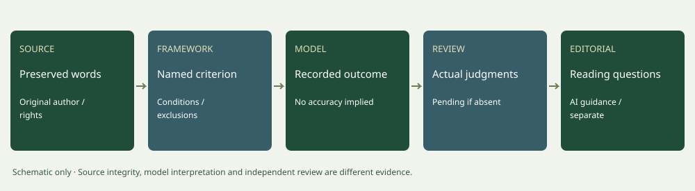
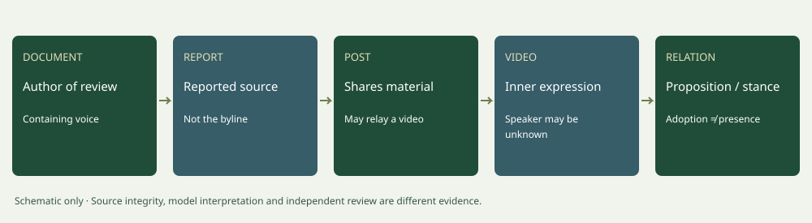
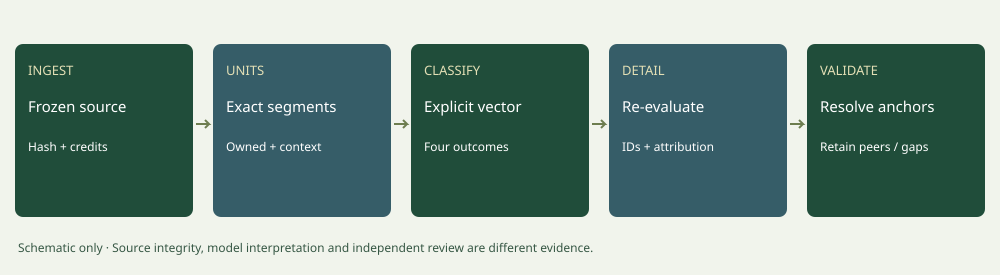
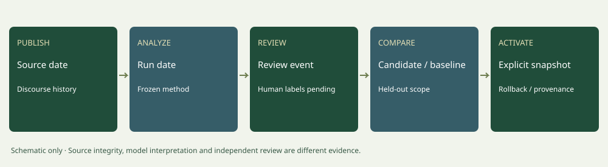

# Reading public discourse with evidence

AI-authored walkthrough guidance; not independent human adjudication or an interpretation-accuracy benchmark.

<!-- page -->

## 01. Reading public discourse with evidence

DOXA by TACITUS · v0.4 reader explainer

A practical guide to examining policy, news and institutional language without confusing an exact quotation with a correct interpretation. This edition explains what the workbench processes, which questions its lenses ask, and where a human reading is still needed.

The examples are real, attributed public documents and licensed news articles. The analytical readings were produced in recorded model runs. This publication adds AI-authored editorial guidance; it does not turn those readings into independent human judgments or alter their original results.

Read this guide for the main ideas, the technical annex for the exact contracts and source audit, and the fifteen-case atlas for inspectable passages. All three share a hash-indexed evidence pack. No paid inference was requested to produce these publications.

<!-- page -->

## 02. A route through the three publications

Begin with the question you want to answer. A researcher may investigate recurring frames; a newsroom may examine attribution and evidence standards; a university may teach the difference between a reported claim and its endorsement. These audiences need different explanations of the same evidence, not silently different definitions.

| Publication | Use it to |
| --- | --- |
| Reader explainer | Understand the measurement layers, outcomes, practical workflow and limits. |
| Technical annex | Inspect criteria, source paragraphs, versions, processing, lineage and evaluation design. |
| Fifteen-case atlas | Compare source text, framework conditions, model records, review state and editorial questions. |
| Evidence pack | Verify parents, hashes, source locators, payloads, source audits and missing captures. |

The case sequence is purposive. It includes protective guidance, reported discrimination, political boundaries, uncertainty, appraisal, policy remedies, definitions, statistical context, nested quotations, news reporting and explicit non-matches. It also includes missing work. It is a teaching set, not a representative prevalence sample.

A green design or a polished PDF is not an assurance of accuracy. Each case retains the original result and review state. Where no detailed model explanation exists, the guide says so. Where the original request was not captured, a reconstructed template cannot stand in for it.

<!-- page -->

## 03. Name the thing being measured

A document may describe discrimination, reproduce a hostile expression, argue against it, or adopt a proposition. A count of passages discussing prejudice measures something different from a count of authorial endorsements. Before comparing authors or institutions, choose and name the observation you intend to count.

| Measurement view | What it can describe |
| --- | --- |
| Contains or describes | A text defines, mentions or reports relevant conduct or ideas. |
| Represented expression | An identified speaker is quoted or reported expressing a proposition. |
| Document relationship | The document asserts, supports, rejects, defines or leaves unresolved that particular proposition. |
| Private belief or social prevalence | Not established by an automated passage assessment. |

The v0.4 semantic layer is additive. It can record evidence function, proposition type, attribution chains and missing-context reasons. It does not silently change a v0.3 outcome or promote an old interpretation into a new one. An unassessed field remains unassessed until an explicitly recorded analysis or review supplies it.

This follows measurement-modeling research: a theoretical construct, the evidence selected as its proxy, and the population to which a claim is applied are different choices. Making those choices explicit helps reveal when a model is measuring topic mention rather than the intended phenomenon. [jacobs2021]

<!-- page -->

## 04. Keep the voices apart

A containing document has an author, but not every sentence is that author's assertion. Government responses reproduce committee recommendations. News reports quote witnesses. A review can reproduce a post that shares a video. The source of the innermost words may be several steps away from the byline.

Record the proposition before recording a stance. A journalist can support the proposition that an incident occurred while rejecting the hostile claim made during that incident. A supportive stance toward a protective policy is not support for the prejudice that the policy opposes. Neither sentiment nor a named group supplies the missing relation.

Attribution research has long treated direct and indirect sources as a hierarchy. The atlas's nested-video case shows why one flat speaker label can be inadequate even when two models agree on a criterion. An unresolved speaker should remain unresolved; the author is not a safe default. [breck2004; mohammad2016]

<!-- page -->

## 05. Lenses ask distinct questions

IHRA, the Jerusalem Declaration and Nexus offer distinct definitions and contextual guidance concerning antisemitism. They are not interchangeable classifiers. England's non-statutory anti-Muslim-hostility guidance and Runnymede's structural account also differ in their emphasis on intention, institutions and effects. The source text must be read alongside each framework's conditions and exclusions.

| Kind | Meaning of a positive match |
| --- | --- |
| Indicator | A passage meets a named operational criterion under a framework; inspect the target and represented voice. |
| Boundary | A classification boundary is met. This is not another prejudice indicator. |
| Descriptive | A stance, frame or language choice is observed. It is not automatically objectionable. |

The political-framing rubric describes positions, appraisal, agency, voices and qualified assumptions. It does not assign left/right identities or use a universal political center. An omission or double-standard claim needs a declared comparison set and relevant supplied evidence; unequal conduct may justify unequal treatment.

The annex maps each operational criterion to a source section and records partial coverage, exclusions and access limits. Referencing a definition does not mean that its authors endorsed this software or that a trained human panel validated DOXA's summaries.

<!-- page -->

## 06. Four outcomes, plus missing work

| Stored outcome | Read it as |
| --- | --- |
| meets_criterion | The recorded method returned a match for this named criterion. |
| does_not_meet | A determinate non-match for this criterion and assessed unit. |
| uncertain | The method retained a question it could not resolve. |
| not_applicable | A recorded applicability judgment, distinct from a non-match. |
| Unresolved / missing | No accepted decision exists. It is not a fifth model outcome or an implicit negative. |

Different criteria within a source unit may have different statuses. Valid peer decisions survive a failed request, but that does not make the whole unit complete. A settled task may be partial or failed. A source collection can be fully imported while many interpretation decisions remain unfinished.

Do not merge an uncertain result with an ordinary negative to make a chart simpler. Do not turn a timeout into evidence of absence. Report both the denominator selected for analysis and the portion accepted successfully. A review can resolve a decision later, but its event belongs to review history rather than the original model record.

Case 13 is a real explicit negative without a detailed rationale; case 14 is a real not-applicable result; case 15 retains a missing decision. Their different records are part of the explanation, not defects to conceal.

<!-- page -->

## 07. From a file to a preserved source

Ingestion records what was supplied, extracts text under resource limits and creates stable source blocks. Metadata retains credited author, date, document type, source URL, license and content identity where available. Text extraction and source rights are separate matters: public visibility alone is not a redistribution license.

- Government prose, news articles, third-party quotations, images and logos can have different rights within one publication.
- The licensed news edition excludes external media and records credited authors and translators. A text-only result does not analyze omitted pictures or video.
- Source revisions receive new immutable identities when content hashes change. Historical results remain attached to their original version.

A source audit checks files, hashes, text ranges, dates and attribution receipts. It does not establish the truth of claims in a report, independent interpretation accuracy, or how representative the collection is. The Global Voices cohort is one publisher's selected historical collection. The institutional documents are purposive cases, not a survey of society.

The evidence pack records the original archives as parents rather than copying a live multi-gigabyte application database. Cases contain only their necessary frozen sources and records. No original database was opened for writing during publication.

<!-- page -->

## 08. What the model was asked to do

The preserved text is divided into deterministic source units. Neighboring source sentences provide bounded context. The classification request asks for one explicit code per unit and criterion; positive or uncertain candidates then receive a separate detailed re-evaluation that selects supplied sentence identifiers and records attribution, proposition, stance and an alternative.

The application resolves identifiers back to original text. The model does not need to manufacture quotation strings. Valid outcomes can be retained independently when another item fails, and the transition between classification and detailed re-evaluation remains visible where recorded.

For these historical cases, the saved records do not supply a contemporaneous full request/response journal. Embedded rubric snapshots and later rubric captures verified against the historical selected-pack hash are labelled separately. Neither is a full request receipt. A reconstructed prompt is not the actual old request; hidden chain-of-thought is neither exposed nor invented.

<!-- page -->

## 09. Reading a negative honestly

The Carnival case records does_not_meet for a named criterion. Its compact record has source-unit anchors but no detailed model rationale. The publication preserves that absence. Editorial questions can help a reader inspect the source; they cannot become an explanation that the original model never supplied.

A useful negative says something bounded: this method did not identify that criterion as met in that assessed unit. It does not show that every issue is absent from the article, that the author is neutral, or that another lens cannot detect a descriptive frame. The same discipline applies to not_applicable, which records a different applicability judgment.

- Read the exact outcome and criterion together.
- Check whether displayed evidence was model-selected or attached by software as a source-unit anchor.
- Distinguish no detailed rationale recorded from an explanation of why the decision is correct.
- Keep unassessed source units and failed decisions outside absence claims.

Evaluation must sample negatives and applicability decisions as well as displayed positive findings. Reviewing only striking outputs can reveal useful failure modes but cannot estimate missed detections or whole-corpus accuracy.

<!-- page -->

## 10. Reading nested attribution

The Prevent review case contains a footnote describing a screenshot of a post that shares a video. Both recorded models identify an anti-Jewish trope in quoted language. One attributes it to a reported speaker; the other assigns author. The text's explicit nesting is therefore central even though the criterion result agrees.

The atlas preserves both records and the footnote wording. It asks whether the statement belongs to the review's author, the person sharing the post, or the voice in the video. These are editorial review questions, not an automatic correction or a verdict about a named person's beliefs.

A robust source chain stores each reporting relation with a textual anchor and can leave the innermost speaker unknown. Quotation marks are useful but insufficient: reported speech may lack them, and a quotation can be endorsed, rejected, questioned or merely cited elsewhere. Wider source context is sometimes necessary.

A single flat attribution label cannot always express this structure. v0.4's additive layer can hold it while leaving the original result intact. A human correction, when supplied by an actual reviewer, should appear as a separate review event with its reason, evidence and actor.

<!-- page -->

## 11. Reading uncertainty without dismissing harm

The reported-harm case concerns a criterion that requires stereotyping and intention to encourage hatred. A speaker's account can document what they report experiencing while leaving another actor's specific intention unestablished. An uncertain criterion result does not imply that no incident or harm occurred.

Uncertainty has several sources: missing context, ambiguous language, unresolved reference, an absent comparator or a contested interpretation. Model disagreement is another reason to review, but it is not identical to uncertainty in the source. A processing error belongs in the processing ledger rather than masquerading as a semantic judgment.

- Name the unresolved requirement rather than offer a generic confidence adjective.
- State what evidence would address it and whether that evidence is available.
- Keep genuine competing readings visible even after an adjudicated evaluation label is created.
- Do not substitute a percentage unless calibration has been evaluated on relevant held-out labels.

Calibration literature motivates testing how confidence relates to correctness. It does not certify these models, and different elicitation methods work differently across tasks. Qualitative uncertainty and review states are more honest than unsupported probability claims. [guo2017; xiong2024; tian2023]

<!-- page -->

## 12. Political framing is observable; unfairness needs a comparison

An executive order's metaphor or stated remedy is inspectable. The political packet records evaluative language and expressed policy positions using six descriptive criteria. A strong word can accompany a well-supported argument. Detecting it does not establish that an allegation is false or that an author has a particular ideology.

A comparison needs a question, eligible sources, dates, genres, relevant evidence and matching limits. An executive order and a sixty-page strategy have different purposes and lengths. Their choice of instruments can be described; a raw difference cannot establish a double standard. Equal airtime is not an objective fairness rule.

The same reasoning applies to omission. To claim that relevant information was unfairly left out, explain why it belonged within the declared scope and was reasonably available. An absence from one selected corpus cannot establish deliberate suppression. The source and comparison policy must remain reviewable.

Framing research describes selection and salience through problem definitions, causes, moral evaluations and remedies. Informational-bias research also shows why broader comparable reporting matters. These are useful analytical distinctions, not a universal bias meter. [entman1993; card2015; fan2019]

<!-- page -->

## 13. Read dashboards through their denominators

| Recorded scope | Sources | Accepted / selected units | Retained / requested decisions | State |
| --- | --- | --- | --- | --- |
| v3-institutions | 20 | 613 / 616 | 11,701 / 11,704 | partial |
| v3-news | 5000 | 10,686 / 10,759 | 204,342 / 204,421 | partial |
| v3-political | 4 | 59 / 60 | 358 / 360 | partial |
| v3-local-news | 20 | 8 / 115 | 186 / 2,185 | cancelled |
| v3-independent-low-verification | 14 | 79 / 79 | 1,501 / 1,501 | completed |

These rows are different recorded scopes and profiles. The independent verifier examines a selected subset; the local Qwen trial was stopped with unfinished work. A numerator without its criterion, source coverage, unit size, kind and review state invites a misleading comparison.

The frozen archive audit recomputes source counts, outcomes and unit states, checks every part checksum, and resolves every retained reference against its original source. Those are mechanical integrity checks. They do not turn source coverage into understanding or the number of observations into the prevalence of prejudice.

A useful dashboard labels imported sources, assessable/accepted units, unresolved decisions, represented voices and review state separately. When grouping by author or institution, use credited metadata and scope limits; do not infer a private political or religious identity from patterns of words.

<!-- page -->

## 14. Publication time and review time are different histories

A publication-date chart concerns when the selected sources were published. A model-run chart concerns when those sources were processed. A review chart concerns when an assessment was changed or approved. A corrected interpretation today is not evidence that a publisher's discourse changed today.

Historical article text was frozen at collection time and grouped by original publication date. It is not a reconstruction of every first edition. Source revisions, changing collection composition and duplicate stories can alter a trajectory even before a model changes. Keep those facts alongside the chart.

A spike should be a question with a declared rate, denominator, time window and compatible method. Sparse periods, missing processing and different source mixes need explicit treatment; a zero or a gap must not be silently interpreted as an absence of prejudice. A detected change does not establish a cause.

<!-- page -->

## 15. Human review is a separate contribution

The current publications have no independent human reference labels. AI-authored notes and a second model can help organize review, but neither is human adjudication. The workflow can be prepared now while actual reviewers and judgments remain pending.

Independent reviewers should see the relevant original context, rubric and annotation instructions before being shown model outputs. Record their target/proposition, speaker chain, criterion outcome, context sufficiency and evidence. A calibration exercise can refine unclear instructions before the held-out evaluation is frozen.

Keep both raw labels and any later adjudication. Disagreement may reveal ambiguity, missing evidence or different plausible readings rather than careless annotators. Reliability should be reported by field and criterion alongside label frequencies; it is not a substitute for construct validity. [plank2022; artstein2008]

Approved project examples can enter an explicit versioned memory snapshot. A candidate method must be compared with its baseline on separated held-out material before activation. This is reviewed example memory, not autonomous weight training; source/story-group exclusions and rollback remain necessary.

<!-- page -->

## 16. Choose the tool for the question

| Recorded tool | Appropriate reading |
| --- | --- |
| Cloud generative assessment | Versioned contextual criterion outcomes; paid remote text transfer, visible gaps and review needed. |
| CPU Qwen generation | A local alternative whose bounded trial completed only two of twenty articles; no complete local-corpus claim. |
| MiniLM retrieval | An index of 120,464 passages across 5,000 sources; similarity supports navigation, not endorsement or prejudice inference. |
| CPU DeBERTa NLI | Twenty articles, 60 windows, 240 independent hypothesis pairs; uncalibrated scores, no winning category or prejudice label. |

Local placement changes where inference happens, not the evidentiary standard. Disk, RAM, context length and CPU contention affect practicality. The recorded CPU index combines attempts and reused caches rather than one cold timing. The local generator, retrieval and NLI baselines have different scopes and should not share a single throughput claim.

Budgets are also scoped. Application-accounted token use and conservative reservations differ from the vendor invoice; fixed infrastructure, electricity and outside requests are separate. Reusing historical outputs in an export makes no new inference call, but it does not erase the original processing cost.

<!-- page -->

## 17. What the research supports—and what was tested

Academic literature supports explicit constructs, target-specific stance, hierarchical attribution, functional testing and preserved disagreement. It motivates context and calibration experiments. It does not independently validate this implementation's particular operational summaries, model choices or source population.

The software tests establish behaviors such as exact-source anchoring, explicit outcome handling, failed-peer recovery, immutable source versions and labelled report layers. Actual model runs establish observed coverage, cost/resource receipts and the model readings recorded in those runs. Neither kind supplies independent interpretation accuracy.

The next evaluation must separate an untouched source/story-group test set from development examples and enriched challenge cases. Publish criterion precision/recall, attribution errors, boundary false positives, abstention, coverage, review effort and uncertainty only when real reference labels justify those quantities. An independent-model difference count remains a difference count.

Keep model, prompt, rubric, memory and context policies frozen for comparisons. Change one component at a time where feasible and report pipeline differences when not. A fluent explanation or a larger context window is a hypothesis about usefulness, not a result. [ribeiro2020; deyoung2020; liu2024]

<!-- page -->

## 18. A practical next reading

Open a case, locate the exact words and identify the source of the proposition. Read the framework condition and its exclusions. Then inspect the original model result, the source-unit state, the review status and the separately labelled editorial questions. Ask what evidence would strengthen or change the interpretation.

- Use the atlas as a teaching set, not as a scorecard of institutions or public figures.
- Use the annex and evidence pack to verify source/method identity, original payloads and gaps in historical capture.
- Keep genuine uncertainty and incomplete processing visible in reports and dashboards.
- Treat independent human annotation as a future evidence-producing activity, not a label the software can award itself.

**jacobs2021** — Measurement and Fairness (2021). https://arxiv.org/abs/1912.05511
Declare construct, operationalization, exclusions and population before interpreting counts. Does not validate DOXA constructs or model predictions.

**breck2004** — Playing the Telephone Game: Determining the Hierarchical Structure of Perspective and Speech Expressions (2004). https://aclanthology.org/C04-1018/
Preserve hierarchical direct/indirect sources of quoted and reported expression. Attribution structure is not access to a person's private beliefs.

**plank2022** — The ‘Problem’ of Human Label Variation: On Ground Truth in Data, Modeling and Evaluation (2022). https://aclanthology.org/2022.emnlp-main.731/
Preserve raw independent labels, plausible disagreement and later adjudication. A position paper motivates design, not an accuracy guarantee.

**rottger2021** — HateCheck: Functional Tests for Hate Speech Detection Models (2021). https://aclanthology.org/2021.acl-long.4/
Test negation, counter-speech, identity references and other specific capabilities. Original seven target groups omit Jewish people; short functional cases do not validate long-document antisemitism.

The full research map, BibTeX and CSL-JSON bibliography accompany this publication. They distinguish a paper's finding, its concrete application consequence and the limits of transferring that result to DOXA. All original v0.3 reports remain unchanged parents of this additive edition.
