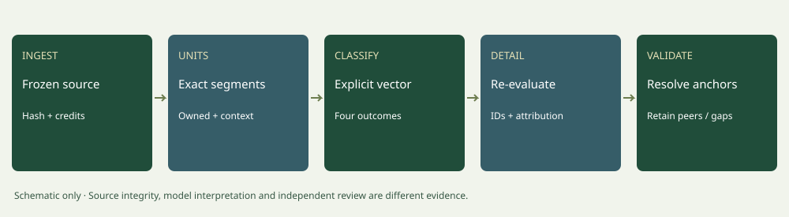
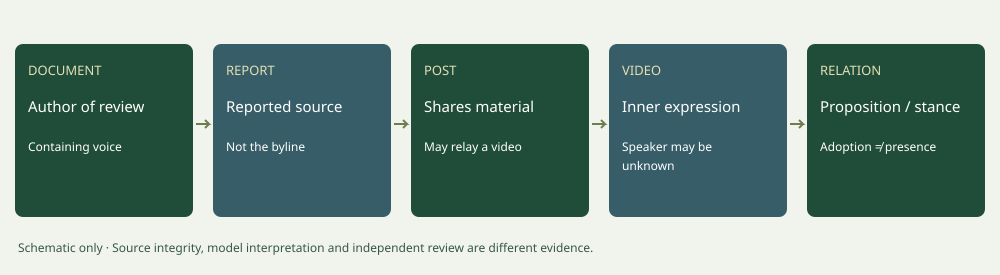
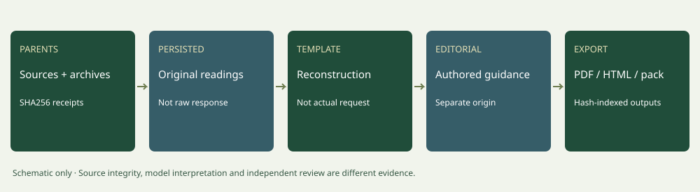

# Technical annex: evidence, contracts and research

AI-authored walkthrough guidance; not independent human adjudication or an interpretation-accuracy benchmark.

<!-- page -->

## 01. Technical annex: contracts, sources and receipts

DOXA by TACITUS · additive v0.4 documentation of frozen v0.3 evidence

This annex specifies the observable processing contract, source audit, recorded model profiles and evidence lineage behind the reader explainer and case atlas. It retains historical outcomes and uncertainty. New semantic annotations or future method experiments must identify their own version rather than overwrite a baseline.



The annex is AI-authored technical and editorial documentation. Framework authors have not endorsed DOXA, and independent human interpretation validation remains pending. The source references support particular methodological choices; they do not confer a general accuracy certificate.

| Object | Integrity boundary |
| --- | --- |
| Original run | Frozen source selection, method configuration, raw outcomes, usage and failures. |
| Publication capture | Read-only extraction and exact-source audit; original payload hashes retained. |
| Editorial layer | Separate AI guidance, questions, research mappings and case selection. |
| Review | Actual recorded review events only; none invented for publication. |

<!-- page -->

## 02. Supported is not the same as tested

A primary source can support the conceptual choice of a criterion without establishing its annotation reliability or the performance of a model applying it. An actual run can exercise a criterion without independently validating the interpretation. Keep those levels visible in research claims.

| Evidence | Established here | Still unmeasured |
| --- | --- | --- |
| Framework text | Source identity, applicable passages, exclusions and declared operational gaps | Official approval or exhaustive implementation |
| Academic method | A reason to test constructs, attribution, context and uncertainty | Transfer of published benchmark accuracy |
| Software tests | Specific source, schema, failure, restoration and report behavior | Population interpretation accuracy |
| Actual model run | Observed outcomes, coverage, costs and resources | Correctness without reference labels |
| Independent model | Literal paired differences and profile limits | Human ground truth or automatic adjudication |

The criterion-source audit is machine readable and covers the selected frozen packs plus an explicitly identified language-norm reference pack. Access restrictions are recorded. A partially summarized definition remains a partial operationalization; a citation is not permission to claim otherwise.

<!-- page -->

## 03. The additive measurement contract

The immutable assessment keeps its original criterion kind, result, proposition, stance, references and method identity. Additional interpretation belongs in a versioned overlay keyed to the assessment and source version. It should identify whether it was proposed by a model, written editorially or reviewed by an actual person.

| Semantic field | Intended distinction |
| --- | --- |
| Evidence function | Definition, incident report, quotation, counter-speech, hypothetical, policy assertion, mixed or unclear |
| Proposition type | Hostile claim, report of conduct, definition, remedy, factual context or unclear |
| Attribution chain | Anchored relations between containing author, report, quoted source and innermost speaker |
| Missing context | Specific absent comparator, quotation origin, intent evidence or unresolved reference |
| Provenance/status | Version, actor/model, timestamp, source references, proposed/reviewed state |

Do not infer document adoption simply from a supports value: support for the proposition that discrimination occurred is different from support for discrimination. Unknown legacy overlay fields remain not assessed. A user must be able to inspect both the original record and the additive interpretation.

The publication itself does not create new semantic reference labels. Its measurement questions are AI-authored prompts for review. Construct-content and discriminant validity are future empirical questions. [jacobs2021]

<!-- page -->

## 04. Outcome, kind and process state are orthogonal

| Dimension | Values / meaning |
| --- | --- |
| Criterion kind | indicator, boundary, descriptive; registry-owned |
| Criterion result | meets_criterion, does_not_meet, uncertain, not_applicable |
| Unit processing | accepted, partial, failed, pending; accepted requires every requested decision |
| Review | Unreviewed and actual recorded review events; independent from original model result |
| Hypothetical | An independent flag, not a speaker identity or a factuality verdict |

An indicator being met contributes to a criterion-specific indicator count. A boundary or descriptive match does not. A positive represented expression is not automatically author adoption. A missing or invalid output is never expanded into a negative vector to make coverage appear complete.

Partial units may retain accepted peers after an exception. A conservative failed/pending label can coexist with those retained rows. Coverage must not be promoted from the mere existence of some assessments. The original unit state and missing keys remain in the archive.

Evaluation should treat the four results as nominal categories unless a separately justified model specifies a different relation. Pooled accuracy dominated by inapplicable questions would hide important boundary and attribution errors.

<!-- page -->

## 05. Preserving source identity

Source identity, file identity and extracted-content identity answer different questions. Identical text can come from distinct credited sources; changed content from one source is a new immutable version. Hashes are used for integrity and recovery, not as a reason to collapse bibliographic authorship.

- Retain source URL, credited author, translator where supplied, date/precision, type, license and retrieval/extraction notices.
- Retain original-source and extracted-block hashes with their distinct meanings.
- Attach assessments to the exact frozen version and retain old versions after revisions.
- Keep cohort membership separate from all historical documents stored in a project.

The case atlas uses source metadata and original extracted blocks preserved in the recorded workspace. It does not re-fetch current web pages as a substitute for the text actually analyzed. A full source remains available in the frozen snapshot even when the PDF displays a bounded exact excerpt.

The archive audit compares each record's source identity/hash and extracted blocks to the bundled corpus before checking all references. Rights are attributed per source; the audit is not exhaustive legal clearance.

<!-- page -->

## 06. Rights, credits and text-only exclusions

The institutional case sources carry US government-work or UK Open Government Licence metadata, with source-specific exceptions. Global Voices articles retain the publisher's CC BY 3.0 attribution evidence, bylines and translation credits. A containing license does not erase rights in separately attributed quotations or media.

The licensed news edition excludes external images, captions and embeds. Those omissions matter analytically: text-only source context may be insufficient to interpret a reference to a video or image. Missing media must be a context limitation rather than an invented visual finding.

This publication cites and briefly paraphrases academic papers and the Runnymede briefing. It links the original 19-page briefing, records its checksum and page locators, and does not redistribute the entire copyrighted PDF. An open repository containing an annotation or a paper does not automatically license the underlying news source articles.

The case source ledger records every included source's title, author, date, URL, license, translator and extracted hash. Reviewer and model claims remain separately attributed. Do not present AI-written commentary as a statement from an original source author or a framework's authors.

<!-- page -->

## 07. Deterministic source units

The frozen source-units-3.1 builder partitions original source characters and records sentence identifiers and available locators. It does not silently normalize quotation text into a new string for citation. Blocks can contain several voices, and a unit can span multiple source segments.

| Recorded profile | Owned source / context |
| --- | --- |
| Cloud baseline | Up to 4,000 source characters per unit; two neighboring sentences on each side |
| CPU Ollama baseline | Up to 1,200 source characters per unit; neighboring sentences retained |
| Offsets | Zero-based, end-exclusive Unicode code points into the original block |
| Coverage | Owned source characters counted once; neighbor context does not inflate coverage |

Source unit, source paragraph, scheduler task, criterion decision and provider request are different denominators. Packing multiple units into a request changes call counts without changing their owned source ranges. Retrying a criterion does not create additional source coverage.

The publication's unresolved case is rebuilt from the frozen source identity and recorded builder configuration. If that unit cannot be reproduced, capture fails rather than constructing an approximate missing case.

<!-- page -->

## 08. Context supplied and context absent

Neighbor context can resolve a pronoun or preserve a local rebuttal, but two sentences may not include a recommendation heading, section boundary or distant footnote. The technical question is what original material was supplied, not what a reader can now infer from the whole source.



A future context-expansion experiment should record requested dependencies and selected source passages. A generated summary must not silently replace original evidence. Missing external material should be flagged explicitly. Reading a larger prompt does not prove that a model used its relevant middle passages effectively.

For historical runs without a request capture, the source-unit builder and frozen settings can reconstruct a likely template and available source units, but this is not the actual transmitted request. The evidence pack labels that distinction. A controlled v0.4 experiment can capture its own visible request receipt from the outset. [liu2024]

<!-- page -->

## 09. Classification: explicit and bounded

The classifier requests a fixed-length outcome vector in a supplied criterion order. The frozen schema uses codes 0 for does_not_meet, 1 for meets_criterion, 2 for uncertain and 3 for not_applicable. Identifiers and vector lengths are constrained; missing codes are incomplete, not zeros.

| Validation boundary | Consequence |
| --- | --- |
| Unknown source/unit ID | Reject that item; never cite an invented unit |
| Wrong vector length | Incomplete structured response; recover independently |
| Length-terminated JSON | Do not repair it into invented decisions |
| Positive/uncertain classification | Requires the bounded detail step before a noteworthy assessment is accepted |

Classifier output is a recorded model decision, not a confidence score. Valid explicit negatives can be committed immediately. Already accepted peers survive failures elsewhere. The two-stage design was measured operationally on a small engineering pilot; that pilot did not have independent interpretation labels.

Prompt/schema versions and selected rubric snapshots belong to the run. A historical run cannot be resumed under an altered selected method merely because the same model name is still available.

<!-- page -->

## 10. Detailed re-evaluation and source identifiers

Positive and uncertain candidates receive a separate bounded re-evaluation. The model selects supplied sentence IDs and supplies concise attribution, proposition, stance, explanation and an alternative. The application derives quotations from the source rather than trusting generated quotation strings.

A detail-step outcome can differ from the initial classifier. Where recorded, the trace preserves both. This is the configured model checking a bounded item, not an independent model or human review. A budget stop between stages leaves the ungrounded candidate incomplete.

- At least one cited sentence must belong to the scored unit; neighbor-only evidence cannot score another unit.
- A directional stance requires an explicit proposition.
- An uncertain result cannot simultaneously claim supported certainty.
- Bounded independent retries preserve valid peers and make remaining failures visible.

Passing these checks verifies structure and anchoring. It does not establish that an explanation follows from the chosen evidence. The technical annex therefore keeps rationale plausibility and model faithfulness as separate future evaluation questions. [deyoung2020]

<!-- page -->

## 11. Compact negative and applicability records

A determinate negative or not-applicable classification may have no detailed model rationale. The persisted representation can attach source-unit sentence anchors so that its scope is inspectable. These are software-derived anchors; they must not be described as a model selecting a minimal reason for its answer.

| Origin | Publication label |
| --- | --- |
| detail_supplied=true | Persisted detail sentence IDs and recorded model detail |
| detail_supplied=false | Software-attached unit anchors; model detail not recorded |
| Flag missing | Unknown evidence-selection origin; no retrospective certainty |
| Display excerpt | Editorial layout excerpt, separately labelled |

The freezer rehydrates absent quote text only by exact slicing of the frozen source. It retains the original payload and both parsed-content and stored-byte hashes. It does not add a rationale to that payload. A displayed excerpt may be chosen for readability, but its selection is editorial, not additional evidence of what the model considered.

Independent evaluation must include these records. Otherwise recall, missed-context behavior and the difference between does_not_meet and not_applicable remain invisible behind positive-only review.

<!-- page -->

## 12. Unresolved work remains a gap

The atlas's fifteenth case contains a genuine missing criterion decision from a partial institutional source unit. Accepted peer criteria remain retained. The unresolved entry carries result=null, a list of missing keys, the source unit and its recorded status payload. It has no fabricated assessment ID, model explanation or confidence.

A retry, a later model experiment or a human review can address the gap, but each must retain its own event and version. Completing a verifier does not retroactively fill a missing primary row. A gap cannot become an implicit negative merely to complete a comparison matrix.

| Quantity | Treatment |
| --- | --- |
| Selected units | Include the incomplete source in the declared denominator |
| Accepted units | Count only those with every required criterion outcome |
| Retained decisions | Include valid peers in their criterion-specific counts |
| Missing decisions | Remain unresolved and excluded from absence claims |

The publication exposes only a bounded teaching example, while the corpus audit retains all incomplete states and exact overall counts. The case should lead to a concrete question about what remains missing, not an unsupported explanation of why a request failed.

<!-- page -->

## 13. Exact references: necessary, not sufficient

Every retained reference is checked against the original source block and Unicode range. A match establishes that the cited words occur there. It does not establish that those words support the explanatory claim, that omitted context is irrelevant, or that a legal condition has been proved.

| Evidence question | Required check |
| --- | --- |
| Integrity | Correct source version, block and exact span |
| Support | A reviewer assesses whether the cited material supports the stated interpretation |
| Context sufficiency | Relevant quotation origin, rebuttal, section and comparison evidence supplied |
| Faithfulness | Controlled study of whether the reported rationale is connected to the model's decision |

The bounded streaming audit checks all published archive references and aggregate counts. Case-specific display windows also retain exact source offsets. Long contexts can be excerpted for layout, but the full selected source blocks remain in the case snapshot.

ERASER distinguishes human-rationale alignment from faithfulness metrics. Applying that lesson means resisting the temptation to equate plausible prose, a matching quote and a trustworthy decision. Any future evidence-removal experiment must be separately specified and measured. [deyoung2020]

<!-- page -->

## 14. Nested attribution and factuality

A useful representation links a proposition to the source expressing it, the relation through which it is reported, and the containing document's stance toward that proposition. Multiple edges can be needed for a quotation inside a post inside a review.

FactBank concerns how events are presented as factual, non-occurring or uncertain in text. That descriptive factuality is different from independent verification that an event happened. Similarly, MPQA-related attribution research models textual sources rather than access to inaccessible mental states. [sauri2009; breck2004]

In the actual nested-video case, both models agree on the Nexus trope outcome but disagree on attribution. The source footnote explicitly describes a post sharing a video. The editorial question is which speech-source node is responsible for which words. Neither raw record is silently overwritten in this atlas.

Separate unknown innermost speaker, reported speaker and authorial voice. Do not infer private identities or hidden motives. When an actual reviewer later changes attribution, retain the original raw reading, source evidence, review actor and correction reason.

<!-- page -->

## 15. Framework audit: Antisemitism · IHRA

The frozen three-criterion pack does not cover every illustrative example as a separate decision. Official primary-page access was bot-blocked during this publication audit. The declared mappings are retained with that limitation rather than presented as a freshly verified full-source audit. This does not invalidate stored outputs, but it limits what this publication claims to have independently rechecked.

| Frozen operational criterion | Source mapping / condition |
| --- | --- |
| anti_jewish_generalization | Definition and examples concerning stereotyping/conspiracies/dehumanization (current-page access limitation retained). |
| collective_responsibility | Illustrative example holding Jews collectively responsible for Israel (current-page access limitation retained). |
| israel_related_context | Context introduction and Israel-related examples; no criterion from Israel mention alone (access limitation retained). |

Scope: Non-legally-binding framework. Findings concern passages, not whether a person is antisemitic.

Exclusions and context: Non-legally binding; examples require overall context; policy criticism similar to other countries is not automatically antisemitic.

Audit status: official_primary_page_access_blocked_in_current_source_audit

[Original reference](https://holocaustremembrance.com/resources/working-definition-antisemitism)

<!-- page -->

## 16. Framework audit: Antisemitism · Jerusalem Declaration

Read the numbered guidelines together. The political-expression boundary cannot make every surrounding statement harmless, and the context of a separate anti-Jewish claim still matters. A framework disagreement is not automatically an annotation error or a reason to vote across definitions.

| Frozen operational criterion | Source mapping / condition |
| --- | --- |
| jews_as_jews | Definition; General guidelines 1–5. |
| tropes_collective_guilt | General 2,4; Israel/Palestine 6,7,8. |
| political_expression_boundary | Guidelines 11–15 read together with 6–10; FAQ on free debate/legal use. |

Scope: Alternative framework with its own protections for political expression; no legal determination.

Exclusions and context: Guidelines must be read together in context; political positions are not inherently antisemitic; not designed as a legal/quasi-legal speech code.

Audit status: original_definition_guidelines_and_FAQ_read

[Original reference](https://jerusalemdeclaration.org/)

<!-- page -->

## 17. Framework audit: Antisemitism · Nexus

The source distinguishes different standards based solely on Jewish identity from disproportionate attention that is not prima facie proof. A comparison needs relevant supplied evidence and a stated standard. Reporting a trope and endorsing that trope remain separate questions.

| Frozen operational criterion | Source mapping / condition |
| --- | --- |
| anti_jewish_tropes | What Is Antisemitic? 2,3; definition. |
| collective_guilt | What Is Antisemitic? 3(c),4. |
| opposition_boundary | What Is Not Antisemitic? 1,3,4,5. |

Scope: Contextual framework; findings do not establish a person's intentions or legal liability.

Exclusions and context: Political opposition and disproportionate attention are not prima facie proof; standards and source context matter.

Audit status: original_definition_and_both_numbered_sections_read

[Original reference](https://nexusproject.us/nexus-resources/the-nexus-document/)

<!-- page -->

## 18. Framework audit: Anti-Muslim hostility · England 2026

Sections 6 and 8 must be read together. The definition is not a new criminal offence and does not rewrite equality law. The source's intent-related conditions require evidence; an automated passage reading cannot pronounce legal unlawfulness or presume an intent to encourage hatred.

| Frozen operational criterion | Source mapping / condition |
| --- | --- |
| targeted_hostility | Section 6, first definition paragraph; section 8 context and protected-expression conditions. |
| stereotyping_and_intent | Section 6, second definition paragraph; section 8 discussion of intention and non-criminal conduct. |
| discrimination_claim | Section 6, third definition paragraph; section 8 deliberately targeted subset of unlawful discrimination. |

Scope: England-specific non-statutory definition. Text alone may not establish intention or unlawful discrimination.

Exclusions and context: England; non-statutory; no change to criminal/equality law; criticism/ridicule of religion protected; required intent/unlawfulness cannot be presumed.

Audit status: original_sections_6_7_8_read

[Original reference](https://www.gov.uk/guidance/a-definition-of-anti-muslim-hostility)

<!-- page -->

## 19. Framework audit: Islamophobia · structural racism

The original July 2025 briefing has 19 PDF pages. Its discussion of institutional/structural effects explicitly does not require deliberate racist intent, unlike an intent-focused conduct question. PDF p12 protects criticism of doctrine and Muslim-majority governments when not targeting populations. The annex links, rather than redistributes, the copyrighted briefing.

| Frozen operational criterion | Source mapping / condition |
| --- | --- |
| racialization | PDF p4/printed p3 longer definition and examples; PDF pp5–7 racialization discussion. |
| exclusion | PDF p4/printed p3 longer definition; PDF pp7–10 institutional and structural forms. |
| institutional_pattern | PDF pp7–10/printed pp6–9; comparison/evidence must establish a pattern rather than merely assert it. |

Scope: Structural analytical lens, distinct from the England conduct-and-intent framework.

Exclusions and context: Protect Muslims/perceived Muslims rather than immunize Islam or governments from criticism; structural effects need not require deliberate intent; a paragraph does not establish a population-level pattern.

Audit status: original_19_page_briefing_relevant_sections_read

[Original reference](https://www.runnymedetrust.org/publications/islamophobia-towards-a-working-definition)

<!-- page -->

## 20. Framework audit: Doxa & discourse

The pack combines descriptive stance, framing, rhetorical function and qualified presupposition hypotheses. Its academic precedents do not establish a numeric doxa scale or an author's hidden beliefs. Absence of evidence for support or opposition is not automatically neutrality.

| Frozen operational criterion | Source mapping / condition |
| --- | --- |
| stance | Mohammad2016 task definition: target-specific stance versus sentiment. |
| framing | Entman1993 p52 four functions; Card2015 annotation/Table1. |
| presupposition | Recasens2013 §2.3 epistemological cues; added uncertainty safeguards. |
| rhetoric | Recasens2013 §2.3 framing/epistemological cues; Entman1993 pp52–53. |

Scope: Descriptive discourse analysis; implicit assumptions are hypotheses, not private beliefs.

Exclusions and context: Distinguish the document author from quoted or reported speakers. Absence of a viewpoint is meaningful only against a declared comparator. Do not infer religious or political identities.

Audit status: Academic precedent with an author-operational descriptive rubric; no independent interpretation validation.

[Original reference](https://aclanthology.org/P15-2072/)

<!-- page -->

## 21. Framework audit: Political positions & framing

All six criteria are descriptive. Comparison-dependent asymmetry requires declared matched evidence; without it retain uncertainty for a relevant inquiry. A generic single-document route cannot itself complete a paired-source omission audit. There is no universal center, left/right label or automatic author score.

| Frozen operational criterion | Source mapping / condition |
| --- | --- |
| expressed_policy_position | Mohammad2016 target-specific stance; Entman1993 p52 remedy. |
| evaluative_language | Recasens2013 §2.3 linguistic cues; Entman1993 p52 evaluation. |
| agency_causal_responsibility | Entman1993 p52 causal interpretation; FactBank source-relative factuality. |
| source_voice_foregrounding | Breck2004 nested sources; Fan2019 matched-event informational bias. |
| comparator_dependent_asymmetry | Fan2019 matched-event design; DOXA adds explicit-comparator safeguards. |
| presupposition_hypothesis | Recasens2013 §2.3 cues; DOXA adds alternative-reading requirements. |

Scope: Descriptive textual analysis, not a universal political-bias, truth, fairness or left/right score. A detected pattern is not a verdict about a person or audience influence.

Exclusions and context: Ground each observation in supplied source evidence and context. Separate document and speaker stance, reporting, attributed quotation, hypothetical examples, negation and counter-speech. No automatic left/right label, universal political center, private identity inference, author-character judgment or aggregate bias score. Frame presence does not demonstrate audience effects. Comparative absence, omission, imbalance and evidential asymmetry require a declared matched comparator and supplied relevant evidence; otherwise preserve uncertainty. These are reviewable descriptive hypotheses, not validated accuracy or factual-verification claims.

Audit status: Academic precedent with an author-operational descriptive rubric; no independent interpretation validation.

[Original reference](https://doi.org/10.1111/j.1460-2466.1993.tb01304.x)

<!-- page -->

## 22. Framework audit: Language norms & political correctness

This is a user-defined research inquiry, not an established political-correctness scale. It is documented here as a reference pack and was not selected in the frozen six-lens runs used by this atlas. Source precedent for framing is not validation of this specific rubric.

| Frozen operational criterion | Source mapping / condition |
| --- | --- |
| norm_claim | Card2015 Table1 morality/cultural identity/public opinion: precedent only. |
| speech_boundary | Card2015 Table1 fairness/legality: no validated expression-harm scale. |
| institutional_expectation | Card2015 Table1 policy/capacity/political frames: research precedent. |

Scope: A user-defined inquiry, not an objective political-correctness score.

Exclusions and context: State the user-selected inquiry and preserve competing interpretations. Never assign a universal PC score or assume a demographic group shares one view.

Audit status: Academic precedent with an author-operational descriptive rubric; no independent interpretation validation.

[Original reference](https://aclanthology.org/P15-2072/)

<!-- page -->

## 23. Context and persona sensitivity experiments

A useful v0.4 experiment changes one context policy while holding source, criterion, model and other settings fixed. Compare the frozen bounded context with source-linked section/footnote expansion. Record every added passage and why it was eligible; do not use a generated summary as unlabelled original evidence.

- Test the same relevant material at beginning, middle and end where a transformation preserves meaning.
- Test quoted versus reported speech, rebuttals crossing boundaries, headings and distant footnote origins.
- Keep presentation persona separate from analytic conditions. A different audience should not silently alter the criterion.
- Report actual pipeline differences when a clean single-component ablation is impractical.

Liu et al. found position-sensitive performance in long-context QA and retrieval. That motivates a controlled test; it does not prove that more context or retrieval necessarily helps this task. A context change is a new method receipt, not compatible resume of a frozen baseline. [liu2024]

<!-- page -->

## 24. Sampling and independence

The 5,000-source news cohort is a frozen selection from one publisher, not a sample of all journalism. The twenty institutional documents and fifteen teaching cases are purposive. Neither selection establishes public prevalence or generalizes across outlets by itself.

A future evaluation should separate a probability-sampled base from enriched challenge cases. Preserve source/story groups across development, calibration and test partitions. Report inclusion rules and weights where prevalence estimation is intended. Do not calculate whole-corpus rates from a deliberately enriched disagreement review set.

The independent verifier selected indicator-flagged units plus a deterministic document-stratified sample of other accepted units. Those other units are not human-validated negatives. Model selection for review is useful, but independent reviewers should not be led by model outcomes during reference-label creation.

Text chunks and multiple criteria from one document are correlated. Confidence intervals should respect source/story clustering. A large count of unit-criterion rows is not an equally large number of independent documents. [bender2018; jacobs2021]

<!-- page -->

## 25. Recomputed corpus receipts

| Recorded scope | Sources | Accepted / selected units | Retained / requested decisions | State |
| --- | --- | --- | --- | --- |
| v3-institutions | 20 | 613 / 616 | 11,701 / 11,704 | partial |
| v3-news | 5000 | 10,686 / 10,759 | 204,342 / 204,421 | partial |
| v3-political | 4 | 59 / 60 | 358 / 360 | partial |
| v3-local-news | 20 | 8 / 115 | 186 / 2,185 | cancelled |
| v3-independent-low-verification | 14 | 79 / 79 | 1,501 / 1,501 | completed |

The publication audit streams every checksum-listed gzip part. For each source record it verifies source identity, frozen hash, extracted-block checksum, every retained reference and aggregate outcome/unit counts. It reads at most one source record at a time and does not copy or mutate the application database.

All selected-source words and characters remain in the scope receipt, including documents with gaps. Verifier units belong to its declared subset. A process state of partial remains partial, even when every task is settled. Historical cancelled local work is not installed as a complete demonstration.

The receipt records input hashes so a repeat build can reuse the audit only when the parent archives and source metadata tree are unchanged. This is an integrity cache, not cached semantic judgment. A changed source must cause a new audit or an explicit refusal.

<!-- page -->

## 26. The separate model comparison

The recorded institutional Gemma and GPT-oss profiles have 1,500 paired decisions on 79 selected units. They differ on 642 result categories. Of those differences, 459 are switches between does_not_meet and not_applicable. Category differences therefore must not be described as an error rate or all counted as changes to positive indicator flags.

The verifier emits one additional decision without a primary counterpart. That row remains unpaired; it is not evidence that the primary returned negative. The primary includes a partial unit even where the verifier completed its own selection. The comparison is not complete on all requested primary counterparts.

The profiles also differ in request packing and output budgets. Their cloud revisions are unresolved. Differences cannot be attributed exclusively to weights or interpreted as a controlled model-ranking experiment. Both readings and the raw provenance remain available.

The atlas includes a definition, statistical context and nested attribution disagreement. They are selected for instructional contrast, not an independent evaluation sample. Any reviewer conclusions must be separate review events with their own evidence and actor.

<!-- page -->

## 27. Model and method identity

| Recorded component | Publication treatment |
| --- | --- |
| Model name | Preserve exact configured identifier and execution profile |
| Revision | Use recorded digest when available; unresolved remains unresolved |
| Rubric | Use embedded snapshots, or later text verified against the historical selected-pack hash. Label those origins separately; a version string alone is weaker evidence. |
| Prompt/schema | Preserve recorded versions; reconstructed templates remain separate |
| Operational settings | Record concurrency, timeouts, quantization and CPU threads without treating them as quality evidence |

The cloud primary uses Gemma 4 26B A4B IT; the independent profile uses GPT-oss-120B. The local generator is Ollama Qwen3.5 4B with a recorded digest/quantization. Model cards, licenses and advertised context lengths describe interfaces and intended use, not demonstrated performance for this corpus.

A changed selected method requires a new run or explicit experiment. A compatible unselected-lens extension does not justify modifying selected rubric semantics. Source/version, prompt, memory and context identities must be visible together when interpreting a comparison.

<!-- page -->

## 28. CPU retrieval and NLI are different tasks

The canonical MiniLM index covers 5,000 articles and 120,464 passages. Its approximately 49.91 active minutes combine attempts, interrupted processing, cached work and a source-version refresh. Restart reuse and exact returned quotations demonstrate persistence/navigation, not ranking accuracy or prejudice inference.

The CPU DeBERTa baseline processed all twenty original selected news articles, 60 source windows and 240 independent hypothesis pairs in 247.102 seconds including the first model load. Peak process RSS was about 2.038 GiB. Its four auxiliary hypotheses are separate from the nineteen generative criteria, and its scores are uncalibrated.

The local Qwen trial completed two of twenty articles, with eight accepted units, two partial units and 105 unprocessed. The sampled combined driver/Ollama RSS peak was about 9.238 GiB, can double-count shared pages and excludes browser/OS memory. This is bounded incomplete generation, not a successful full local benchmark.

These tasks should not share a winner or a combined throughput claim. Run heavy CPU phases sequentially when they contend for resources. Complete source windows and low API cost do not remove the need for attribution and interpretation review.

<!-- page -->

## 29. Budgets, retries and operational limits

A run budget is an application-accounted total cap, not an incremental allowance on every resume. The workspace's monthly ledger is a separate shared limit. Independent benchmark directories have separate ledgers; their caps do not combine into an account-wide vendor limit.

Reported token receipts, configured prices, conservative reservations and vendor invoices can differ. Unknown billing remains unknown. A request interrupted after transmission can still be billed; conservative accounting may retain the reserved maximum. Hosting, GPU idle time, storage, electricity and requests outside the workspace are separate costs.

The isolated v3 CLI supports up to 48 remote scheduler workers and defaults to four; this is not a throughput promise. Ollama requires one. The normal application's remote worker count and the shipped Cloudflare queue's single consumer are distinct execution paths. Local-state cloud inference does not benchmark deployed D1/R2/Queues throughput.

Timeout or budget exhaustion leaves explicit gaps. A charged failed call does not become a successful empty interpretation. The publication itself reuses saved evidence and requests no additional paid inference.

<!-- page -->

## 30. Source revisions, forks and historical usage

A changed complete-news cohort cannot be smuggled into an old run by rewriting its checkpoint's source hash. The explicit fork helper verifies the stopped original receipt, preserves that run and creates a separate frozen source selection. Only identical source versions can reuse outcomes.

A citation-link metadata cleanup changed the canonical extracted hash of one still-unassessed news source. Even though its text and locators were separately checked unchanged, that source received a new immutable version and an audited cohort fork. The changed version acquired no invented reused assessment.

The fork inherits historical usage and accounted spend as provenance without debiting those requests to the monthly ledger twice. Do not add the original total again to a new total that already includes it. Preserve historical sessions and current sessions separately; active processing duration is not a single uninterrupted wall-clock benchmark.

A narrow news-sample exception permits recorded parent-manifest digest updates only when every selected source identity, order, content hash, path and setting remains unchanged. It cannot authorize changing selected articles or a complete cohort.

<!-- page -->

## 31. A prepared review workflow, not manufactured labels

The prepared v0.4 scaffold has 200 unlabelled source cases, split into 100 development and 100 held-out cases with disjoint story groups, plus separate reviewer A/B forms and an exposure ledger. Its functional casebook contains 120 protocol fixtures from 24 real bases across six existing lenses. Expected human labels are null and model execution is not_run. Independent judgments remain pending.

[Prepared evaluation protocol and source forms](https://github.com/sargonxg/DOXA-by-TACITUS/blob/main/docs/evaluation-v04.md)

Use a calibration exercise with two independent trained reviewers to identify unclear instructions before freezing a test. Each reviewer records criterion result, evidence span, source chain, proposition/stance and context sufficiency. Adjudication, where appropriate, follows as a separate event while preserving raw labels.

Blinding model outputs reduces anchoring during reference-label creation. Source context required for attribution should not be removed merely to hide a byline. Different interpretive expertise can reveal ambiguity; private demographic identities must not be guessed or required without a justified purpose.

Approved examples enter versioned memory only through an explicit review process. Candidate/baseline comparison, activation and rollback remain inspectable. No automatic weight training or human-quality claim follows from having a review button. [plank2022]

<!-- page -->

## 32. Evaluation design and reliability

Report criterion-specific precision/recall only after independent labels exist. Also report four-way outcome confusion, context insufficiency, attribution-chain errors, proposition/stance errors, boundary false positives, abstention, accepted coverage and review effort. A single aggregate F1 can conceal important failure types.

For human annotation, report raw agreement and label frequencies with a task-appropriate nominal coefficient. Separate evidence span selection from category assignment; overlapping spans require their own rule. Do not impose an ordinal distance on the four outcomes without an argument. Agreement is not validity, and an adjudicated label does not erase genuine interpretive variation.

Separate probability-sampled estimates from challenge-set results and preserve clustered uncertainty by document/story group. A rare criterion can produce deceptively high apparent accuracy through ordinary negatives; publish class-specific sample sizes and uncertainty.

CheckList and HateCheck motivate targeted behavioral tests alongside held-out measurement. Extend Jewish-target and long-document context cases explicitly rather than assuming the original HateCheck population covers them. [artstein2008; ribeiro2020; rottger2021]

<!-- page -->

## 33. Calibration and abstention

Qualitative certainty labels, NLI softmax scores and a model's verbal confidence are different quantities. None is a demonstrated probability of prejudice in this application. Independent reference labels are required before fitting or evaluating a calibrator for the actual task.

Guo et al. studied neural classification calibration and temperature scaling. Tian et al. found useful verbal-confidence methods on particular QA benchmarks. Xiong et al. found remaining overconfidence and task-dependent performance across elicitation strategies. These motivate experiments; they do not settle the best method for contextual prejudice analysis.

- Use separate development/calibration/test data and preserve source/story-group separation.
- Report reliability plots and proper scores with criterion-specific sample sizes and uncertainty.
- Show errors versus abstention/coverage where a rejection policy is evaluated.
- Do not promise risk guarantees or causal explanations unsupported by the evaluation design.

Until then, use named missing-context reasons and review states rather than an authoritative percentage. A second model's agreement can trigger review or comparison, but it is not a calibrated confidence estimate or reference truth. [guo2017; tian2023; xiong2024]

<!-- page -->

## 34. Artifact lineage and reproduction



The evidence pack records source artifacts, frozen rubric parents, persisted assessment payloads, editorial annotations, reconstructed templates and report exports as distinct origins. Every file receipt is content hashed. A parent reference identifies which source and method object a derivative used.

Historical request capture is not recorded for these cases. The reconstruction is explicitly not the actual request, and a persisted assessment is not a raw provider response. No hidden chain-of-thought, credential or invented historical response is included. A future opted-in visible-I/O journal would produce a different origin record.

```text
PYTHONPATH=. python scripts/build_v04_publications.py
PYTHONPATH=. pytest -q tests/test_v04_publications.py
```

The build opens original SQLite with mode=ro, verifies portable archives and source evidence, writes only new v04-prefixed outputs, and checks original parent hashes again before success. Publication regeneration uses saved outputs; no provider/model call is made.

<!-- page -->

## 35. Academic source map · 1

**jacobs2021** — Measurement and Fairness (2021). https://arxiv.org/abs/1912.05511
Declare construct, operationalization, exclusions and population before interpreting counts. Does not validate DOXA constructs or model predictions.

**entman1993** — Framing: Toward Clarification of a Fractured Paradigm (1993). https://fbaum.unc.edu/teaching/articles/J-Communication-1993-Entman.pdf
Separate problem definition, causal interpretation, evaluation and remedy. A textual frame does not establish unfairness or audience influence.

**mohammad2016** — SemEval-2016 Task 6: Detecting Stance in Tweets (2016). https://aclanthology.org/S16-1003/
Specify target/proposition; distinguish sentiment, stance and lack of evidence. Tweet performance does not transfer to whole policy documents.

**card2015** — The Media Frames Corpus: Annotations of Frames Across Issues (2015). https://aclanthology.org/P15-2072/
Use explicit framing dimensions, evidence spans and preserved disagreement. Three original policy issues; original article redistribution requires source rights.

**recasens2013** — Linguistic Models for Analyzing and Detecting Biased Language (2013). https://aclanthology.org/P13-1162/
Inspect appraisal and qualified presupposition/entailment cues. Wikipedia neutrality edits do not validate a universal political-bias score.

**fan2019** — In Plain Sight: Media Bias Through the Lens of Factual Reporting (2019). https://aclanthology.org/D19-1664/
Informational selection needs declared comparable sources and broader context. An arbitrary corpus absence is not deliberate omission.

**breck2004** — Playing the Telephone Game: Determining the Hierarchical Structure of Perspective and Speech Expressions (2004). https://aclanthology.org/C04-1018/
Preserve hierarchical direct/indirect sources of quoted and reported expression. Attribution structure is not access to a person's private beliefs.

**sauri2009** — FactBank: a corpus annotated with event factuality (2009). https://link.springer.com/article/10.1007/s10579-009-9089-9
Record how a source presents factuality rather than assert independent world truth. Publisher abstract/notes reviewed; a factuality label is not external fact-checking.

**plank2022** — The ‘Problem’ of Human Label Variation: On Ground Truth in Data, Modeling and Evaluation (2022). https://aclanthology.org/2022.emnlp-main.731/
Preserve raw independent labels, plausible disagreement and later adjudication. A position paper motivates design, not an accuracy guarantee.

<!-- page -->

## 36. Academic source map · 2

**artstein2008** — Inter-Coder Agreement for Computational Linguistics (2008). https://aclanthology.org/J08-4004/
Choose agreement measures by task and assumptions; report frequencies and uncertainty. Agreement is not validity; no pooled coefficient substitutes for field-specific evaluation.

**rottger2021** — HateCheck: Functional Tests for Hate Speech Detection Models (2021). https://aclanthology.org/2021.acl-long.4/
Test negation, counter-speech, identity references and other specific capabilities. Original seven target groups omit Jewish people; short functional cases do not validate long-document antisemitism.

**ribeiro2020** — Beyond Accuracy: Behavioral Testing of NLP Models with CheckList (2020). https://aclanthology.org/2020.acl-main.442/
Use minimum-functionality, invariance and directional test matrices. Passing engineered tests is not population accuracy.

**deyoung2020** — ERASER: A Benchmark to Evaluate Rationalized NLP Models (2020). https://aclanthology.org/2020.acl-main.408/
Separate rationale plausibility/faithfulness from exact quotation integrity. DOXA's explanations are editorially inspectable, not proof of causal model reasoning.

**liu2024** — Lost in the Middle: How Language Models Use Long Contexts (2024). https://transacl.org/index.php/tacl/article/view/5757
Test position/context packing and preserve supplied-context receipts. Long-context QA/retrieval results do not establish the best DOXA context policy.

**guo2017** — On Calibration of Modern Neural Networks (2017). https://proceedings.mlr.press/v70/guo17a.html
Fit/evaluate confidence calibration on separate labelled data. Temperature scaling on classifiers is not a calibration certificate for verbal LLM confidence.

**xiong2024** — Can LLMs Express Their Uncertainty? An Empirical Evaluation of Confidence Elicitation in LLMs (2024). https://iclr.cc/virtual/2024/poster/18135
Evaluate verbal confidence and failure prediction rather than assuming them reliable. Reported benchmark findings do not establish DOXA correctness probabilities.

**tian2023** — Just Ask for Calibration: Strategies for Eliciting Calibrated Confidence Scores from Language Models Fine-Tuned with Human Feedback (2023). https://aclanthology.org/2023.emnlp-main.330/
Treat confidence-elicitation methods as hypotheses to evaluate on the actual task. QA improvements do not transfer automatically to prejudice interpretation.

**bender2018** — Data Statements for Natural Language Processing: Toward Mitigating System Bias and Enabling Better Science (2018). https://aclanthology.org/Q18-1041/
Publish source, language, population, sampling and intended-use limits. A one-publisher corpus is not a representative sample of public discourse.
