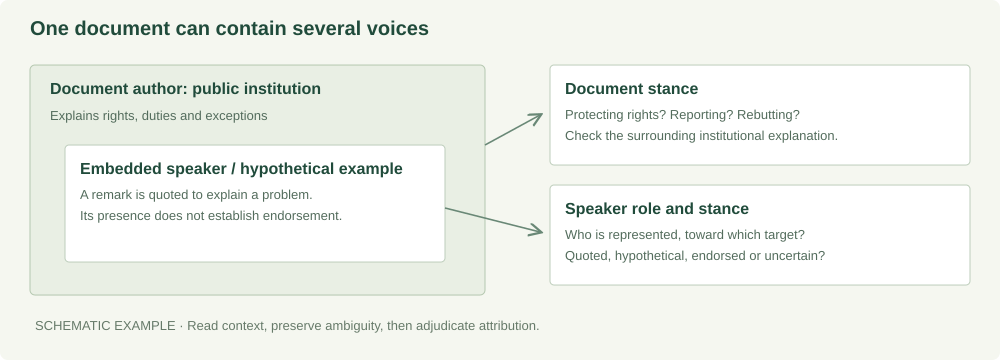
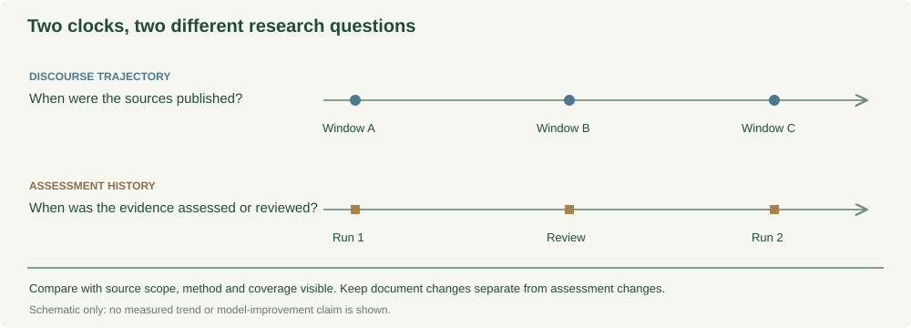

# Read the commented examples

The annotated guides connect exact source wording to an explicit criterion, represented speaker, recorded model interpretation and a separately labeled reading note. They are examples of how to inspect an assessment, rather than independent human judgments of model accuracy.

| Guide | Read the PDF | Offline HTML | Case workbook |
| --- | --- | --- | --- |
| How DOXA captures political framing | [Political framing, commented](../examples/political-framing-commentary.pdf) | [HTML](../examples/political-framing-commentary.html) | [XLSX](../examples/political-framing-commentary.xlsx) |
| Institutional voice and reported prejudice | [Institutional context, commented](../examples/institutional-context-commentary.pdf) | [HTML](../examples/institutional-context-commentary.html) | [XLSX](../examples/institutional-context-commentary.xlsx) |
| Monitoring a real news cohort | [News monitoring, commented](../examples/news-monitoring.pdf) | [HTML](../examples/news-monitoring.html) | [XLSX](../examples/news-monitoring.xlsx) |

Each guide states the original run, frozen source selection, accepted/partial/pending unit coverage, model provenance and review state. The accompanying `*.manifest.json` records actual file checksums and counts. Its `*.snapshot.json.gz` freezes the selected assessments and source blocks so the anchor audit can be repeated. A small selection of illustrative cases is not a representative sample of the source collection.

## What was captured?

The political-framing guide follows institutional policy texts using the [operational rubric and worked source packet](political-bias-methodology.md). An explicit policy position, an evaluative descriptor and a causal allegation are different observations. Identifying them does not independently verify the underlying factual claim or establish unfairness, hidden motives, a party identity or a universal left/right score. A stronger comparative-bias claim needs a declared, relevant comparator and supplied evidence.

The institutional-context guide separates reporting about prejudice from quoted hostility and author-endorsed hostility. The same distinction matters when monitoring news. Publication-time comparisons also need compatible source selections, criteria, model settings and assessed denominators. Partial or failed units cannot establish an absence of relevant discourse.

The news-monitoring guide follows four actual cases from the settled 5,000-article run: a quoted slogan, a political-expression boundary, uncertainty in a reported discrimination claim and a descriptive constitutional frame. Author and translator credits remain separate. The underlying run accepted 204,342 of 204,421 requested decisions; 79 remain unresolved. The four selected cases do not supply representative error estimates or independent human labels.

The [full news dashboard PDF](../examples/news-corpus-dashboard.pdf) and [complete workbook](../examples/news-corpus-dashboard.xlsx) serve a different purpose: they retain the entire selected cohort and all four result types. Their [export manifest](../examples/news-corpus-dashboard.manifest.json) identifies the full data and the 25-entry human appendix. See [streaming recorded-run exports](v3-recorded-exports.md) for reproduction without inference.



## Which voice is which?

Each case keeps four layers visible:

1. **Source:** the exact passage, public source link, author, date and page/paragraph or character locator.
2. **Recorded model assessment:** the criterion, kind, result, proposition, attribution, two stances, explanation and alternative reading.
3. **AI-authored walkthrough note:** what the reading captures, an attribution check, the evidence a stronger bias claim would require, and a review question.
4. **Stored review state:** the application’s existing review status and any separate review overlay. Generating a guide does not mark a case human-reviewed or rewrite its model record.

The added commentary is AI-authored guidance, **not independent human adjudication**. Exact source anchoring checks where words occur; interpretation accuracy remains unmeasured. Unknown provider billing remains unknown, while conservative application budget accounting is identified separately.



The trajectory diagram is schematic. It shows no measured increase, prevalence estimate or model improvement. See the [V3 research and pilot evidence](research-v3.md) for the distinction between source/structure checks and interpretation validation.

## Reproduce a guide without new inference

After installing the normal report dependencies, render an existing frozen snapshot:

```bash
python scripts/build_walkthrough.py \
  --snapshot examples/political-framing-commentary.snapshot.json.gz \
  --kind political-framing \
  --title 'How DOXA captures political framing' \
  --output-prefix /tmp/political-framing-commentary
```

To create a new guide from a recorded local run, supply `--data-dir`, `--run-id` and one or more `--assessment-id` arguments. `--notes` accepts a JSON object keyed by those selected assessment IDs; only the declared AI reading-note fields are accepted. The SQLite database opens read-only. The command validates the frozen source version and every primary/reference span before writing PDF, HTML, XLSX, the gzipped snapshot and its manifest.

Active runs are rejected by default. An explicit `--capture-unfinished` preserves their unfinished status and current coverage. A frozen verification subset remains labeled as a subset. No inference calls, model downloads, review approvals or deployment occur while building these guides.
