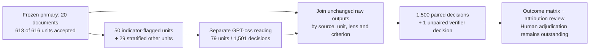

# Two model readings of the same evidence

The recorded Gemma and GPT-oss runs disagree on **642 of 1,500 paired criterion decisions**. That is a descriptive difference count, not an error rate. **459 of those differences are switches between `does_not_meet` and `not_applicable`**, which do not turn a positive indicator flag on or off. Attribution and surrounding context need their own inspection.

This note uses real, separately recorded model output from the licensed institutional corpus. The tables and examples are frozen in the [comparison matrix JSON](../benchmarks/v3-independent-low-matrix.json). The commentary and reviewer questions are **AI-authored reading guidance, not human adjudication**. Neither model supplies reference truth; accuracy and F1 remain unmeasured.

## What was compared

| Recorded profile | Primary | Separate verifier |
| --- | --- | --- |
| Model | `@cf/google/gemma-4-26b-a4b-it` | `@cf/openai/gpt-oss-120b` |
| Run | `074539f031e64dc28f03384481563a85` | `ad5046e9849d4392a8160d55de9beacd` |
| Provider | Cloudflare | Cloudflare |
| Scope | 20 institutional documents; 613/616 units accepted | 79 selected units in 14 documents; 79/79 accepted |
| Final run state | Partial | Completed |
| Unit builder / prompt | `source-units-3.1` / `contextual-decisions-3.2.1` | Same versions |
| Criterion registry | `3.0.0`, six selected lenses | Same registry and lenses |

The frozen selection contains **all 50 primary units with at least one positive or uncertain indicator**, plus **29 other accepted units**, sampled proportionally by document with seed `20261116`. The latter are 29 of 564 eligible other units: a requested 5% sample, rounded globally. They are not human-validated negatives. The 45 units with positive indicators and six with uncertain indicators overlap by one unit.

The verifier emitted **1,501 decisions**. One lacks a primary counterpart: `anti-muslim-hostility/discrimination_claim` in the EEOC's *Section 12: Religious Discrimination*, unit `u_581dfa046319abeee367ee1c`. It remains unpaired, rather than becoming an invented negative primary label. Among the selected units, the primary has 78 accepted units and one partial unit. Consequently, the frozen comparison correctly reports `comparison_complete_on_selected_units: false` and a comparability notice even though the verifier completed its own selection.

These are two deployed pipeline profiles. Provider packing and output budgets differ: Gemma used a 12,000-byte source-pack budget and lens batches up to 12; GPT-oss used 3,600 bytes and batches up to two. Both used the frozen 4,000-character source units and two neighboring context sentences. GPT-oss requested low reasoning with a 2,048-token allowance; the adapter does not independently confirm that the provider applied that setting. Both cloud model revisions are unresolved. Differences cannot be attributed exclusively to model weights, and rerunning cloud inference need not reproduce the same outputs.

This is an enriched review subset of the **20-document institutional corpus**. It is not a representative sample, a whole-corpus interpretation assessment, or a validation of the 5,000-article news collection. Multiple criteria within the same source unit also share evidence.

## The actual outcome matrix

Rows are the original Gemma result; columns are the separate GPT-oss result. Each cell counts paired **unit–criterion decisions**, including indicator, boundary and descriptive criteria.

| Gemma → GPT-oss | `meets_criterion` | `does_not_meet` | `uncertain` | `not_applicable` | Row total |
| --- | ---: | ---: | ---: | ---: | ---: |
| `meets_criterion` | 250 | 55 | 17 | 16 | 338 |
| `does_not_meet` | 46 | 179 | 24 | 369 | 618 |
| `uncertain` | 4 | 3 | 0 | 5 | 12 |
| `not_applicable` | 10 | 90 | 3 | 429 | 532 |
| **Column total** | **310** | **327** | **44** | **819** | **1,500** |

There are **858 identical result categories** and **642 differing categories**. `does_not_meet` records a determinate non-match; `not_applicable` records the model's applicability judgment. Their 369 forward and 90 reverse switches retain a meaningful methodological distinction, while neither is a positive indicator under the implemented flag definition. `uncertain` remains explicit uncertainty.

Criterion kinds must stay separate. A positive descriptive criterion can describe framing or rhetoric; a positive boundary criterion can identify a protected-expression boundary. Neither automatically becomes an indicator flag.

| Frozen criterion kind | Paired decisions | Different result | Different attribution |
| --- | ---: | ---: | ---: |
| Indicator | 1,026 | 491 | 168 |
| Boundary | 158 | 63 | 2 |
| Descriptive | 316 | 88 | 119 |
| **All kinds** | **1,500** | **642** | **289** |

Full 4×4 matrices for each kind are in the [machine-readable artifact](../benchmarks/v3-independent-low-matrix.json). The original comparison's displayed disagreement list is capped at 200; these aggregate tables use **every paired row**.

### Changes to positive indicator flags

Here, “positive” means `criterion_kind=indicator` and `result=meets_criterion`. It does not mean an author endorses the quoted proposition.

| Indicator transition | Decisions |
| --- | ---: |
| Positive in both readings | 38 |
| Primary-only positive | 53 |
| Verifier-only positive | 25 |
| Primary positive → `does_not_meet` | 31 |
| `does_not_meet` → verifier positive | 24 |
| Primary positive → `not_applicable` | 12 |
| `not_applicable` → verifier positive | 1 |
| Primary positive → `uncertain` | 10 |
| `uncertain` → verifier positive | 0 |

The primary has 91 positive indicator decisions; the verifier has 63. Positive membership changes on **78 decisions**: 55 positive/non-match reversals, 13 positive/applicability switches and ten positive-to-uncertain switches. Separately, **381 indicator differences** switch only between non-match and non-applicability. These are not 381 new or removed positive flags.

### Attribution deserves a separate review queue

Attribution differs on **289/1,500 pairs**, including **168/1,026 indicator pairs**. Even among the 38 indicator pairs that are positive in both readings, **20 assign different attribution**. Some differences elsewhere accompany negative/default rows whose attribution is `unknown`; the complete attribution matrix is preserved in the JSON.

The conservative author-endorsement combination additionally requires `attribution=author`, `speaker_stance=supports`, and `hypothetical=false`. It appears on three primary-only and two verifier-only paired decisions, with none satisfying that combination in both readings. These are decision counts, not counts of authors or evidence about their private beliefs.

## Three disagreements to inspect

The examples below are purposively chosen to expose different context problems. They are not an independently labelled evaluation sample. Exact assessment IDs, source hashes and Unicode offsets are in the matrix JSON. A negative compact output may provide source anchors without a detailed explanation; no missing rationale is invented here.

### 1. Defining racialization versus applying it

**Source:** Ministry of Housing, Communities and Local Government, [*A Definition of Anti-Muslim Hostility*](https://www.gov.uk/guidance/a-definition-of-anti-muslim-hostility), 9 March 2026; frozen source `uk10`, block `uk10-b00029`, characters 0–377.

> It is also the prejudicial stereotyping of Muslims, or people perceived to be Muslim including because of their ethnic or racial backgrounds or their appearance, and treating them as a collective group defined by fixed and negative characteristics, with the intention of encouraging hatred against them, irrespective of their actual opinions, beliefs or actions as individuals.

For `anti-muslim-racism/racialization`, Gemma returns `meets_criterion`, author attribution and neutral speaker/document stance. Its explanation points to the definition's description of treating Muslims as a fixed collective. GPT-oss returns `does_not_meet`, unknown attribution and no detailed rationale.

**AI-authored review questions:** Is the passage defining a prejudicial mechanism, enacting it, or attributing it to someone else? Does the operational criterion require an instance of that mechanism, or also count explanatory discussion? Resolve that scope question separately from author endorsement.

### 2. Statistical context versus a substantive criterion

**Source:** Home Office, [*Hate crime, England and Wales, year ending March 2024*](https://www.gov.uk/government/statistics/hate-crime-england-and-wales-year-ending-march-2024/hate-crime-england-and-wales-year-ending-march-2024), 10 October 2024; source `uk04`, block `uk04-b00011`, characters 0–168.

> this increase was driven by a rise in hate crimes against Jewish people and to a lesser extent Muslims and has occurred since the beginning of the Israel-Hamas conflict

For `ihra/israel_related_context`, Gemma returns `not_applicable`, without a detailed rationale. GPT-oss returns `meets_criterion`, with reported-speaker attribution and neutral stance. Its explanation says that the temporal link supplies Israel-related context.

**AI-authored review questions:** Which words, if any, establish the operational criterion's anti-Jewish trope, discriminatory standard or denial of self-determination beyond naming the conflict? Does reported chronology alone support this indicator? The verifier's positive label is a review target, not proof that the statistical author voiced antisemitism.

### 3. Agreement on content, disagreement on who voiced it

**Source:** William Shawcross CVO, [*Independent Review of Prevent*](https://www.gov.uk/government/publications/independent-review-of-prevents-report-and-government-response/independent-review-of-prevent-accessible), 8 February 2023; source `uk01`, footnote block `uk01-b01422`.

The preceding source text explicitly says: “Screenshot of this individual’s Facebook post, 19 July 2014. The post shares a video that contains the following call”. Within that embedded quotation, both models cite characters 156–261:

> Don’t you care that the Jews are defiling the place of the Prophet’s nocturnal journey with their filth?

Both return `meets_criterion` for `nexus/anti_jewish_tropes`. Gemma assigns `reported_speaker` and identifies an unidentified Facebook user via reportage. GPT-oss assigns `author` and fills the speaker field with William Shawcross CVO. Both record **unclear speaker stance and neutral document stance**.

**AI-authored review questions:** Who voices the proposition: the report author, the person posting, or the speaker in the embedded video? Read the preceding footnote before assigning author attribution. Neither output satisfies the conservative author-endorsement rule here because neither supplies `speaker_stance=supports`.

The government sources carry OGL notices; the short third-party quotation in the Prevent report retains its original rights and attribution. The [corpus rights and source notices](corpus.md) remain applicable. No full linked third-party work is reproduced here.

## What the recorded checks establish

A read-only audit checked **3,000 raw payloads and 67,946 evidence references** across all 1,500 paired decisions and 14 documents. Document hashes/version identities, frozen unit/sentence membership, Unicode offsets and every provided quotation matched the persisted source. Of those references, 66,697 compact references omit repeated quotation text; their offsets and sentence identities were checked against the original blocks. Neither raw output was edited. This audit covers the paired rows; the one unpaired verifier decision is separately disclosed.

These checks establish where the evidence occurs. They do not establish whether either interpretation is sound. No human adjudication, automatic relabelling, learned-example approval, accuracy score or F1 calculation was performed for this comparison.

The completed verifier recorded **277 requests**, **991,254 input tokens**, **243,735 output tokens**, and an application-accounted estimate of **$0.52974015** over **1,187.5 seconds of recorded active-session time** across two sessions. These are recorded cloud-run measurements and estimates, not an invoice, a local-hardware benchmark or a guaranteed future price. An [earlier cancelled default-reasoning diagnostic](../benchmarks/v3-independent-verification.json) recorded **$0.31884295 across 159 requests**; it is a separate run, excluded from these matrices and from the low-profile verifier cost above.

Use the frozen files to inspect both readings without making further model calls:

- [Complete comparison JSON and bounded disagreement records](../benchmarks/v3-independent-low-verification.json)
- [Small matrices, transitions, source audit and exact worked-example anchors](../benchmarks/v3-independent-low-matrix.json)
- [Primary institutional archive manifest and checksum-listed JSONL parts](../benchmarks/v3-institutions/showcase.json)
- [Completed verifier archive manifest and checksum-listed JSONL parts](../benchmarks/v3-independent-low-verification/showcase.json)

The portable archives retain the raw model decisions. Comparison pairs use source identity, source-unit ID, lens and criterion; canonical SQL review columns are not substituted for the original model payloads. Human reviewers can subsequently resolve disagreements with explicit source-based reasons while preserving both historical readings.
