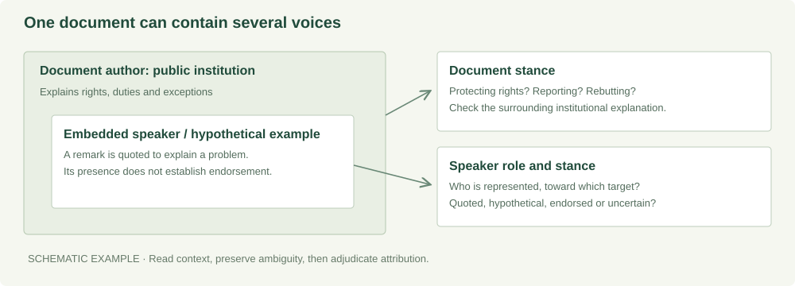

# Interpretation, attribution and evaluation

An exact citation is a necessary evidence check. It establishes where words occur in a preserved source. It does not establish that a model has understood those words correctly.

## Attribute the statement

A public institution can quote a discriminatory remark to explain why it violates a rule. A document can also contain reported allegations, rebuttals, hypothetical examples and unresolved claims. Preserve the source passage, represented speaker, speech role, target and surrounding explanation.

Assess the speaker’s stance separately from the document’s stance. A prejudicial statement appearing in a document does not establish the author’s endorsement. Where attribution is unresolved, retain that uncertainty instead of defaulting to the author.

## Keep definitions separate

IHRA, Jerusalem Declaration and Nexus are distinct frameworks with different conditions and scopes. Apply and report them separately. Anti-Muslim-prejudice, discourse and custom lenses also require explicit criteria. Do not vote across frameworks to manufacture a universal prejudice score.

A reviewer persona declares priorities and questions. A report audience guides presentation. Neither silently changes the analytical definition or source evidence. Do not infer an author’s private identity or beliefs from an automated discourse assessment.

## Name the denominator

Report what was selected, what was extracted, what was assessed successfully and what failed. Source-block coverage and text-character coverage are different quantities. A rate requires the eligible assessed units for its criterion, not an unspecified total of all observations.

“Not detected” is limited to the assessed material and method. A failed, missing, unextracted or uncertain unit cannot support a claim of absence. Duplicate stories, source-selection changes and uneven time windows can distort comparisons.

Keep publication time separate from analysis and review time. A publication-time pattern describes the selected source collection; a review-time change may describe a correction or method update. Neither establishes population prevalence without an appropriate sampling design.

## Evaluate beyond citation checks

Use independently adjudicated examples, suitable domain expertise and a held-out split. Preserve story groups across the split to reduce near-duplicate leakage. Evaluate attribution, criterion application, uncertainty handling and consequential error types, alongside source coverage and resource use.

Reviewed project examples can inform a candidate method. Their approval, snapshot, baseline comparison and activation must remain inspectable. Do not claim that reviewed context automatically fine-tunes the model, or treat its own training examples as independent validation.

## Recorded legacy evidence

The original v1.2 managed-cloud run retained **1,071 observations across 20 public institutional documents**. It was partial: **5,788 of 8,999 source blocks (64.3%)** passed all checks, with **115 recorded errors**. Exact citation checks passed for the retained observations. Independent interpretation accuracy is unmeasured.

The CPU-only local Qwen 4B benchmark sampled one passage per document and retained 32 observations. It does not measure full-corpus local performance. These artifacts remain explicitly legacy results, rather than validation of revised assessment, attribution or learning behavior.

See the [machine-readable summaries](../benchmarks/), [methodology dossier](methodology.md) and [corpus and rights manifest](corpus.md). All diagrams in these guides are schematic unless identified as plots from recorded data.
