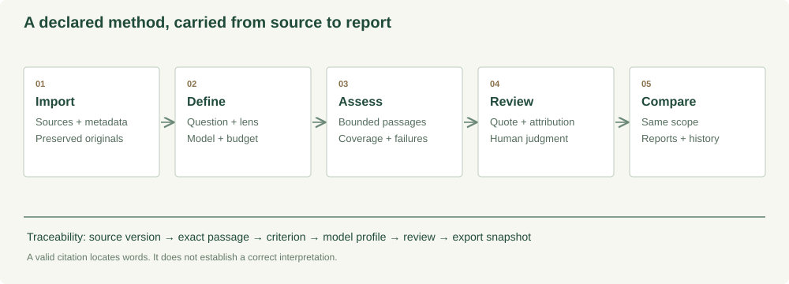
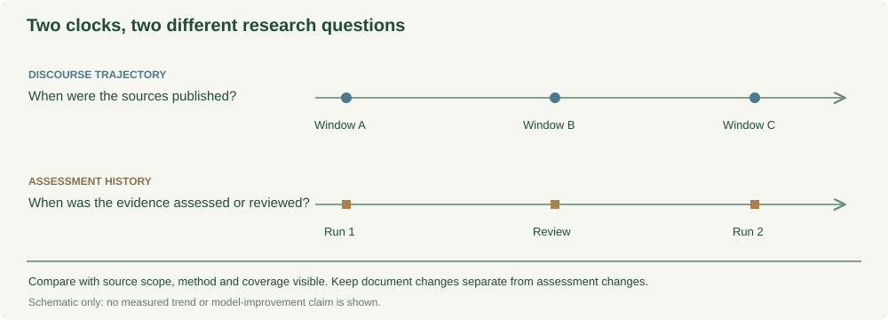
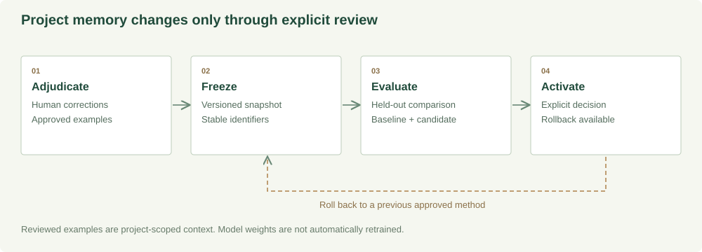

# DOXA as an open-source service toolkit

DOXA provides a browser workspace for a specific discourse-analysis inquiry. Run it locally or deploy it in your own cloud. TACITUS can separately help prepare a collection, develop a rubric, configure deployment and organize review. There is no public hosted account, multitenant checkout or automatic consulting enrollment.

## The workbench

Import documents and inspect extraction before analysis. Correct the author, institution, document type, publication date and source identity. State the research question, analytical framework, reviewer perspective and model configuration. Keep that method stable within a run.

Criterion assessments and detected signals have different roles. An assessment records whether a passage meets the criterion, does not meet it, is uncertain or is not applicable. A signal is an observation to investigate. Failed, missing and uncertain assessments remain visible; they cannot establish the absence of a phenomenon.

The evidence workspace connects each assessment to exact source wording and surrounding context. Speaker role, speaker stance and document stance must be checked separately. Review can confirm, reject or correct the proposed interpretation while retaining its history.

## Two clocks

**Discourse trajectory** follows the publication dates of the selected sources. **Assessment history** follows analysis and review timestamps. A corrected attribution, expanded coverage or new model can change an assessment without establishing a change in published discourse.

Charts and exports retain the selected query scope, filters and coverage. Comparisons need compatible source selections, criteria, models and denominators, or an explicit account of what changed. The trajectory diagram is schematic; it shows no measured trend.

## Reviewed learning

Human-adjudicated examples can become project-scoped method context. Freeze approved examples into a versioned snapshot, evaluate a candidate against a baseline on held-out material, and explicitly activate or roll back. Raw model output is not automatically approved as learning data. The workflow does not automatically train model weights.

An evaluation must preserve the baseline, candidate, source split and results. Reviewed examples used in candidate context must not also be presented as independent validation. A better score on one collection does not establish general accuracy.

## Deployment and delivery

The same Python engine supports a local SQLite/filesystem workspace and Cloudflare D1/R2 persistence with authenticated routing and durable jobs. Local inference and configured remote providers are separate choices. Remote inference sends the selected source text to that provider; credentials remain on the server.

PDF and HTML serve human readers. XLSX, CSV and JSONL support inspection and further analysis. Each export preserves its selected source and method context; human-readable appendices disclose limits. Report audience is distinct from analysis method.

PDF/HTML registers show up to 100 sources for research, 25 for briefing or 50 for teaching, with shown/total counts. Sources cited in the displayed evidence appear first. Author tables are bounded too. XLSX and JSONL retain every selected source. V3 CSV includes `record_type=document` rows for the complete source register and `record_type=assessment` rows for criterion results; legacy CSV retains its finding-only layout. Typed results, speaker and document stance, propositions, query scope and snapshot identity remain inspectable in the data exports.

Use the [deployment guide](deployment.md), [interpretation guide](v3-interpretation.md), [corpus manifest](corpus.md) and [recorded benchmarks](../benchmarks/README.md) to decide whether a configuration suits the work. The original 8-bit [DOXA Quest](guide.md) remains available as a shorter introduction.
